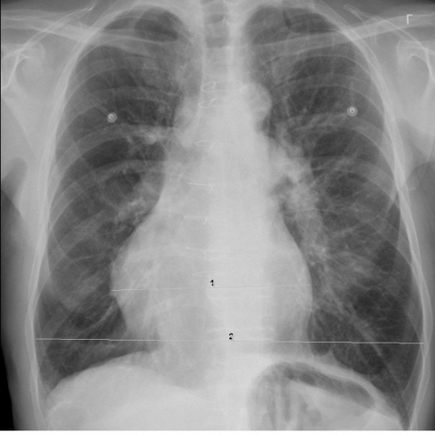

# 早期实验逐题档案：12918_8353800587295

独立评分参考选项：**B**。此页用于完成后的复盘，参考答案未反馈给历史推理过程。

[全部保留记录 JSON](12918_8353800587295.json) 包含逐轮终态、工具语义观察、检索记录与 V7 分支原文；每条带有来源文件。工具或模型的断言仍是待核实的观察。

## 原题与完整选项

Based on the chest X-ray findings, what is the most likely diagnosis for the anterior mediastinal mass observed in the lateral view (Figure 1a), considering its location, size, and relationship to surrounding structures?
A) Thymoma, due to its typical location in the anterior mediastinum and possible calcification.
B) Saphenous vein graft aneurysm, considering the patient’s surgical history and the mass's relation to the heart and large vessels.
C) Intrathoracic goiter, because of its potential to appear in the anterior mediastinum and mimic other masses.
D) Lymphoma, as it can present as an anterior mediastinal mass with calcifications.
E) Thoracic-aorta aneurism, given its possible presence in the anterior mediastinum and round appearance.
F) Germ cell tumor, because these can also present as rounded masses in the anterior mediastinum.

## 原图

来源输入：`data/inference.jsonl`；实际路径：`cxr_037.png`。

来源输入：`data/memory_train_subset_v1.jsonl`；实际路径：`figures/12918/figure_1a.jpg`。

## 当时保存的逐轮结果

备份/中断尝试单列，不能与最终完成版本相加。

| 来源 | 臂 | 选项 | 执行状态 | 参考匹配 |
|---|---|---|---|---|
| `diagnostic50_v1/results.jsonl` | direct | A | completed | 未答对 |
| `diagnostic50_v1/results.jsonl` | agent | A | completed | 未答对 |
| `train60_full_r0/results.jsonl` | agent | A | completed | 未答对 |
| `train60_r0_v2/results.jsonl` | agent | A | completed | 未答对 |
| `train60_r0_v3/results.jsonl` | agent | A | completed | 未答对 |

保留的语义观察 0 条；检索记录 0 条；V7 恢复实验记录 0 条。详见同页 JSON。早期只有摘要/哈希的响应无法从哈希还原原文；此处未补写模型输出。
