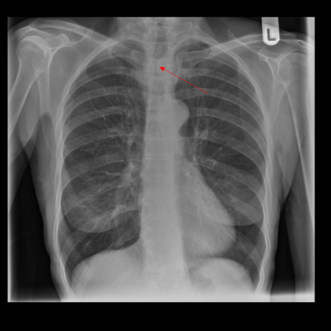

# 早期实验逐题档案：13181_8353800587820

独立评分参考选项：**B**。此页用于完成后的复盘，参考答案未反馈给历史推理过程。

[全部保留记录 JSON](13181_8353800587820.json) 包含逐轮终态、工具语义观察、检索记录与 V7 分支原文；每条带有来源文件。工具或模型的断言仍是待核实的观察。

## 原题与完整选项

Based on the initial chest X-ray (Figure 1), which of the following findings is most indicative of an overlooked tracheal stenosis that could have been mistaken for COPD, and what reasoning supports this conclusion?

A. Flattened hemi-diaphragms are the primary indicator, suggesting emphysema rather than tracheal stenosis.
B. Hyperinflation of the chest is the main finding, which can mask tracheal stenosis under the sternal shadow.
C. Presence of stridor on examination directly correlates with the visible tracheal stenosis on the X-ray.
D. A well-defined mass near the clavicle signifies tracheal stenosis, unrelated to COPD presentation.
E. Decreased air entry throughout the lung fields is the sole indicator of tracheal stenosis.
F. The presence of bilateral pleural effusion, obscuring tracheal details, is mistaken for COPD.

## 原图

来源输入：`data/inference.jsonl`；实际路径：`cxr_042.png`。

来源输入：`data/memory_train_subset_v1.jsonl`；实际路径：`figures/13181/figure_1.jpg`。

## 当时保存的逐轮结果

备份/中断尝试单列，不能与最终完成版本相加。

| 来源 | 臂 | 选项 | 执行状态 | 参考匹配 |
|---|---|---|---|---|
| `diagnostic50_v1/results.jsonl` | agent | C | completed | 未答对 |
| `diagnostic50_v1/results.jsonl` | direct | C | completed | 未答对 |
| `train60_full_r0/results.jsonl` | agent | B | completed | 对 |
| `train60_r0_v2/results.jsonl` | agent | B | completed | 对 |
| `train60_r0_v3/results.jsonl` | agent | C | completed | 未答对 |

保留的语义观察 0 条；检索记录 0 条；V7 恢复实验记录 0 条。详见同页 JSON。早期只有摘要/哈希的响应无法从哈希还原原文；此处未补写模型输出。
