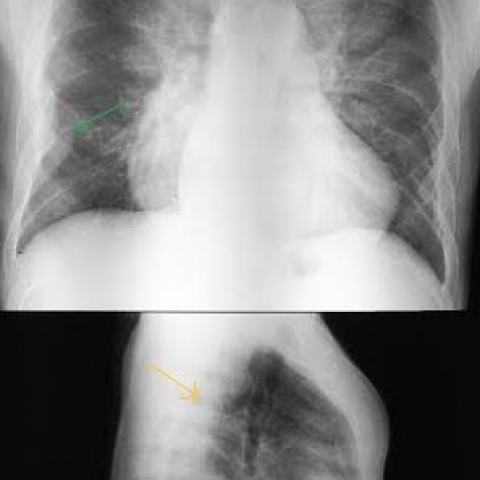

# 早期实验逐题档案：13669_8353800603751

独立评分参考选项：**C**。此页用于完成后的复盘，参考答案未反馈给历史推理过程。

[全部保留记录 JSON](13669_8353800603751.json) 包含逐轮终态、工具语义观察、检索记录与 V7 分支原文；每条带有来源文件。工具或模型的断言仍是待核实的观察。

## 原题与完整选项

Based on the chest X-ray findings in Figure 1, which of the following statements most accurately describes the relationship between the observed opacities and the underlying skeletal changes in the context of thalassemia intermedia?

A) The bilateral well-defined opacities overlying the spine are indicative of pulmonary nodules, unrelated to any skeletal changes.
B) The peripheral right basal opacity abutting the costal arches indicates pleural effusion, which is commonly seen in thalassemia intermedia.
C) The bilateral well-defined opacities overlying the spine suggest the presence of extramedullary haematopoiesis, likely associated with bone marrow hyperplasia and cortical interruptions.
D) The observed opacities are consistent with metastatic deposits, contributing to the skeletal abnormalities seen in thalassemia intermedia.
E) The right basal opacity is a result of a diaphragmatic hernia, unrelated to the skeletal findings.
F) The opacities indicate a pneumonic process, which is causing secondary skeletal changes due to infection.

## 原图

来源输入：`data/inference.jsonl`；实际路径：`cxr_049.png`。

来源输入：`data/memory_train_subset_v1.jsonl`；实际路径：`figures/13669/figure_1.jpg`。

## 当时保存的逐轮结果

备份/中断尝试单列，不能与最终完成版本相加。

| 来源 | 臂 | 选项 | 执行状态 | 参考匹配 |
|---|---|---|---|---|
| `diagnostic50_v1/results.jsonl` | direct | C | completed | 对 |
| `diagnostic50_v1/results.jsonl` | agent | C | completed | 对 |
| `train60_full_r0/results.jsonl` | agent | C | completed | 对 |
| `train60_r0_v2/results.jsonl` | agent | C | completed | 对 |
| `train60_r0_v3/results.jsonl` | agent | C | completed | 对 |

保留的语义观察 0 条；检索记录 0 条；V7 恢复实验记录 0 条。详见同页 JSON。早期只有摘要/哈希的响应无法从哈希还原原文；此处未补写模型输出。
