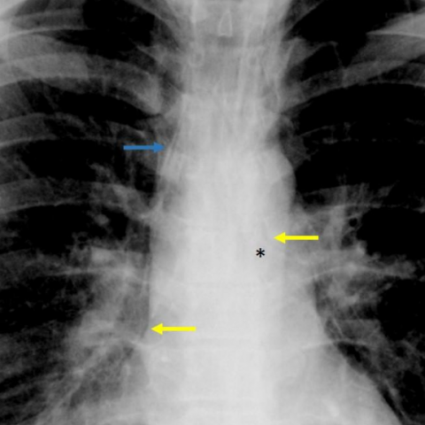

# 早期实验逐题档案：13935_8353800618951

独立评分参考选项：**C**。此页用于完成后的复盘，参考答案未反馈给历史推理过程。

[全部保留记录 JSON](13935_8353800618951.json) 包含逐轮终态、工具语义观察、检索记录与 V7 分支原文；每条带有来源文件。工具或模型的断言仍是待核实的观察。

## 原题与完整选项

A 26-year-old male patient presents with sudden thoracic and supraclavicular pain and dyspnoea. The chest X-ray was initially misinterpreted as normal. Upon reevaluation, multiple subtle signs were observed. Which of the following findings is most indicative of a spontaneous pneumomediastinum on the chest X-ray, and what does this imply about the underlying pathophysiological mechanism?

A) Presence of a continuous diaphragmatic sign; suggests pneumopericardium due to air posterior to the pericardium.
B) Observation of subcutaneous emphysema in the supraclavicular region; indicates air leakage from the mediastinum into subcutaneous tissue.
C) Detection of a double bronchial wall sign; implies air dissecting along the bronchial walls due to alveolar rupture.
D) Identification of Naclerio's V sign; indicates an esophageal rupture with mediastinal air lateral to the aorta.
E) Visualization of the thymic sail sign; suggests pneumomediastinum in a pediatric patient due to elevated thymus.
F) Recognition of the ring around the artery sign; signifies air enclosing the pulmonary artery due to tracheobronchial injury.

## 原图

来源输入：`v4_validation60/inputs.jsonl`；实际路径：`figures/13935/figure_3a.jpg`。

来源输入：`v4_validation60/inputs.jsonl`；实际路径：`figures/13935/figure_3b.jpg`。

同一固定 60 题后续证据：[V10/V11 图文档案](../../../v11/cases/13935_8353800618951.md)。不同轮 P0 独立生成，不能把差异直接视为方法收益。

## 当时保存的逐轮结果

备份/中断尝试单列，不能与最终完成版本相加。

| 来源 | 臂 | 选项 | 执行状态 | 参考匹配 |
|---|---|---|---|---|
| `v4_A_r1/results.jsonl` | agent | B | completed | 未答对 |
| `v4_B_r1/results.jsonl` | agent | B | completed | 未答对 |
| `v4_B_r1/results.jsonl.bak-before-resume` | agent | B | completed | 未答对 |
| `v4_C_r1/results.jsonl` | agent | B | completed | 未答对 |
| `v7_recovery/round2_verify.jsonl` | P0 | B | ok | 未答对 |
| `v7_recovery/round2_verify.jsonl` | P1 | B | ok | 未答对 |
| `v7_recovery/round2_verify.jsonl` | G1 | B | ok | 未答对 |
| `v7_recovery/round2_verify.jsonl` | PB | B | ok | 未答对 |
| `v7_recovery/round2_verify.jsonl` | GB | B | ok | 未答对 |
| `v7_recovery/round2_verify.jsonl` | PC | B | ok | 未答对 |
| `v7_recovery/round2_verify.jsonl` | GC | B | ok | 未答对 |

保留的语义观察 23 条；检索记录 2 条；V7 恢复实验记录 1 条。详见同页 JSON。早期只有摘要/哈希的响应无法从哈希还原原文；此处未补写模型输出。
