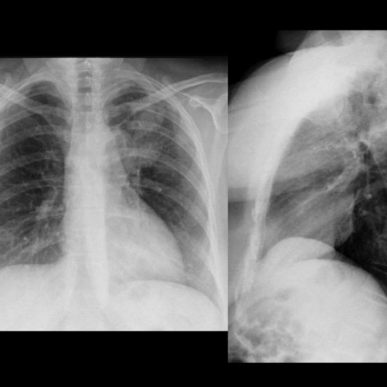

# 早期实验逐题档案：14074_8353800631005

独立评分参考选项：**B**。此页用于完成后的复盘，参考答案未反馈给历史推理过程。

[全部保留记录 JSON](14074_8353800631005.json) 包含逐轮终态、工具语义观察、检索记录与 V7 分支原文；每条带有来源文件。工具或模型的断言仍是待核实的观察。

## 原题与完整选项

Based on the chest X-ray findings in Figure 1, which of the following best describes the characteristics and likely diagnosis of the observed opacity in the left upper lobe?  
A) A branching nodular opacity with poorly defined borders, likely indicating a neoplastic process.  
B) A branching nodular opacity with well-defined borders, consistent with a bronchocele caused by congenital bronchial atresia.  
C) A round solitary opacity with irregular margins, suggestive of a bronchogenic cyst.  
D) A linear opacity with diffuse borders, possibly indicative of interstitial lung disease.  
E) A branching nodular opacity with well-defined borders, most likely a pulmonary sequestration.  
F) A homogeneously dense round opacity, typical of a tuberculous granuloma.

## 原图

来源输入：`data/memory_train_subset_v1.jsonl`；实际路径：`figures/14074/figure_1.jpg`。

## 当时保存的逐轮结果

备份/中断尝试单列，不能与最终完成版本相加。

| 来源 | 臂 | 选项 | 执行状态 | 参考匹配 |
|---|---|---|---|---|
| `train60_full_r0/results.jsonl` | agent | B | completed | 对 |
| `train60_r0_v2/results.jsonl` | agent | B | completed | 对 |
| `train60_r0_v3/results.jsonl` | agent | B | completed | 对 |

保留的语义观察 0 条；检索记录 0 条；V7 恢复实验记录 0 条。详见同页 JSON。早期只有摘要/哈希的响应无法从哈希还原原文；此处未补写模型输出。
