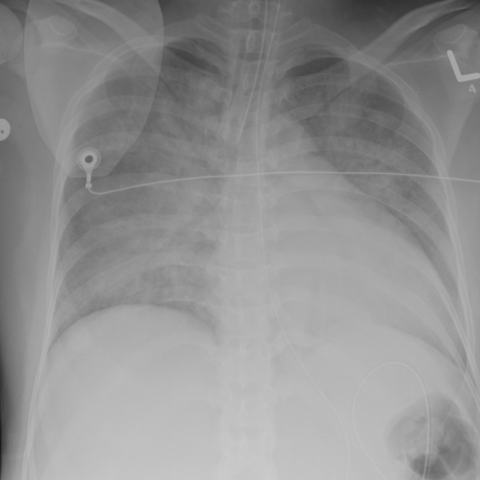

# 早期实验逐题档案：14106_8353800588060

独立评分参考选项：**B**。此页用于完成后的复盘，参考答案未反馈给历史推理过程。

[全部保留记录 JSON](14106_8353800588060.json) 包含逐轮终态、工具语义观察、检索记录与 V7 分支原文；每条带有来源文件。工具或模型的断言仍是待核实的观察。

## 原题与完整选项

A young female patient presented to the emergency department with asystole following a severe headache. A chest X-ray was performed after intubation. Based on Figure 1, which of the following statements best describes the findings and diagnosis related to the patient's pulmonary condition?

A) The endotracheal tube is correctly positioned, and the opacities suggest cardiogenic pulmonary edema due to the presence of Kerley B lines.
B) The endotracheal tube is incorrectly positioned in the right main bronchus, and the opacities are characteristic of neurogenic pulmonary edema.
C) The endotracheal tube is correctly positioned, and the opacities suggest diffuse pneumonia due to patchy air space consolidation.
D) The endotracheal tube is incorrectly positioned, but the opacities indicate cardiogenic pulmonary edema because of bilateral pleural effusions.
E) The endotracheal tube is incorrectly positioned in the right main bronchus, and the opacities suggest an allergic reaction.
F) The endotracheal tube is correctly positioned, with opacities indicating non-cardiogenic pulmonary edema with pleural effusions.

## 原图

来源输入：`data/memory_train_subset_v1.jsonl`；实际路径：`figures/14106/figure_1.jpg`。

## 当时保存的逐轮结果

备份/中断尝试单列，不能与最终完成版本相加。

| 来源 | 臂 | 选项 | 执行状态 | 参考匹配 |
|---|---|---|---|---|
| `train60_full_r0/results.jsonl` | agent | F | completed | 未答对 |
| `train60_r0_v2/results.jsonl` | agent | F | completed | 未答对 |
| `train60_r0_v3/results.jsonl` | agent | F | completed | 未答对 |

保留的语义观察 0 条；检索记录 0 条；V7 恢复实验记录 0 条。详见同页 JSON。早期只有摘要/哈希的响应无法从哈希还原原文；此处未补写模型输出。
