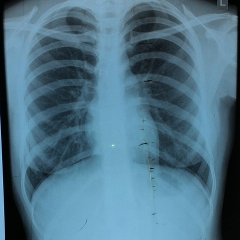

# 早期实验逐题档案：14238_8353800529101

独立评分参考选项：**C**。此页用于完成后的复盘，参考答案未反馈给历史推理过程。

[全部保留记录 JSON](14238_8353800529101.json) 包含逐轮终态、工具语义观察、检索记录与 V7 分支原文；每条带有来源文件。工具或模型的断言仍是待核实的观察。

## 原题与完整选项

Based on the chest X-ray findings, which statement most accurately describes the potential subtle indications of tracheal narrowing in the context of the patient's clinical presentation?

A) The trachea appears slightly deviated to the right, suggesting potential mass effect.
B) The left main bronchus shows signs of narrowing, correlating with the lesion at T2 level.
C) The trachea maintains a central position with no visible signs of mass effect.
D) The right lung shows increased lucency, indirectly suggesting compensatory hyperinflation.
E) The cardiac silhouette is enlarged, indicating possible mediastinal shift.
F) There is evidence of bilateral pleural effusion, supporting mediastinal involvement.

## 原图

来源输入：`data/memory_train_subset_v1.jsonl`；实际路径：`figures/14238/figure_3.jpg`。

## 当时保存的逐轮结果

备份/中断尝试单列，不能与最终完成版本相加。

| 来源 | 臂 | 选项 | 执行状态 | 参考匹配 |
|---|---|---|---|---|
| `train60_full_r0/results.jsonl` | agent | 缺答 | case_budget_exceeded | 未答对 |
| `train60_r0_v2/results.jsonl` | agent | C | completed | 对 |
| `train60_r0_v3/results.jsonl` | agent | C | completed | 对 |

保留的语义观察 0 条；检索记录 0 条；V7 恢复实验记录 0 条。详见同页 JSON。早期只有摘要/哈希的响应无法从哈希还原原文；此处未补写模型输出。
