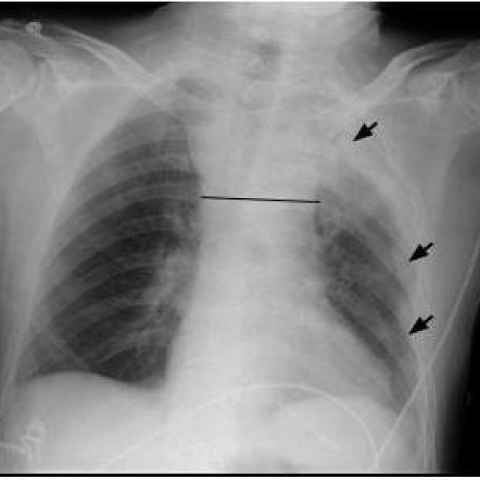

# 早期实验逐题档案：14255_8353800688938

独立评分参考选项：**B**。此页用于完成后的复盘，参考答案未反馈给历史推理过程。

[全部保留记录 JSON](14255_8353800688938.json) 包含逐轮终态、工具语义观察、检索记录与 V7 分支原文；每条带有来源文件。工具或模型的断言仍是待核实的观察。

## 原题与完整选项

Based on the chest X-ray findings after the unsuccessful pacemaker implantation attempt (Figure 1b), which of the following best describes the abnormalities observed, and what is the most likely cause given the clinical context?
A. Loculated pleural effusion in the right lung apex and mediastinal widening due to pneumothorax.
B. Loculated pleural effusion in the left lung apex and mediastinal widening due to hematoma formation.
C. Diffuse pleural effusion on both sides and mediastinal widening due to pulmonary edema.
D. Loculated pleural effusion in the right lung base and mediastinal widening due to cardiac tamponade.
E. Free-flowing pleural effusion in the left lung apex and mediastinal shift due to atelectasis.
F. Right-sided pleural effusion and mediastinal widening due to diaphragmatic paralysis.

## 原图

来源输入：`data/memory_train_subset_v1.jsonl`；实际路径：`figures/14255/figure_1b.jpg`。

## 当时保存的逐轮结果

备份/中断尝试单列，不能与最终完成版本相加。

| 来源 | 臂 | 选项 | 执行状态 | 参考匹配 |
|---|---|---|---|---|
| `train60_full_r0/results.jsonl` | agent | A | completed | 未答对 |
| `train60_r0_v2/results.jsonl` | agent | A | completed | 未答对 |
| `train60_r0_v3/results.jsonl` | agent | B | completed | 对 |

保留的语义观察 0 条；检索记录 0 条；V7 恢复实验记录 0 条。详见同页 JSON。早期只有摘要/哈希的响应无法从哈希还原原文；此处未补写模型输出。
