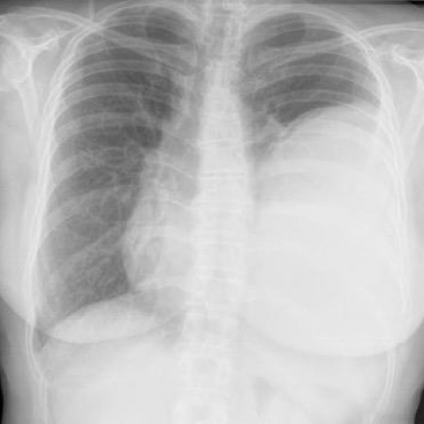

# 早期实验逐题档案：14388_8353800529053

独立评分参考选项：**B**。此页用于完成后的复盘，参考答案未反馈给历史推理过程。

[全部保留记录 JSON](14388_8353800529053.json) 包含逐轮终态、工具语义观察、检索记录与 V7 分支原文；每条带有来源文件。工具或模型的断言仍是待核实的观察。

## 原题与完整选项

Based on the chest X-ray findings in Figure 3, where is the large soft tissue mass most likely located, and what is its relationship with the surrounding structures? Additionally, how does the appearance of the mass support the diagnosis of a solitary fibrous tumor of the pleura, considering its typical presentation?

A) The mass is located in the left upper lung zone, forming an acute angle with the chest wall, suggesting an intrapulmonary location, which contradicts the typical appearance of a solitary fibrous tumor.
B) The mass is located in the left lower lung zone, forming an obtuse angle with the chest wall, consistent with a pleural origin typical of a solitary fibrous tumor.
C) The mass is in the right lower lung zone, forming an obtuse angle with the chest wall, consistent with a pleural origin typical of a solitary fibrous tumor.
D) The mass is located in the left middle lung zone, forming a sharp angle with the diaphragm, suggesting a subdiaphragmatic origin.
E) The mass is located in the left upper lung zone, forming an obtuse angle with the chest wall, consistent with a pleural origin typical of a solitary fibrous tumor.
F) The mass is located in the right upper lung zone, forming an acute angle with the chest wall, suggesting an intrapulmonary origin, which contradicts the typical appearance of a solitary fibrous tumor.

## 原图

来源输入：`data/validation_subset_v1.jsonl`；实际路径：`figures/14388/figure_3.jpg`。

## 当时保存的逐轮结果

备份/中断尝试单列，不能与最终完成版本相加。

| 来源 | 臂 | 选项 | 执行状态 | 参考匹配 |
|---|---|---|---|---|
| `credit_r3_drop1/results.jsonl` | agent | B | completed | 对 |
| `val29_full_r0/results.jsonl` | agent | B | completed | 对 |
| `val29_full_r1/results.jsonl` | agent | B | completed | 对 |
| `val29_full_r2/results.jsonl` | agent | B | completed | 对 |
| `val29_full_r3/results.jsonl` | agent | B | completed | 对 |
| `val29_r1c_v1/results.jsonl` | agent | B | completed | 对 |
| `val29_r3_v1/results.jsonl` | agent | B | completed | 对 |
| `val30_r0_v1/results.jsonl` | agent | B | completed | 对 |
| `val8_r0/results.jsonl` | agent | C | completed | 未答对 |
| `val8_r1/results.jsonl` | agent | B | completed | 对 |
| `val8_r5/results.jsonl` | agent | 缺答 | case_budget_exceeded | 未答对 |
| `val8_r57/results.jsonl` | agent | 缺答 | case_budget_exceeded | 未答对 |
| `val8b_r0/results.jsonl` | agent | B | completed | 对 |
| `val8b_r1/results.jsonl` | agent | B | completed | 对 |
| `val8b_r5/results.jsonl` | agent | B | completed | 对 |
| `val8b_r57/results.jsonl` | agent | B | completed | 对 |

保留的语义观察 0 条；检索记录 12 条；V7 恢复实验记录 0 条。详见同页 JSON。早期只有摘要/哈希的响应无法从哈希还原原文；此处未补写模型输出。
