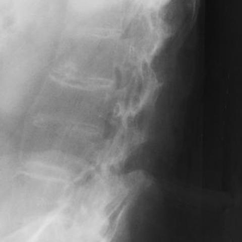

# 早期实验逐题档案：1483_8353802278976

独立评分参考选项：**B**。此页用于完成后的复盘，参考答案未反馈给历史推理过程。

[全部保留记录 JSON](1483_8353802278976.json) 包含逐轮终态、工具语义观察、检索记录与 V7 分支原文；每条带有来源文件。工具或模型的断言仍是待核实的观察。

## 原题与完整选项

Based on the chest X-ray findings in Figure 1, which of the following best describes the specific characteristics of the Andersson lesion at the level of TH12-L1, and why is this important for distinguishing it from other conditions?

A) Minimal sclerosis with significant disc space narrowing, indicating an inflammatory process.
B) Widening of the disc space with extensive sclerosis of the endplates, suggesting a non-inflammatory pseudoarthrosis.
C) Normal disc space with mild sclerosis, characteristic of degenerative disc disease.
D) Narrowing of the disc space with moderate sclerosis, indicating infectious spondylitis.
E) Absence of sclerosis with normal disc space, consistent with early ankylosing spondylitis.
F) Widening of the disc space with no sclerosis, indicative of a metastatic lesion.

## 原图

来源输入：`data/validation_subset_v1.jsonl`；实际路径：`figures/1483/figure_1.jpg`。

## 当时保存的逐轮结果

备份/中断尝试单列，不能与最终完成版本相加。

| 来源 | 臂 | 选项 | 执行状态 | 参考匹配 |
|---|---|---|---|---|
| `val29_full_r0/results.jsonl` | agent | B | completed | 对 |
| `val29_full_r1/results.jsonl` | agent | B | completed | 对 |
| `val29_full_r2/results.jsonl` | agent | B | completed | 对 |
| `val29_full_r3/results.jsonl` | agent | B | completed | 对 |
| `val29_r1c_v1/results.jsonl` | agent | A | completed | 未答对 |
| `val29_r3_v1/results.jsonl` | agent | B | completed | 对 |
| `val30_r0_v1/results.jsonl` | agent | B | completed | 对 |
| `val8_r0/results.jsonl` | agent | B | completed | 对 |
| `val8_r1/results.jsonl` | agent | B | completed | 对 |
| `val8_r5/results.jsonl` | agent | B | completed | 对 |
| `val8_r57/results.jsonl` | agent | B | completed | 对 |
| `val8b_r0/results.jsonl` | agent | B | completed | 对 |
| `val8b_r1/results.jsonl` | agent | B | completed | 对 |
| `val8b_r5/results.jsonl` | agent | B | completed | 对 |
| `val8b_r57/results.jsonl` | agent | B | completed | 对 |

保留的语义观察 0 条；检索记录 11 条；V7 恢复实验记录 0 条。详见同页 JSON。早期只有摘要/哈希的响应无法从哈希还原原文；此处未补写模型输出。
