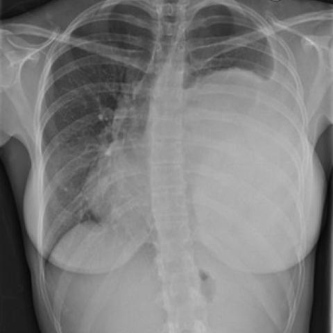

# 早期实验逐题档案：16366_8353800455571

独立评分参考选项：**C**。此页用于完成后的复盘，参考答案未反馈给历史推理过程。

[全部保留记录 JSON](16366_8353800455571.json) 包含逐轮终态、工具语义观察、检索记录与 V7 分支原文；每条带有来源文件。工具或模型的断言仍是待核实的观察。

## 原题与完整选项

Based on the chest X-ray findings from Figure 1, which of the following best describes the likely diagnosis and the immediate clinical management plan for this patient?

A) The dense opacification in the left hemithorax represents a left-sided pneumonia. Immediate management should include antibiotics and supportive care.
B) The opacification and rightward mediastinal shift suggest a tension pneumothorax on the left. Immediate management should include needle decompression and chest tube insertion.
C) The dense opacification and rightward mediastinal shift indicate a large mass consistent with an intrapulmonary teratoma. Surgical resection should be considered to prevent complications.
D) The opacification with mediastinal shift is indicative of a large pleural effusion. Thoracentesis should be performed to relieve symptoms.
E) The findings suggest pulmonary edema, necessitating diuretic therapy for fluid overload.

## 原图

来源输入：`data/validation_subset_v1.jsonl`；实际路径：`figures/16366/figure_1.jpg`。

## 当时保存的逐轮结果

备份/中断尝试单列，不能与最终完成版本相加。

| 来源 | 臂 | 选项 | 执行状态 | 参考匹配 |
|---|---|---|---|---|
| `val29_full_r0/results.jsonl` | agent | D | completed | 未答对 |
| `val29_full_r1/results.jsonl` | agent | 缺答 | case_budget_exceeded | 未答对 |
| `val29_full_r2/results.jsonl` | agent | D | completed | 未答对 |
| `val29_full_r3/results.jsonl` | agent | D | completed | 未答对 |
| `val29_r1c_v1/results.jsonl` | agent | D | completed | 未答对 |
| `val29_r3_v1/results.jsonl` | agent | D | completed | 未答对 |
| `val30_r0_v1/results.jsonl` | agent | D | completed | 未答对 |
| `val8_r0/results.jsonl` | agent | D | completed | 未答对 |
| `val8_r1/results.jsonl` | agent | D | completed | 未答对 |
| `val8_r5/results.jsonl` | agent | D | completed | 未答对 |
| `val8_r57/results.jsonl` | agent | 缺答 | case_budget_exceeded | 未答对 |
| `val8b_r0/results.jsonl` | agent | D | completed | 未答对 |
| `val8b_r1/results.jsonl` | agent | D | completed | 未答对 |
| `val8b_r5/results.jsonl` | agent | D | completed | 未答对 |
| `val8b_r57/results.jsonl` | agent | D | completed | 未答对 |

保留的语义观察 0 条；检索记录 11 条；V7 恢复实验记录 0 条。详见同页 JSON。早期只有摘要/哈希的响应无法从哈希还原原文；此处未补写模型输出。
