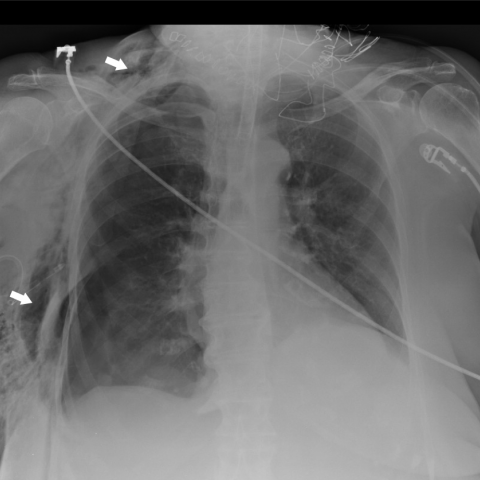

# 早期实验逐题档案：16376_8353800471640

独立评分参考选项：**E**。此页用于完成后的复盘，参考答案未反馈给历史推理过程。

[全部保留记录 JSON](16376_8353800471640.json) 包含逐轮终态、工具语义观察、检索记录与 V7 分支原文；每条带有来源文件。工具或模型的断言仍是待核实的观察。

## 原题与完整选项

Based on the chest anteroposterior radiography (Fig. 1), which of the following statements is the most accurate regarding the relationship and location of the findings, considering the clinical suspicion of tracheal rupture?

A) The emphysema in the soft tissues is predominantly located in the left thoracic region, suggesting a possible left-sided tracheal injury.
B) The pneumothorax is more pronounced on the right side, supporting the likelihood of a right-sided tracheal disruption.
C) The pneumomediastinum is centrally located, indicating a midline tracheal rupture without lateral preference.
D) The soft tissue emphysema is bilaterally symmetrical, suggesting a tracheal rupture at the level of the carina.
E) The right-sided pneumothorax and right-sided emphysema suggest a rupture of the right posterolateral tracheal wall.
F) The findings suggest pneumothorax and pneumomediastinum are unrelated, indicating a spontaneous pneumothorax.

## 原图

来源输入：`data/validation_subset_v1.jsonl`；实际路径：`figures/16376/figure_1.jpg`。

## 当时保存的逐轮结果

备份/中断尝试单列，不能与最终完成版本相加。

| 来源 | 臂 | 选项 | 执行状态 | 参考匹配 |
|---|---|---|---|---|
| `val29_full_r0/results.jsonl` | agent | A | completed | 未答对 |
| `val29_full_r1/results.jsonl` | agent | A | completed | 未答对 |
| `val29_full_r2/results.jsonl` | agent | A | completed | 未答对 |
| `val29_full_r3/results.jsonl` | agent | A | completed | 未答对 |
| `val29_r1c_v1/results.jsonl` | agent | A | completed | 未答对 |
| `val29_r3_v1/results.jsonl` | agent | A | completed | 未答对 |
| `val30_r0_v1/results.jsonl` | agent | A | completed | 未答对 |
| `val8_r0/results.jsonl` | agent | 缺答 | case_budget_exceeded | 未答对 |
| `val8_r1/results.jsonl` | agent | 缺答 | case_budget_exceeded | 未答对 |
| `val8_r5/results.jsonl` | agent | 缺答 | case_budget_exceeded | 未答对 |
| `val8_r57/results.jsonl` | agent | 缺答 | case_budget_exceeded | 未答对 |
| `val8b_r0/results.jsonl` | agent | 缺答 | failed | 未答对 |
| `val8b_r1/results.jsonl` | agent | A | completed | 未答对 |
| `val8b_r5/results.jsonl` | agent | A | completed | 未答对 |
| `val8b_r57/results.jsonl` | agent | D | completed | 未答对 |

保留的语义观察 0 条；检索记录 11 条；V7 恢复实验记录 0 条。详见同页 JSON。早期只有摘要/哈希的响应无法从哈希还原原文；此处未补写模型输出。
