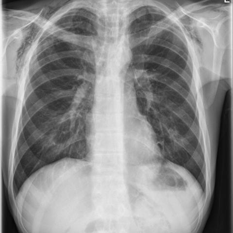

# 早期实验逐题档案：16486_8353800471802

独立评分参考选项：**C**。此页用于完成后的复盘，参考答案未反馈给历史推理过程。

[全部保留记录 JSON](16486_8353800471802.json) 包含逐轮终态、工具语义观察、检索记录与 V7 分支原文；每条带有来源文件。工具或模型的断言仍是待核实的观察。

## 原题与完整选项

Based on the chest X-ray findings in Figure 1 and Figure 8, what is the most likely diagnosis, and what does the progression of findings suggest about the clinical course of the condition in this patient?
A) Secondary pneumomediastinum due to oesophageal rupture, with worsening condition
B) Spontaneous pneumothorax with stable condition
C) Primary spontaneous pneumomediastinum with improvement
D) Pneumopericardium with no change in condition
E) Pneumoperitoneum with deterioration
F) Primary spontaneous pneumomediastinum with worsening condition

## 原图

来源输入：`v4_validation60/inputs.jsonl`；实际路径：`figures/16486/figure_1.jpg`。

来源输入：`v4_validation60/inputs.jsonl`；实际路径：`figures/16486/figure_8.jpg`。

同一固定 60 题后续证据：[V10/V11 图文档案](../../../v11/cases/16486_8353800471802.md)。不同轮 P0 独立生成，不能把差异直接视为方法收益。

## 当时保存的逐轮结果

备份/中断尝试单列，不能与最终完成版本相加。

| 来源 | 臂 | 选项 | 执行状态 | 参考匹配 |
|---|---|---|---|---|
| `v4_A_r1/results.jsonl` | agent | C | completed | 对 |
| `v4_B_r1/results.jsonl` | agent | C | completed | 对 |
| `v4_B_r1/results.jsonl.bak-before-resume` | agent | C | completed | 对 |
| `v4_C_r1/results.jsonl` | agent | C | completed | 对 |
| `v7_recovery/round2_verify.jsonl` | P0 | C | ok | 对 |
| `v7_recovery/round2_verify.jsonl` | P1 | C | ok | 对 |
| `v7_recovery/round2_verify.jsonl` | G1 | C | ok | 对 |
| `v7_recovery/round2_verify.jsonl` | PB | C | ok | 对 |
| `v7_recovery/round2_verify.jsonl` | GB | C | ok | 对 |
| `v7_recovery/round2_verify.jsonl` | PC | C | ok | 对 |
| `v7_recovery/round2_verify.jsonl` | GC | C | ok | 对 |

保留的语义观察 22 条；检索记录 2 条；V7 恢复实验记录 1 条。详见同页 JSON。早期只有摘要/哈希的响应无法从哈希还原原文；此处未补写模型输出。
