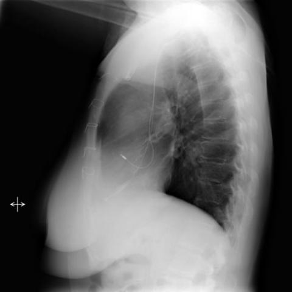
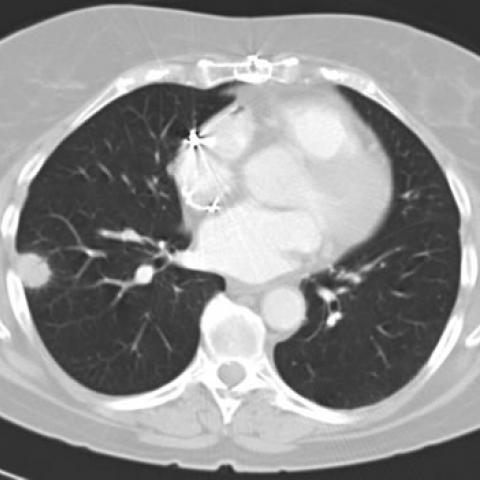

# 早期实验逐题档案：1653_8353802281156

独立评分参考选项：**C**。此页用于完成后的复盘，参考答案未反馈给历史推理过程。

[全部保留记录 JSON](1653_8353802281156.json) 包含逐轮终态、工具语义观察、检索记录与 V7 分支原文；每条带有来源文件。工具或模型的断言仍是待核实的观察。

## 原题与完整选项

In a patient with a history of heart transplantation and a pacemaker, presenting with two nodular shadows in the right lung observed on routine chest X-ray, which of the following is the most likely diagnosis for the nodular lesions, considering the absence of symptoms and geographic exposure?

A) Post-transplant lymphoproliferative disorder
B) Lung tumor (primary or secondary)
C) Pulmonary blastomycosis
D) Histoplasmosis
E) Tuberculosis
F) Fungal infection other than blastomycosis

## 原图

来源输入：`v4_validation60/inputs.jsonl`；实际路径：`figures/1653/figure_1a.jpg`。

来源输入：`v4_validation60/inputs.jsonl`；实际路径：`figures/1653/figure_1b.jpg`。

来源输入：`v4_validation60/inputs.jsonl`；实际路径：`figures/1653/figure_2a.jpg`。

来源输入：`v4_validation60/inputs.jsonl`；实际路径：`figures/1653/figure_2b.jpg`。

来源输入：`v4_validation60/inputs.jsonl`；实际路径：`figures/1653/figure_2c.jpg`。

同一固定 60 题后续证据：[V10/V11 图文档案](../../../v11/cases/1653_8353802281156.md)。不同轮 P0 独立生成，不能把差异直接视为方法收益。

## 当时保存的逐轮结果

备份/中断尝试单列，不能与最终完成版本相加。

| 来源 | 臂 | 选项 | 执行状态 | 参考匹配 |
|---|---|---|---|---|
| `v4_A_r1/results.jsonl` | agent | A | completed | 未答对 |
| `v4_B_r1/results.jsonl` | agent | A | completed | 未答对 |
| `v4_B_r1/results.jsonl.bak-before-resume` | agent | A | completed | 未答对 |
| `v4_C_r1/results.jsonl` | agent | A | completed | 未答对 |
| `v7_recovery/round2_verify.jsonl` | P0 | A | ok | 未答对 |
| `v7_recovery/round2_verify.jsonl` | P1 | A | ok | 未答对 |
| `v7_recovery/round2_verify.jsonl` | G1 | A | ok | 未答对 |
| `v7_recovery/round2_verify.jsonl` | PB | A | ok | 未答对 |
| `v7_recovery/round2_verify.jsonl` | GB | A | ok | 未答对 |
| `v7_recovery/round2_verify.jsonl` | PC | A | ok | 未答对 |
| `v7_recovery/round2_verify.jsonl` | GC | A | ok | 未答对 |

保留的语义观察 13 条；检索记录 2 条；V7 恢复实验记录 1 条。详见同页 JSON。早期只有摘要/哈希的响应无法从哈希还原原文；此处未补写模型输出。
