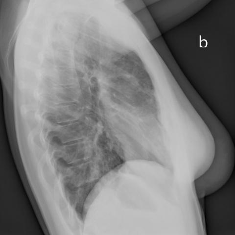

# 早期实验逐题档案：16568_8353800483171

独立评分参考选项：**B**。此页用于完成后的复盘，参考答案未反馈给历史推理过程。

[全部保留记录 JSON](16568_8353800483171.json) 包含逐轮终态、工具语义观察、检索记录与 V7 分支原文；每条带有来源文件。工具或模型的断言仍是待核实的观察。

## 原题与完整选项

Based on the chest radiographs in Figures 1a and 1b, which statement best describes the findings and their clinical significance in relation to the patient's condition?

A) The radiographs indicate unilateral alveolar infiltrates confined to the right lung's middle lobe, suggesting a localized infection.
B) The bilateral alveolar infiltrates are predominantly in the lower lobes and the middle lobe of the right lung, consistent with pulmonary alveolar proteinosis, despite the absence of restrictive impairment in pulmonary function tests.
C) The infiltrates are primarily observed in the upper lobes bilaterally, aligning with a pattern suggestive of pulmonary edema.
D) The X-rays show no significant infiltrates, indicating a possible error in clinical correlation.
E) The infiltrates are diffuse and homogeneously distributed across all lung lobes, indicating acute respiratory distress syndrome.
F) The radiographs reveal alveolar infiltrates only in the left lower lobe, suggesting lipoid pneumonia.

## 原图

来源输入：`v4_validation60/inputs.jsonl`；实际路径：`figures/16568/figure_1a.jpg`。

来源输入：`v4_validation60/inputs.jsonl`；实际路径：`figures/16568/figure_1b.jpg`。

同一固定 60 题后续证据：[V10/V11 图文档案](../../../v11/cases/16568_8353800483171.md)。不同轮 P0 独立生成，不能把差异直接视为方法收益。

## 当时保存的逐轮结果

备份/中断尝试单列，不能与最终完成版本相加。

| 来源 | 臂 | 选项 | 执行状态 | 参考匹配 |
|---|---|---|---|---|
| `v4_A_r1/results.jsonl` | agent | B | completed | 对 |
| `v4_B_r1/results.jsonl` | agent | A | completed | 未答对 |
| `v4_B_r1/results.jsonl.bak-before-resume` | agent | A | completed | 未答对 |
| `v4_C_r1/results.jsonl` | agent | A | completed | 未答对 |
| `v7_recovery/round2_verify.jsonl` | P0 | B | ok | 对 |
| `v7_recovery/round2_verify.jsonl` | P1 | B | ok | 对 |
| `v7_recovery/round2_verify.jsonl` | G1 | B | ok | 对 |
| `v7_recovery/round2_verify.jsonl` | PB | B | ok | 对 |
| `v7_recovery/round2_verify.jsonl` | GB | B | ok | 对 |
| `v7_recovery/round2_verify.jsonl` | PC | B | ok | 对 |
| `v7_recovery/round2_verify.jsonl` | GC | B | ok | 对 |

保留的语义观察 22 条；检索记录 2 条；V7 恢复实验记录 1 条。详见同页 JSON。早期只有摘要/哈希的响应无法从哈希还原原文；此处未补写模型输出。
