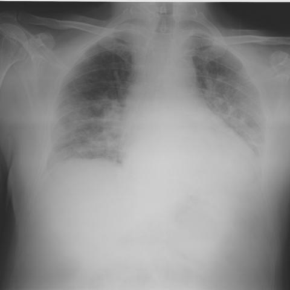

# 早期实验逐题档案：16895_8143559669619

独立评分参考选项：**D**。此页用于完成后的复盘，参考答案未反馈给历史推理过程。

[全部保留记录 JSON](16895_8143559669619.json) 包含逐轮终态、工具语义观察、检索记录与 V7 分支原文；每条带有来源文件。工具或模型的断言仍是待核实的观察。

## 原题与完整选项

A 65-year-old male with a past medical history of hypertension and dyslipidemia presents with a 5-day history of cough and fever, along with dyspnea for the past 48 hours. Initial lab tests show elevated inflammatory markers but a normal white cell count. On admission, a chest X-ray (Figure 1) reveals certain findings. Considering the patient's clinical history and the chest X-ray findings, which of the following is the most likely explanation for the observed radiographic features?

A) Bilateral pleural effusions due to congestive heart failure
B) Patchy airspace opacities indicating multifocal bacterial pneumonia
C) Diffuse interstitial thickening suggestive of pulmonary fibrosis
D) Patchy airspace opacities consistent with COVID-19 pneumonia
E) Upper lobe predominant opacities indicating tuberculosis
F) Right lower lobe consolidation suggesting aspiration pneumonia

## 原图

来源输入：`data/validation_subset_v1.jsonl`；实际路径：`figures/16895/figure_1.jpg`。

## 当时保存的逐轮结果

备份/中断尝试单列，不能与最终完成版本相加。

| 来源 | 臂 | 选项 | 执行状态 | 参考匹配 |
|---|---|---|---|---|
| `val29_full_r0/results.jsonl` | agent | D | completed | 对 |
| `val29_full_r1/results.jsonl` | agent | B | completed | 未答对 |
| `val29_full_r2/results.jsonl` | agent | B | completed | 未答对 |
| `val29_full_r3/results.jsonl` | agent | D | completed | 对 |
| `val29_r1c_v1/results.jsonl` | agent | F | completed | 未答对 |
| `val30_r0_v1/results.jsonl` | agent | B | completed | 未答对 |
| `val8_r0/results.jsonl` | agent | D | completed | 对 |
| `val8_r1/results.jsonl` | agent | B | completed | 未答对 |
| `val8_r5/results.jsonl` | agent | 缺答 | case_budget_exceeded | 未答对 |
| `val8_r57/results.jsonl` | agent | D | completed | 对 |
| `val8b_r0/results.jsonl` | agent | B | completed | 未答对 |
| `val8b_r1/results.jsonl` | agent | D | completed | 对 |
| `val8b_r5/results.jsonl` | agent | B | completed | 未答对 |
| `val8b_r57/results.jsonl` | agent | B | completed | 未答对 |

保留的语义观察 0 条；检索记录 10 条；V7 恢复实验记录 0 条。详见同页 JSON。早期只有摘要/哈希的响应无法从哈希还原原文；此处未补写模型输出。
