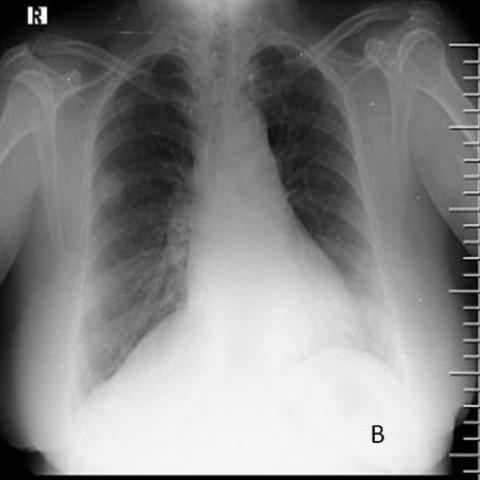

# 早期实验逐题档案：17621_8143559684844

独立评分参考选项：**D**。此页用于完成后的复盘，参考答案未反馈给历史推理过程。

[全部保留记录 JSON](17621_8143559684844.json) 包含逐轮终态、工具语义观察、检索记录与 V7 分支原文；每条带有来源文件。工具或模型的断言仍是待核实的观察。

## 原题与完整选项

Based on the findings from the initial chest X-ray and the follow-up X-ray (Figures 1 and 7b), which of the following best describes the progression of the pulmonary findings in the context of Pyoderma gangrenosum with pulmonary involvement?
A) The right middle zone opacity has resolved, and new lesions have appeared in the bilateral lower zones.
B) The right middle zone opacity has increased in size, and new cavitating nodules have appeared in the bilateral upper zones.
C) The right middle zone opacity remains unchanged, and the nodular shadows have decreased in size in the bilateral upper zones.
D) The right middle zone opacity has decreased in size, and the nodular shadows in the bilateral upper zones have increased in size.
E) The right middle zone opacity has increased in size, and the nodular shadows have decreased in size in the bilateral lower zones.
F) The right middle zone opacity has decreased in size, and the nodular shadows have increased in size in the bilateral lower zones.

## 原图

来源输入：`v4_validation60/inputs.jsonl`；实际路径：`figures/17621/figure_1.jpg`。

来源输入：`v4_validation60/inputs.jsonl`；实际路径：`figures/17621/figure_7b.jpg`。

同一固定 60 题后续证据：[V10/V11 图文档案](../../../v11/cases/17621_8143559684844.md)。不同轮 P0 独立生成，不能把差异直接视为方法收益。

## 当时保存的逐轮结果

备份/中断尝试单列，不能与最终完成版本相加。

| 来源 | 臂 | 选项 | 执行状态 | 参考匹配 |
|---|---|---|---|---|
| `v4_A_r1/results.jsonl` | agent | D | completed | 对 |
| `v4_B_r1/results.jsonl` | agent | A | completed | 未答对 |
| `v4_B_r1/results.jsonl.bak-before-resume` | agent | A | completed | 未答对 |
| `v4_C_r1/results.jsonl` | agent | A | completed | 未答对 |
| `v7_recovery/round2_verify.jsonl` | P1 | 缺答 | p0_failed | 未答对 |

保留的语义观察 26 条；检索记录 2 条；V7 恢复实验记录 1 条。详见同页 JSON。早期只有摘要/哈希的响应无法从哈希还原原文；此处未补写模型输出。
