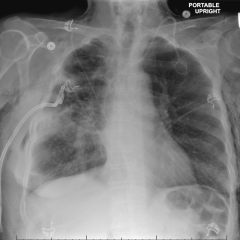

# 早期实验逐题档案：17947_8143559000377

独立评分参考选项：**B**。此页用于完成后的复盘，参考答案未反馈给历史推理过程。

[全部保留记录 JSON](17947_8143559000377.json) 包含逐轮终态、工具语义观察、检索记录与 V7 分支原文；每条带有来源文件。工具或模型的断言仍是待核实的观察。

## 原题与完整选项

Considering the chest X-ray findings in Figure 2 and Figure 6, what is the most likely explanation for the improvement in subcutaneous emphysema observed in the patient by day 14 of hospitalization?

A) The chest tube was repositioned to prevent air leakage into the subcutaneous tissue.
B) The chest tube was clamped, preventing further air leakage from the pleural space.
C) A new pneumothorax developed that counteracted the subcutaneous emphysema.
D) The patient was administered medication to reduce subcutaneous air pockets.
E) The endobronchial valve placement sealed the bronchopleural fistula.
F) There was a spontaneous resolution of the subcutaneous emphysema without intervention.

## 原图

来源输入：`v4_validation60/inputs.jsonl`；实际路径：`figures/17947/figure_2.jpg`。

来源输入：`v4_validation60/inputs.jsonl`；实际路径：`figures/17947/figure_6.jpg`。

同一固定 60 题后续证据：[V10/V11 图文档案](../../../v11/cases/17947_8143559000377.md)。不同轮 P0 独立生成，不能把差异直接视为方法收益。

## 当时保存的逐轮结果

备份/中断尝试单列，不能与最终完成版本相加。

| 来源 | 臂 | 选项 | 执行状态 | 参考匹配 |
|---|---|---|---|---|
| `v4_A_r1/results.jsonl` | agent | E | completed | 未答对 |
| `v4_B_r1/results.jsonl` | agent | E | completed | 未答对 |
| `v4_B_r1/results.jsonl.bak-before-resume` | agent | E | completed | 未答对 |
| `v4_C_r1/results.jsonl` | agent | E | completed | 未答对 |
| `v7_recovery/round2_verify.jsonl` | P0 | E | ok | 未答对 |
| `v7_recovery/round2_verify.jsonl` | P1 | E | ok | 未答对 |
| `v7_recovery/round2_verify.jsonl` | G1 | E | ok | 未答对 |
| `v7_recovery/round2_verify.jsonl` | PB | E | ok | 未答对 |
| `v7_recovery/round2_verify.jsonl` | GB | E | ok | 未答对 |
| `v7_recovery/round2_verify.jsonl` | PC | E | ok | 未答对 |
| `v7_recovery/round2_verify.jsonl` | GC | E | ok | 未答对 |

保留的语义观察 13 条；检索记录 2 条；V7 恢复实验记录 1 条。详见同页 JSON。早期只有摘要/哈希的响应无法从哈希还原原文；此处未补写模型输出。
