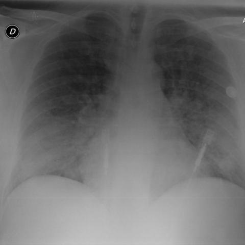
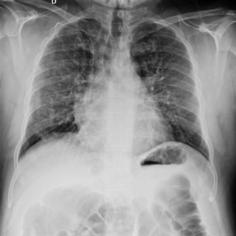

# 早期实验逐题档案：18780_8143559008557

独立评分参考选项：**A**。此页用于完成后的复盘，参考答案未反馈给历史推理过程。

[全部保留记录 JSON](18780_8143559008557.json) 包含逐轮终态、工具语义观察、检索记录与 V7 分支原文；每条带有来源文件。工具或模型的断言仍是待核实的观察。

## 原题与完整选项

Based on the chest X-ray findings in Figures 1a and 1b, which of the following statements best describes the changes observed after 7 days of corticosteroid treatment, and what does this indicate about the patient's condition?
A) The bilateral pulmonary consolidations have completely resolved, indicating full recovery; however, the presence of persistent reticular markings suggests ongoing peripheral interstitial involvement.
B) The bilateral pulmonary consolidations remain unchanged, indicating no response to treatment, with reticular markings being less prominent.
C) The bilateral pulmonary consolidations have partially resolved, indicating partial response to treatment, while reticular markings have become more pronounced.
D) The bilateral pulmonary consolidations have completely resolved, indicating full recovery, with no remaining reticular markings.
E) The bilateral pulmonary consolidations have worsened, indicating deterioration, with new reticular markings appearing.
F) There is no significant change in the bilateral pulmonary consolidations, but the reticular markings have disappeared, suggesting a reduction in interstitial involvement.

## 原图

来源输入：`v4_validation60/inputs.jsonl`；实际路径：`figures/18780/figure_1a.jpg`。

来源输入：`v4_validation60/inputs.jsonl`；实际路径：`figures/18780/figure_1b.jpg`。

同一固定 60 题后续证据：[V10/V11 图文档案](../../../v11/cases/18780_8143559008557.md)。不同轮 P0 独立生成，不能把差异直接视为方法收益。

## 当时保存的逐轮结果

备份/中断尝试单列，不能与最终完成版本相加。

| 来源 | 臂 | 选项 | 执行状态 | 参考匹配 |
|---|---|---|---|---|
| `v4_A_r1/results.jsonl` | agent | C | completed | 未答对 |
| `v4_B_r1/results.jsonl` | agent | C | completed | 未答对 |
| `v4_B_r1/results.jsonl.bak-before-resume` | agent | C | completed | 未答对 |
| `v4_C_r1/results.jsonl` | agent | A | completed | 对 |
| `v7_recovery/round2_verify.jsonl` | P0 | A | ok | 对 |
| `v7_recovery/round2_verify.jsonl` | P1 | C | ok | 未答对 |
| `v7_recovery/round2_verify.jsonl` | G1 | A | ok | 对 |
| `v7_recovery/round2_verify.jsonl` | PB | A | ok | 对 |
| `v7_recovery/round2_verify.jsonl` | GB | A | ok | 对 |
| `v7_recovery/round2_verify.jsonl` | PC | A | ok | 对 |
| `v7_recovery/round2_verify.jsonl` | GC | A | ok | 对 |

保留的语义观察 23 条；检索记录 2 条；V7 恢复实验记录 1 条。详见同页 JSON。早期只有摘要/哈希的响应无法从哈希还原原文；此处未补写模型输出。
