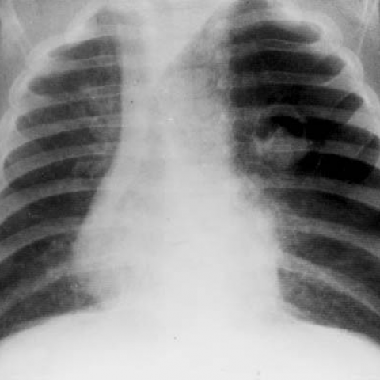

# 早期实验逐题档案：3546_8353801521080

独立评分参考选项：**A**。此页用于完成后的复盘，参考答案未反馈给历史推理过程。

[全部保留记录 JSON](3546_8353801521080.json) 包含逐轮终态、工具语义观察、检索记录与 V7 分支原文；每条带有来源文件。工具或模型的断言仍是待核实的观察。

## 原题与完整选项

Based on the chest X-ray findings, which of the following statements accurately describes the relationship between the radiological findings and the clinical presentation of the 2-month-old boy with acute dyspnea and wheezing?
A) The rounded opacity with regular borders and hypertransparent area indicates a pulmonary mass causing airway obstruction and mediastinal shift, explaining the dyspnea.
B) The air trapping in the left upper lobe results in a contralateral mediastinal shift, which does not contribute to the acute dyspnea.
C) The presence of a rounded opacity with air-fluid levels in the chest X-ray is indicative of a foreign body aspiration causing wheezing.
D) The contralateral mediastinal shift seen on the X-ray is due to a right-sided pneumothorax, which explains the hyperresonance on percussion.
E) The hypertransparent area within the rounded opacity indicates a pulmonary abscess, causing the acute respiratory symptoms.
F) The mediastinal shift and air trapping are unrelated, and the symptoms are primarily due to a viral infection.

## 原图

来源输入：`v4_validation60/inputs.jsonl`；实际路径：`figures/3546/figure_1.jpg`。

同一固定 60 题后续证据：[V10/V11 图文档案](../../../v11/cases/3546_8353801521080.md)。不同轮 P0 独立生成，不能把差异直接视为方法收益。

## 当时保存的逐轮结果

备份/中断尝试单列，不能与最终完成版本相加。

| 来源 | 臂 | 选项 | 执行状态 | 参考匹配 |
|---|---|---|---|---|
| `v4_A_r1/results.jsonl` | agent | B | completed | 未答对 |
| `v4_B_r1/results.jsonl` | agent | B | completed | 未答对 |
| `v4_B_r1/results.jsonl.bak-before-resume` | agent | B | completed | 未答对 |
| `v4_C_r1/results.jsonl` | agent | A | completed | 对 |
| `v7_recovery/round2_verify.jsonl` | P0 | C | ok | 未答对 |
| `v7_recovery/round2_verify.jsonl` | P1 | B | ok | 未答对 |
| `v7_recovery/round2_verify.jsonl` | G1 | C | ok | 未答对 |
| `v7_recovery/round2_verify.jsonl` | PB | C | ok | 未答对 |
| `v7_recovery/round2_verify.jsonl` | GB | C | ok | 未答对 |
| `v7_recovery/round2_verify.jsonl` | PC | C | ok | 未答对 |
| `v7_recovery/round2_verify.jsonl` | GC | C | ok | 未答对 |

保留的语义观察 15 条；检索记录 2 条；V7 恢复实验记录 1 条。详见同页 JSON。早期只有摘要/哈希的响应无法从哈希还原原文；此处未补写模型输出。
