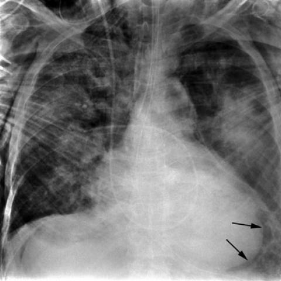

# 早期实验逐题档案：562_8353802023537

独立评分参考选项：**F**。此页用于完成后的复盘，参考答案未反馈给历史推理过程。

[全部保留记录 JSON](562_8353802023537.json) 包含逐轮终态、工具语义观察、检索记录与 V7 分支原文；每条带有来源文件。工具或模型的断言仍是待核实的观察。

## 原题与完整选项

A 61-year-old male patient involved in a high-speed deceleration traffic accident has been admitted for evaluation. Based on the chest X-rays provided:
Which of the following sets of findings most accurately supports the diagnosis of blunt tracheal rupture with subsequent pneumomediastinum, pneumoperitoneum, and subcutaneous emphysema?
A) Presence of pneumothorax and hemothorax with a tracheal shift
B) Subcutaneous emphysema, pneumopericardium, and bilateral pulmonary contusions
C) Pneumomediastinum, pneumothorax, and widened mediastinum
D) Interruption of radiolucent lumen and sharp angulation of trachea
E) Pneumopericardium, pneumothorax persisting despite chest tube drainage, and tension pneumothorax
F) Subcutaneous emphysema, pneumoperitoneum, and anterior pneumomediastinum delineated by xiphoid attachment

## 原图

来源输入：`v4_validation60/inputs.jsonl`；实际路径：`figures/562/figure_1a.jpg`。

来源输入：`v4_validation60/inputs.jsonl`；实际路径：`figures/562/figure_1b.jpg`。

同一固定 60 题后续证据：[V10/V11 图文档案](../../../v11/cases/562_8353802023537.md)。不同轮 P0 独立生成，不能把差异直接视为方法收益。

## 当时保存的逐轮结果

备份/中断尝试单列，不能与最终完成版本相加。

| 来源 | 臂 | 选项 | 执行状态 | 参考匹配 |
|---|---|---|---|---|
| `v4_A_r1/results.jsonl` | agent | F | completed | 对 |
| `v4_B_r1/results.jsonl` | agent | F | completed | 对 |
| `v4_C_r1/results.jsonl` | agent | F | completed | 对 |
| `v7_recovery/round2_verify.jsonl` | P0 | D | ok | 未答对 |
| `v7_recovery/round2_verify.jsonl` | P1 | F | ok | 对 |
| `v7_recovery/round2_verify.jsonl` | G1 | D | ok | 未答对 |
| `v7_recovery/round2_verify.jsonl` | PB | D | ok | 未答对 |
| `v7_recovery/round2_verify.jsonl` | GB | D | ok | 未答对 |
| `v7_recovery/round2_verify.jsonl` | PC | D | ok | 未答对 |
| `v7_recovery/round2_verify.jsonl` | GC | D | ok | 未答对 |

保留的语义观察 15 条；检索记录 2 条；V7 恢复实验记录 1 条。详见同页 JSON。早期只有摘要/哈希的响应无法从哈希还原原文；此处未补写模型输出。
