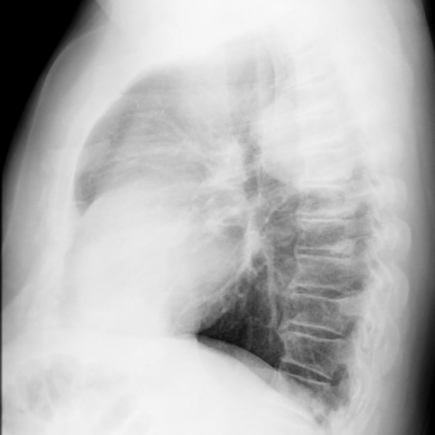

# M1：11858_8353800664572

D0 **B**；E **D**；ES **A**；参考 **B**。

[D0原回复](../../direct_qwen60/responses/11858_8353800664572_1.json) · [基准来源/原图](../../v12/results/cases/11858_8353800664572.md)

```text
Based on the chest X-ray findings and the clinical history, which of the following is the most likely diagnosis for the mass observed in the right hemithorax of this 57-year-old male patient?

A. Lipoma
B. Well-differentiated liposarcoma
C. Metastatic tumor
D. Pleural effusion
E. Primary lung cancer
F. Pneumonia
```




## E

[请求/原回复/检索/反馈/反思/更新](../traces/eval/11858_8353800664572_E.json) · [作答前真实可见记忆](../memory/visible/11858_8353800664572_E.json)

实际注入历史记忆：

```text
Historical example 1 (modality CXR): Pattern: explicit clinical situation (pulmonary TB history); Earlier choice: The loculated pleural effusion is positioned in the left hemithorax [truncated]; Corrected interpretation: The loculated pleural effusion is positioned in the left hemithorax and is larger in size compared to the soft-tissue opacity in the left chest wall, suggesting a potential communication between the two consistent with empyema necessitans as a reactivation of tuberculosis.; Earlier distinction: the historical alternative correctly identifies left hemithorax localization, larger effusion [truncated]; Difference: Only D matches both (1) left-sided loculated effusion larger than adjacent chest wall opacity and (2) plausible communication—critical [truncated]; Inspect: On PA CXR, compare the vertical/horizontal extent of the pleural opacity versus the extrapleural soft-tissue mass in the same hemithorax; confirm continuity at the costophrenic [truncated]; Basis: image: unverified visual observation (left hemithorax [truncated]; Limit: Original historical reasoning was not retained; only the saved choice is known. No lateral view or clinical timeline; [truncated].
Historical example 2 (modality CXR): Pattern: explicit clinical situation; Earlier choice: The lesion is a poorly-defined mass with evidence of rib [truncated]; Corrected interpretation: The lesion is a well-defined mass without rib destruction, consistent with an extrapulmonary neoplastic process, possibly Askin tumor.; Earlier distinction: chosen A (poorly-defined mass with rib destruction) vs reference B [truncated]; Difference: Reference diagnosis requires well-defined margins and absence of rib destruction; saved response incorrectly interpreted opacity as poorly-defined with [truncated]; Inspect: On lateral CXR, inspect rib cortex continuity at lesion periphery and assess mass margin sharpness against adjacent lung/pleura using window/level adjustment; Basis: image: unverified visual observation: rib cortices [truncated]; Limit: No magnified or CT confirmation; reference explanation unavailable; image resolution limits subtle cortical erosion detection.
Historical example 3 (modality CXR): Pattern: serial imaging in known primary pulmonary nodular amyloidosis; Earlier choice: Bilateral nodules with increase in number and size on the [truncated]; Corrected interpretation: Bilateral nodules with increase in number and size on the right side, accompanied by a transient left pleural effusion.; Earlier distinction: correct selection of B based on temporal evolution across CXRs [truncated]; Difference: the historical alternative uniquely matches observed increase in nodule number/size (especially right lung) and transient left pleural effusion [truncated]; Inspect: On serial CXRs, compare nodule count/size per lung field across timepoints and specifically check for presence/absence of pleural effusion at each date; correlate with CT [truncated]; Basis: image: Fig 5a shows left pleural [truncated]; Limit: Exact dates/timing of all images not fully visible; some figures are CT slices without orientation labels; no clinical [truncated].
```

本题提交后的原回复：

```text
Answer: D. Pleural effusion  
Reason: The PA view (Figure 1a) shows a large, homogeneous opacity in the right hemithorax with blunting of the right costophrenic angle and mediastinal shift to the left—classic signs of a substantial pleural effusion. The lateral view (Figure 1b) confirms anterior and posterior fluid layers with a meniscus, and absence of a discrete mass margin, ruling out solid tumors or lipoma.
```

提交时间：2026-10-31T15:51:42.684550+00:00；本病例反馈时间：2026-10-31T15:51:46.080973+00:00，反馈释放位置5。当前/未来病例未进入本次记忆投影。

## ES

[请求/原回复/检索/反馈/反思/更新](../traces/eval/11858_8353800664572_ES.json) · [作答前真实可见记忆](../memory/visible/11858_8353800664572_ES.json)

实际注入历史记忆：

```text
Historical example 1 (modality CXR): Pattern: explicit clinical situation (pulmonary TB history); Earlier choice: The loculated pleural effusion is positioned in the left hemithorax [truncated]; Corrected interpretation: The loculated pleural effusion is positioned in the left hemithorax and is larger in size compared to the soft-tissue opacity in the left chest wall, suggesting a potential communication between the two consistent with empyema necessitans as a reactivation of tuberculosis.; Earlier distinction: the historical alternative correctly identifies left hemithorax localization, larger effusion [truncated]; Difference: Only D matches both (1) left-sided loculated effusion larger than adjacent chest wall opacity and (2) plausible communication—critical [truncated]; Inspect: On PA CXR, compare the vertical/horizontal extent of the pleural opacity versus the extrapleural soft-tissue mass in the same hemithorax; confirm continuity at the costophrenic [truncated]; Basis: image: unverified visual observation (left hemithorax [truncated]; Limit: Original historical reasoning was not retained; only the saved choice is known. No lateral view or clinical timeline; [truncated].
Historical example 2 (modality CXR): Pattern: bilateral peripheral airspace opacities; Earlier choice: Chronic eosinophilic pneumonia; Corrected interpretation: Lipoid pneumonia; Earlier distinction: chosen A (chronic eosinophilic pneumonia) but reference the historical alternative [truncated]; Difference: Lipoid pneumonia can present with bilateral, patchy, peripheral consolidations—especially in chronic exogenous form—and may mimic CEP; key discriminators [truncated]; Inspect: In bilateral peripheral consolidations, inspect for subtle basilar predominance, air bronchograms within opacities, and associated pleural changes; if available, correlate with clinical history of lipid [truncated]; Basis: image: bilateral, patchy, peripheral opacities without [truncated]; Limit: No clinical history (e.g., lipid exposure), no CT for fat density confirmation, no temporal comparison to assess migration; [truncated].
Historical example 3 (modality CXR): Pattern: explicit clinical situation; Earlier choice: The lesion is a poorly-defined mass with evidence of rib [truncated]; Corrected interpretation: The lesion is a well-defined mass without rib destruction, consistent with an extrapulmonary neoplastic process, possibly Askin tumor.; Earlier distinction: chosen A (poorly-defined mass with rib destruction) vs reference B [truncated]; Difference: Reference diagnosis requires well-defined margins and absence of rib destruction; saved response incorrectly interpreted opacity as poorly-defined with [truncated]; Inspect: On lateral CXR, inspect rib cortex continuity at lesion periphery and assess mass margin sharpness against adjacent lung/pleura using window/level adjustment; Basis: image: unverified visual observation: rib cortices [truncated]; Limit: No magnified or CT confirmation; reference explanation unavailable; image resolution limits subtle cortical erosion detection.
Conditional procedure 1: when When a right-sided lower lung opacity merges with the right heart border on PA CXR and the right costophrenic angle [truncated], inspect Inspect lateral CXR for anterior-inferior opacity overlapping the cardiac silhouette and diaphragm dome; if present, localize to right lower lobe abutting heart and diaphragm; limitation: Unreliable if lateral view is rotated or overpenetrated; does not distinguish tumor from consolidation [truncated].
Conditional procedure 2: when When a new unilateral hemithorax opacity appears after resolution of prior ipsilateral opacity, and mediastinal shift is toward the new [truncated], inspect Inspect for loss of lung volume (flattened diaphragm, crowding of ribs, tracheal deviation) and absence of meniscus sign to favor atelectasis over effusion; limitation: Fails if poor inspiration or overpenetration masks volume loss; does not differentiate mucus plugging [truncated].
```

本题提交后的原回复：

```text
Answer: A. Lipoma  
Reason: The PA and lateral chest X-rays show a well-circumscribed, homogeneous, soft-tissue density mass in the right hemithorax with no rib destruction, no lung invasion, and no pleural effusion or air bronchograms; its location and radiographic appearance are most consistent with a benign fatty tumor (lipoma), especially given the absence of aggressive features seen in sarcoma, metastasis, or primary lung cancer.
```

提交时间：2026-10-31T15:51:46.076585+00:00；本病例反馈时间：2026-10-31T15:51:46.080973+00:00，反馈释放位置5。当前/未来病例未进入本次记忆投影。

