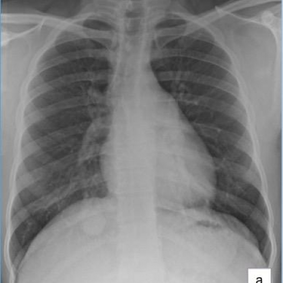
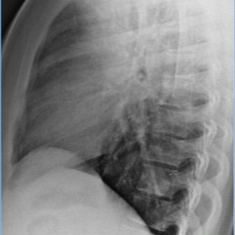

# M1：13154_8353800587826

D0 **F**；E **C**；ES **C**；参考 **C**。

[D0原回复](../../direct_qwen60/responses/13154_8353800587826_1.json) · [基准来源/原图](../../v12/results/cases/13154_8353800587826.md)

```text
Based on the provided chest X-ray images, which of the following statements accurately describes the findings and their implications in this clinical case?

A) The PA chest X-ray (Figure 1a) shows a large solitary nodule with cavitation behind the right hemidiaphragm, which suggests a high likelihood of active tuberculosis.
B) The lateral chest X-ray (Figure 1b) confirms the presence of a large solitary nodule in the anterior right upper lobe, which is consistent with a typical presentation of a hamartoma.
C) The PA chest X-ray (Figure 1a) demonstrates a solitary nodule with smooth margins behind the right hemidiaphragm, and the lateral view (Figure 1b) confirms it in the posterior right lower lobe, consistent with a pulmonary inflammatory myofibroblastic tumor.
D) The PA chest X-ray (Figure 1a) reveals multiple nodules scattered throughout both lungs, indicating a possible metastatic process rather than a solitary lesion.
E) The lateral chest X-ray (Figure 1b) shows a nodule with irregular margins in the right middle lobe, which aligns with the characteristics of a malignant neoplasm.
F) The PA chest X-ray (Figure 1a) demonstrates a calcified nodule behind the right hemidiaphragm, which is consistent with granuloma.
```





## E

[请求/原回复/检索/反馈/反思/更新](../traces/eval/13154_8353800587826_E.json) · [作答前真实可见记忆](../memory/visible/13154_8353800587826_E.json)

实际注入历史记忆：

```text
Historical example 1 (modality CXR): Pattern: explicit clinical situation; Earlier choice: An irregular, ill-defined mass in the left lower lobe extending [truncated]; Corrected interpretation: An irregular, ill-defined mass in the left lower lobe extending to the mediastinum, consistent with pulmonary epithelioid haemangioendothelioma (PEH).; Earlier distinction: selection of B over the competing alternatives based on margin [truncated]; Difference: the historical alternative describes a sharply marginated solitary mass (typical bronchogenic carcinoma), whereas image shows an ill-defined, heterogeneous [truncated]; Inspect: On PA CXR, assess left heart border silhouette sign; on lateral view, confirm posterior location and whether mass abuts or displaces the esophagus/hilum—ill-defined margins + [truncated]; Basis: image: unverified visual observation: left lower [truncated]; Limit: No clinical history, size scale, or follow-up imaging; PEH is rare and imaging overlap with other malignancies exists; [truncated].
Historical example 2 (modality CXR): Pattern: recurrent pneumonia with surgery; Earlier choice: Persistent right lower lobe consolidation with progression to atelectasis, followed [truncated]; Corrected interpretation: Persistent right lower lobe consolidation with progression to atelectasis, followed by resolution of consolidation and minimal pneumothorax post-surgery.; Earlier distinction: correct selection of B over the competing alternatives/E based on [truncated]; Difference: Figure 1a/1b show right lower lobe (RLL) consolidation (posterior basal on lateral), not middle or upper; Figure 4a [truncated]; Inspect: In sequential CXRs, correlate opacity location across PA/lateral views to confirm lobe (e.g., RLL = posterior basal on lateral, silhouetting diaphragm on PA); then assess [truncated]; Basis: image: RLL opacity in Fig 1a/1b; [truncated]; Limit: No time stamps or clinical timeline; lateral view (Fig 1b) is low-contrast but sufficient to localize posterior basal [truncated].
Historical example 3 (modality CXR): Pattern: supported distribution; Earlier choice: The nodular infiltrates are evenly distributed across both lungs, with [truncated]; Corrected interpretation: The nodular infiltrates are evenly distributed across both lungs, with cavitation present in both smaller and larger nodules.; Earlier distinction: the historical alternative selected and confirmed correct; Difference: the historical alternative uniquely specifies even bilateral nodular distribution with cavitation in both small and large nodules; other [truncated]; Inspect: On PA CXR, assess nodule count and size per hemithorax (upper/mid/lower zones), and inspect for lucent centers within nodules ≥1 cm—especially comparing right vs left [truncated]; Basis: image: unverified visual observation; question: explicit [truncated]; Limit: Original historical reasoning was not retained; only the saved choice is known. Image resolution limits confident cavitation detection; [truncated].
```

本题提交后的原回复：

```text
Answer: C) The PA chest X-ray (Figure 1a) demonstrates a solitary nodule with smooth margins behind the right hemidiaphragm, and the lateral view (Figure 1b) confirms it in the posterior right lower lobe, consistent with a pulmonary inflammatory myofibroblastic tumor.

Reason: On Figure 1a (PA), a well-circumscribed, round opacity is visible just above the right hemidiaphragm, silhouetting the diaphragm—indicating a right lower lobe location. On Figure 1b (lateral), the same opacity lies posteriorly, behind the heart and adjacent to the vertebral bodies, confirming a posterior right lower lobe position. The margins appear smooth, not irregular or spiculated, and there is no evidence of multiple nodules, cavitation, or calcification. This matches option C’s description; other options misstate location (e.g., anterior upper lobe in B), number (D), margin (E), or calcification (F).
```

提交时间：2026-10-31T15:53:37.511358+00:00；本病例反馈时间：2026-10-31T15:53:43.531200+00:00，反馈释放位置9。当前/未来病例未进入本次记忆投影。

## ES

[请求/原回复/检索/反馈/反思/更新](../traces/eval/13154_8353800587826_ES.json) · [作答前真实可见记忆](../memory/visible/13154_8353800587826_ES.json)

实际注入历史记忆：

```text
Historical example 1 (modality CXR): Pattern: explicit clinical situation; Earlier choice: An irregular, ill-defined mass in the left lower lobe extending [truncated]; Corrected interpretation: An irregular, ill-defined mass in the left lower lobe extending to the mediastinum, consistent with pulmonary epithelioid haemangioendothelioma (PEH).; Earlier distinction: selection of B over the competing alternatives based on margin [truncated]; Difference: the historical alternative describes a sharply marginated solitary mass (typical bronchogenic carcinoma), whereas image shows an ill-defined, heterogeneous [truncated]; Inspect: On PA CXR, assess left heart border silhouette sign; on lateral view, confirm posterior location and whether mass abuts or displaces the esophagus/hilum—ill-defined margins + [truncated]; Basis: image: unverified visual observation: left lower [truncated]; Limit: No clinical history, size scale, or follow-up imaging; PEH is rare and imaging overlap with other malignancies exists; [truncated].
Historical example 2 (modality CXR): Pattern: recurrent pneumonia with surgery; Earlier choice: Persistent right lower lobe consolidation with progression to atelectasis, followed [truncated]; Corrected interpretation: Persistent right lower lobe consolidation with progression to atelectasis, followed by resolution of consolidation and minimal pneumothorax post-surgery.; Earlier distinction: correct selection of B over the competing alternatives/E based on [truncated]; Difference: Figure 1a/1b show right lower lobe (RLL) consolidation (posterior basal on lateral), not middle or upper; Figure 4a [truncated]; Inspect: In sequential CXRs, correlate opacity location across PA/lateral views to confirm lobe (e.g., RLL = posterior basal on lateral, silhouetting diaphragm on PA); then assess [truncated]; Basis: image: RLL opacity in Fig 1a/1b; [truncated]; Limit: No time stamps or clinical timeline; lateral view (Fig 1b) is low-contrast but sufficient to localize posterior basal [truncated].
Historical example 3 (modality CXR): Pattern: supported distribution; Earlier choice: The nodular infiltrates are evenly distributed across both lungs, with [truncated]; Corrected interpretation: The nodular infiltrates are evenly distributed across both lungs, with cavitation present in both smaller and larger nodules.; Earlier distinction: the historical alternative selected and confirmed correct; Difference: the historical alternative uniquely specifies even bilateral nodular distribution with cavitation in both small and large nodules; other [truncated]; Inspect: On PA CXR, assess nodule count and size per hemithorax (upper/mid/lower zones), and inspect for lucent centers within nodules ≥1 cm—especially comparing right vs left [truncated]; Basis: image: unverified visual observation; question: explicit [truncated]; Limit: Original historical reasoning was not retained; only the saved choice is known. Image resolution limits confident cavitation detection; [truncated].
Conditional procedure 1: when When a right-sided lower lung opacity merges with the right heart border on PA CXR and the right costophrenic angle [truncated], inspect Inspect lateral CXR for anterior-inferior opacity overlapping the cardiac silhouette and diaphragm dome; if present, localize to right lower lobe abutting heart and diaphragm; limitation: Unreliable if lateral view is rotated or overpenetrated; does not distinguish tumor from consolidation [truncated].
Conditional procedure 2: when When PA CXR shows enlarged central pulmonary arteries and cardiomegaly with right heart border prominence, and symptoms suggest chronic dyspnea, inspect Inspect lateral CXR for convex retrosternal clear space and posterior displacement of heart—signs of right ventricular hypertrophy—and exclude left-sided volume overload signs (e.g., upper lobe vessel [truncated]; limitation: Unreliable in poor inspiration or scoliosis; does not differentiate etiology of PH (e.g., sarcoid [truncated].
```

本题提交后的原回复：

```text
Answer: C) The PA chest X-ray (Figure 1a) demonstrates a solitary nodule with smooth margins behind the right hemidiaphragm, and the lateral view (Figure 1b) confirms it in the posterior right lower lobe, consistent with a pulmonary inflammatory myofibroblastic tumor.

Reason: On Figure 1a (PA), a well-circumscribed, round opacity is visible just above the right hemidiaphragm, silhouetting the diaphragm but not the heart border—suggesting a posterior RLL location. Figure 1b (lateral) shows the opacity overlapping the posterior aspect of the diaphragm and spine, confirming a posterior RLL position; the margins appear smooth, not spiculated or irregular, and no cavitation or calcification is evident. This matches option C’s description and distinguishes it from A (no cavitation), B (not anterior/upper lobe), D (not multiple), E (not middle lobe, margins not irregular), and F (no calcification).
```

提交时间：2026-10-31T15:53:43.526928+00:00；本病例反馈时间：2026-10-31T15:53:43.531200+00:00，反馈释放位置9。当前/未来病例未进入本次记忆投影。

