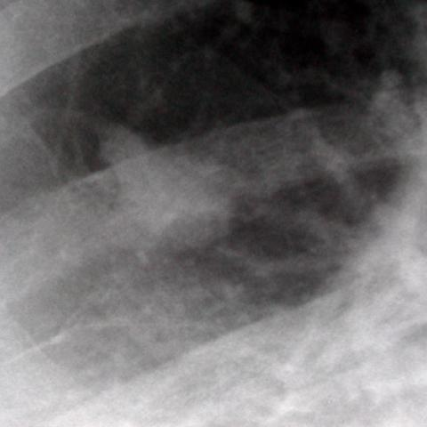

# M1：1461_8353802159822

D0 **B**；E **F**；ES **F**；参考 **B**。

[D0原回复](../../direct_qwen60/responses/1461_8353802159822_1.json) · [基准来源/原图](../../v12/results/cases/1461_8353802159822.md)

```text
Based on the PA chest radiograph (Figure 1a) and the magnified view of the lesion (Figure 1b), which of the following best describes the findings and diagnosis for the patient?

A) A well-defined round mass in the right lower zone with calcified margins, suggestive of a granuloma.
B) A trefoil-shaped mass lesion in the right lower zone with indistinct margins, consistent with bronchial atresia.
C) A poorly-defined mass in the left lower zone with surrounding consolidation, indicative of pneumonia.
D) A trefoil-shaped mass lesion in the right upper zone with clear margins, suggestive of a benign tumor.
E) A round mass lesion in the right lower zone with irregular margins, consistent with malignancy.
F) A linear opacity in the right lower zone suggestive of atelectasis.
```




## E

[请求/原回复/检索/反馈/反思/更新](../traces/eval/1461_8353802159822_E.json) · [作答前真实可见记忆](../memory/visible/1461_8353802159822_E.json)

实际注入历史记忆：

```text
Historical example 1 (modality CXR): Pattern: explicit clinical situation; Earlier choice: An irregular, ill-defined mass in the left lower lobe extending [truncated]; Corrected interpretation: An irregular, ill-defined mass in the left lower lobe extending to the mediastinum, consistent with pulmonary epithelioid haemangioendothelioma (PEH).; Earlier distinction: selection of B over the competing alternatives based on margin [truncated]; Difference: the historical alternative describes a sharply marginated solitary mass (typical bronchogenic carcinoma), whereas image shows an ill-defined, heterogeneous [truncated]; Inspect: On PA CXR, assess left heart border silhouette sign; on lateral view, confirm posterior location and whether mass abuts or displaces the esophagus/hilum—ill-defined margins + [truncated]; Basis: image: unverified visual observation: left lower [truncated]; Limit: No clinical history, size scale, or follow-up imaging; PEH is rare and imaging overlap with other malignancies exists; [truncated].
Historical example 2 (modality CXR): Pattern: explicit clinical situation; Earlier choice: The lesion is a poorly-defined mass with evidence of rib [truncated]; Corrected interpretation: The lesion is a well-defined mass without rib destruction, consistent with an extrapulmonary neoplastic process, possibly Askin tumor.; Earlier distinction: chosen A (poorly-defined mass with rib destruction) vs reference B [truncated]; Difference: Reference diagnosis requires well-defined margins and absence of rib destruction; saved response incorrectly interpreted opacity as poorly-defined with [truncated]; Inspect: On lateral CXR, inspect rib cortex continuity at lesion periphery and assess mass margin sharpness against adjacent lung/pleura using window/level adjustment; Basis: image: unverified visual observation: rib cortices [truncated]; Limit: No magnified or CT confirmation; reference explanation unavailable; image resolution limits subtle cortical erosion detection.
Historical example 3 (modality CXR): Pattern: silhouette sign in right lower lung zone with diaphragm/heart border merging; Earlier choice: The mass is situated in the right lower lung zone, [truncated]; Corrected interpretation: The mass is situated in the right lower lung zone, merging with the right heart border, and silhouettes the right hemidiaphragm anteriorly.; Earlier distinction: correct selection of B based on right heart border loss [truncated]; Difference: the historical alternative uniquely specifies right lower zone + right heart border merging + anterior hemidiaphragm silhouetting; A [truncated]; Inspect: On PA CXR, identify which cardiac border is lost (right border loss → right lower lobe pathology) and whether the costophrenic angle is obscured anteriorly [truncated]; Basis: image: unverified visual observation: right lower [truncated]; Limit: Images lack scale markers or clinical history; lateral view resolution limits precise diaphragm contour assessment; no temporal data [truncated].
```

本题提交后的原回复：

```text
Answer: F) A linear opacity in the right lower zone suggestive of atelectasis.  
Reason: Figure 1a shows a subtle linear/strip-like opacity in the right lower lung zone, with mild volume loss and possible crowding of vessels; Figure 1b (magnified view) confirms a non-mass-like, linear density without discrete margins or calcification—consistent with atelectasis rather than a rounded or trefoil-shaped mass. No silhouette sign involving the right heart border is evident, and the opacity lacks features of consolidation, granuloma, or malignancy.
```

提交时间：2026-10-31T15:55:34.815895+00:00；本病例反馈时间：2026-10-31T15:55:38.231988+00:00，反馈释放位置13。当前/未来病例未进入本次记忆投影。

## ES

[请求/原回复/检索/反馈/反思/更新](../traces/eval/1461_8353802159822_ES.json) · [作答前真实可见记忆](../memory/visible/1461_8353802159822_ES.json)

实际注入历史记忆：

```text
Historical example 1 (modality CXR): Pattern: explicit clinical situation; Earlier choice: The lesion is a poorly-defined mass with evidence of rib [truncated]; Corrected interpretation: The lesion is a well-defined mass without rib destruction, consistent with an extrapulmonary neoplastic process, possibly Askin tumor.; Earlier distinction: chosen A (poorly-defined mass with rib destruction) vs reference B [truncated]; Difference: Reference diagnosis requires well-defined margins and absence of rib destruction; saved response incorrectly interpreted opacity as poorly-defined with [truncated]; Inspect: On lateral CXR, inspect rib cortex continuity at lesion periphery and assess mass margin sharpness against adjacent lung/pleura using window/level adjustment; Basis: image: unverified visual observation: rib cortices [truncated]; Limit: No magnified or CT confirmation; reference explanation unavailable; image resolution limits subtle cortical erosion detection.
Historical example 2 (modality CXR): Pattern: explicit clinical situation; Earlier choice: An irregular, ill-defined mass in the left lower lobe extending [truncated]; Corrected interpretation: An irregular, ill-defined mass in the left lower lobe extending to the mediastinum, consistent with pulmonary epithelioid haemangioendothelioma (PEH).; Earlier distinction: selection of B over the competing alternatives based on margin [truncated]; Difference: the historical alternative describes a sharply marginated solitary mass (typical bronchogenic carcinoma), whereas image shows an ill-defined, heterogeneous [truncated]; Inspect: On PA CXR, assess left heart border silhouette sign; on lateral view, confirm posterior location and whether mass abuts or displaces the esophagus/hilum—ill-defined margins + [truncated]; Basis: image: unverified visual observation: left lower [truncated]; Limit: No clinical history, size scale, or follow-up imaging; PEH is rare and imaging overlap with other malignancies exists; [truncated].
Historical example 3 (modality CXR): Pattern: silhouette sign in right lower lung zone with diaphragm/heart border merging; Earlier choice: The mass is situated in the right lower lung zone, [truncated]; Corrected interpretation: The mass is situated in the right lower lung zone, merging with the right heart border, and silhouettes the right hemidiaphragm anteriorly.; Earlier distinction: correct selection of B based on right heart border loss [truncated]; Difference: the historical alternative uniquely specifies right lower zone + right heart border merging + anterior hemidiaphragm silhouetting; A [truncated]; Inspect: On PA CXR, identify which cardiac border is lost (right border loss → right lower lobe pathology) and whether the costophrenic angle is obscured anteriorly [truncated]; Basis: image: unverified visual observation: right lower [truncated]; Limit: Images lack scale markers or clinical history; lateral view resolution limits precise diaphragm contour assessment; no temporal data [truncated].
Conditional procedure 1: when When CXR shows a new or enlarging cavitary lesion in the upper lobe with irregular thick wall (>15 mm) and [truncated], inspect Inspect for mass effect (mediastinal shift, hilum displacement), wall thickness on magnified view, and absence of satellite nodules; consider malignancy over TB; limitation: Unreliable if image quality poor or no prior imaging for comparison.
Conditional procedure 2: when When a right-sided lower lung opacity merges with the right heart border on PA CXR and the right costophrenic angle [truncated], inspect Inspect lateral CXR for anterior-inferior opacity overlapping the cardiac silhouette and diaphragm dome; if present, localize to right lower lobe abutting heart and diaphragm; limitation: Unreliable if lateral view is rotated or overpenetrated; does not distinguish tumor from consolidation [truncated].
```

本题提交后的原回复：

```text
Answer: F) A linear opacity in the right lower zone suggestive of atelectasis.

Reason: Figure 1a shows a subtle linear/strip-like opacity in the right lower lung zone, not a round or trefoil-shaped mass; Figure 1b (magnified view) confirms a linear, non-mass-like density with indistinct but elongated configuration, consistent with volume loss rather than a discrete lesion—this matches atelectasis, especially given absence of calcification, cavitation, or surrounding consolidation.
```

提交时间：2026-10-31T15:55:38.227447+00:00；本病例反馈时间：2026-10-31T15:55:38.231988+00:00，反馈释放位置13。当前/未来病例未进入本次记忆投影。

