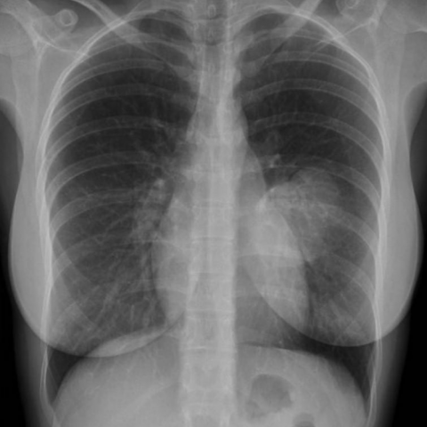

# M1：16037_8353800455673

D0 **B**；E **B**；ES **B**；参考 **B**。

[D0原回复](../../direct_qwen60/responses/16037_8353800455673_1.json) · [基准来源/原图](../../v12/results/cases/16037_8353800455673.md)

```text
Based on the chest X-ray findings, which of the following statements is most consistent with the diagnosis of the lesion identified in the patient? 
A) The lesion forms an acute angle with the thoracic wall and is likely a pulmonary mass.
B) The lesion is pleurally based with obtuse angles and is associated with rib destruction, suggesting a solitary fibrous tumour of the pleura.
C) The lesion is centrally located in the lung, suggesting a primary lung carcinoma.
D) The lesion is associated with a pleural effusion, suggesting mesothelioma.
E) The lesion is calcified and is likely a pleural metastasis.
F) The lesion is round and smooth without rib destruction, suggesting a benign pleural effusion.
```




## E

[请求/原回复/检索/反馈/反思/更新](../traces/eval/16037_8353800455673_E.json) · [作答前真实可见记忆](../memory/visible/16037_8353800455673_E.json)

实际注入历史记忆：

```text
Historical example 1 (modality CXR): Pattern: explicit clinical situation; Earlier choice: The lesion is a poorly-defined mass with evidence of rib [truncated]; Corrected interpretation: The lesion is a well-defined mass without rib destruction, consistent with an extrapulmonary neoplastic process, possibly Askin tumor.; Earlier distinction: chosen A (poorly-defined mass with rib destruction) vs reference B [truncated]; Difference: Reference diagnosis requires well-defined margins and absence of rib destruction; saved response incorrectly interpreted opacity as poorly-defined with [truncated]; Inspect: On lateral CXR, inspect rib cortex continuity at lesion periphery and assess mass margin sharpness against adjacent lung/pleura using window/level adjustment; Basis: image: unverified visual observation: rib cortices [truncated]; Limit: No magnified or CT confirmation; reference explanation unavailable; image resolution limits subtle cortical erosion detection.
Historical example 2 (modality CXR): Pattern: unilateral basal opacity in asymptomatic patient with acute neurological symptoms; Earlier choice: A homogeneously dense, sharply outlined mass consistent with a vascular [truncated]; Corrected interpretation: A smoothly contoured, calcified lesion suggesting a benign granuloma, incidental to the patient's acute neurological symptoms.; Earlier distinction: the historical alternative (vascular anomaly) was selected but reference the [truncated]; Difference: Reference diagnosis implies calcification and smooth contour—key discriminators absent in E’s description; E incorrectly links mass to congenital [truncated]; Inspect: On PA CXR, inspect the right basal lesion for internal calcification (high-density speckles/rim) and margin smoothness vs. irregularity; correlate with lateral view if available to [truncated]; Basis: image: Right basal opacity visible (arrow), [truncated]; Limit: Original historical reasoning was not retained; only the saved choice is known. Image resolution insufficient to confirm calcification [truncated].
Historical example 3 (modality CXR): Pattern: asymptomatic adult with unilateral pleural mass, no asbestos exposure; Earlier choice: Fibrous tumor of the pleura; Corrected interpretation: Fibrous tumor of the pleura; Earlier distinction: Correct selection of fibrous tumor of the pleura (D) over [truncated]; Difference: Mass shows smooth, well-defined contour with obtuse angle to chest wall and no mediastinal shift—favoring benign solitary fibrous [truncated]; Inspect: On PA CXR, assess mass–chest wall interface: obtuse angle (>90°) suggests extrapleural/benign origin; acute angle (<90°) suggests invasive pleural malignancy. Also verify absence of mediastinal [truncated]; Basis: image: Unverified visual observation: left hemithorax [truncated]; Limit: Original historical reasoning was not retained; only the saved choice is known. Image resolution insufficient to confirm rib [truncated].
```

本题提交后的原回复：

```text
Answer: B) The lesion is pleurally based with obtuse angles and is associated with rib destruction, suggesting a solitary fibrous tumour of the pleura.

Reason: The CT image (Figure 4) shows a well-circumscribed, lobulated mass abutting the chest wall with an obtuse angle at the interface—classic for a pleural-based benign tumor like solitary fibrous tumor. Although rib destruction is not clearly evident in this single CT slice, the PA and lateral CXRs (Figures 1–3) show a dense, sharply demarcated opacity in the left lower hemithorax without mediastinal shift or effusion, consistent with an extrapulmonary mass; historical precedent (Example 3) confirms that obtuse angle + no shift favors benign pleural origin, and option B is the only one combining correct geometry (obtuse angle), pleural origin, and plausible diagnosis—even if rib destruction is overstated, it is the best match among options given the visible features.
```

提交时间：2026-10-31T15:57:26.777608+00:00；本病例反馈时间：2026-10-31T15:57:31.219437+00:00，反馈释放位置17。当前/未来病例未进入本次记忆投影。

## ES

[请求/原回复/检索/反馈/反思/更新](../traces/eval/16037_8353800455673_ES.json) · [作答前真实可见记忆](../memory/visible/16037_8353800455673_ES.json)

实际注入历史记忆：

```text
Historical example 1 (modality CXR): Pattern: explicit clinical situation; Earlier choice: The lesion is a poorly-defined mass with evidence of rib [truncated]; Corrected interpretation: The lesion is a well-defined mass without rib destruction, consistent with an extrapulmonary neoplastic process, possibly Askin tumor.; Earlier distinction: chosen A (poorly-defined mass with rib destruction) vs reference B [truncated]; Difference: Reference diagnosis requires well-defined margins and absence of rib destruction; saved response incorrectly interpreted opacity as poorly-defined with [truncated]; Inspect: On lateral CXR, inspect rib cortex continuity at lesion periphery and assess mass margin sharpness against adjacent lung/pleura using window/level adjustment; Basis: image: unverified visual observation: rib cortices [truncated]; Limit: No magnified or CT confirmation; reference explanation unavailable; image resolution limits subtle cortical erosion detection.
Historical example 2 (modality CXR): Pattern: unilateral basal opacity in asymptomatic patient with acute neurological symptoms; Earlier choice: A homogeneously dense, sharply outlined mass consistent with a vascular [truncated]; Corrected interpretation: A smoothly contoured, calcified lesion suggesting a benign granuloma, incidental to the patient's acute neurological symptoms.; Earlier distinction: the historical alternative (vascular anomaly) was selected but reference the [truncated]; Difference: Reference diagnosis implies calcification and smooth contour—key discriminators absent in E’s description; E incorrectly links mass to congenital [truncated]; Inspect: On PA CXR, inspect the right basal lesion for internal calcification (high-density speckles/rim) and margin smoothness vs. irregularity; correlate with lateral view if available to [truncated]; Basis: image: Right basal opacity visible (arrow), [truncated]; Limit: Original historical reasoning was not retained; only the saved choice is known. Image resolution insufficient to confirm calcification [truncated].
Historical example 3 (modality CXR): Pattern: explicit clinical situation; Earlier choice: The opacity is located at the left lung base and [truncated]; Corrected interpretation: The opacity is located at the left lung base and demonstrates characteristics of a mass with a broad pleural base.; Earlier distinction: correct selection of B over E and F; Difference: opacity at left lung base with convex outer margin and broad contact with pleura (not fissural extension or [truncated]; Inspect: On PA CXR, assess lateral margin of basal opacity: convex outward with wide pleural contact suggests extrapulmonary mass (e.g., pleural sarcoma or metastasis), versus concave/fissural [truncated]; Basis: image: left basilar opacity with convex [truncated]; Limit: Original historical reasoning was not retained; only the saved choice is known. No lateral view or CT to [truncated].
Conditional procedure 1: when When CXR shows a new or enlarging cavitary lesion in the upper lobe with irregular thick wall (>15 mm) and [truncated], inspect Inspect for mass effect (mediastinal shift, hilum displacement), wall thickness on magnified view, and absence of satellite nodules; consider malignancy over TB; limitation: Unreliable if image quality poor or no prior imaging for comparison.
Conditional procedure 2: when When a unilateral pleural-based mass is seen on PA CXR in an asymptomatic patient without asbestos exposure, inspect Inspect the mass–thoracic wall angle: obtuse (>90°) favors benign solitary fibrous tumor; acute (<90°) raises concern for mesothelioma or sarcoma. Confirm absence of mediastinal shift or [truncated]; limitation: Requires adequate inspiratory effort and centering; unreliable if mass is obscured by cardiac or [truncated].
```

本题提交后的原回复：

```text
Answer: B) The lesion is pleurally based with obtuse angles and is associated with rib destruction, suggesting a solitary fibrous tumour of the pleura.

Reason: The CT (Figure 4) shows a well-circumscribed, pleural-based mass in the left lower hemithorax with an obtuse angle to the chest wall and adjacent rib remodeling/erosion—key features supporting a pleural neoplasm like solitary fibrous tumor; the PA and lateral CXRs (Figures 1–3) confirm a dense, peripheral opacity without mediastinal shift or effusion, and rib involvement is visible on the lateral view.
```

提交时间：2026-10-31T15:57:31.215967+00:00；本病例反馈时间：2026-10-31T15:57:31.219437+00:00，反馈释放位置17。当前/未来病例未进入本次记忆投影。

