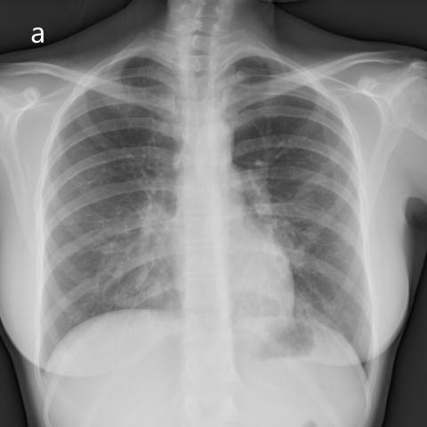

# M1：16568_8353800483171

D0 **B**；E **B**；ES **B**；参考 **B**。

[D0原回复](../../direct_qwen60/responses/16568_8353800483171_1.json) · [基准来源/原图](../../v12/results/cases/16568_8353800483171.md)

```text
Based on the chest radiographs in Figures 1a and 1b, which statement best describes the findings and their clinical significance in relation to the patient's condition?

A) The radiographs indicate unilateral alveolar infiltrates confined to the right lung's middle lobe, suggesting a localized infection.
B) The bilateral alveolar infiltrates are predominantly in the lower lobes and the middle lobe of the right lung, consistent with pulmonary alveolar proteinosis, despite the absence of restrictive impairment in pulmonary function tests.
C) The infiltrates are primarily observed in the upper lobes bilaterally, aligning with a pattern suggestive of pulmonary edema.
D) The X-rays show no significant infiltrates, indicating a possible error in clinical correlation.
E) The infiltrates are diffuse and homogeneously distributed across all lung lobes, indicating acute respiratory distress syndrome.
F) The radiographs reveal alveolar infiltrates only in the left lower lobe, suggesting lipoid pneumonia.
```




## E

[请求/原回复/检索/反馈/反思/更新](../traces/eval/16568_8353800483171_E.json) · [作答前真实可见记忆](../memory/visible/16568_8353800483171_E.json)

实际注入历史记忆：

```text
Historical example 1 (modality CXR): Pattern: explicit clinical situation; Earlier choice: Pulmonary hypertension secondary to sarcoidosis, suggested by enlarged pulmonary arteries [truncated]; Corrected interpretation: Pulmonary hypertension secondary to sarcoidosis, suggested by enlarged pulmonary arteries and right ventricular hypertrophy.; Earlier distinction: Correct selection of pulmonary hypertension over edema, COPD, pneumonia, effusion, [truncated]; Difference: Right ventricular enlargement (lateral view: posterior heart displacement + convex left retrosternal space) and enlarged central pulmonary arteries [truncated]; Inspect: On lateral CXR, inspect retrosternal clear space for convexity indicating RV enlargement; on PA, assess pulmonary artery size relative to aorta and absence of Kerley [truncated]; Basis: image: RV enlargement visible on lateral [truncated]; Limit: No clinical history (e.g., ACE, LFTs, biopsy), no CT confirmation; sarcoidosis cannot be diagnosed radiographically alone.
Historical example 2 (modality CXR): Pattern: unilateral diffuse opacification with air bronchograms and minimal effusion; Earlier choice: Consolidation in the right upper, middle, and lower lobes is [truncated]; Corrected interpretation: Consolidation in the right upper, middle, and lower lobes is causing air bronchograms, with a small pleural effusion also present.; Earlier distinction: Correct selection of C over A, B, D, E, F [truncated]; Difference: Air bronchograms visible throughout right lung field (PA and lateral) indicate parenchymal consolidation across all three lobes; no [truncated]; Inspect: On PA CXR, trace the opacity from apex to costophrenic angle and confirm continuity across upper/middle/lower zones; on lateral view, verify that opacity spans anterior [truncated]; Basis: image: Diffuse right lung opacification with [truncated]; Limit: No clinical history or temporal data; lateral view slightly overpenetrated but sufficient for lobar assessment.
Historical example 3 (modality CXR): Pattern: supported distribution; Earlier choice: Patchy multifocal opacities and nodules of various sizes, predominantly in [truncated]; Corrected interpretation: Patchy multifocal opacities and nodules of various sizes, predominantly in both lower lobes.; Earlier distinction: the historical alternative selected and confirmed correct; Difference: the historical alternative describes patchy multifocal opacities/nodules in both lower lobes; image shows bilateral, predominantly basilar, ill-defined opacities [truncated]; Inspect: On PA CXR, assess lobar distribution of nodular/patchy opacities: confirm bilateral basilar predominance and absence of upper-lobe cavitation or homogenous consolidation; Basis: image: bilateral basilar patchy opacities with [truncated]; Limit: Original historical reasoning was not retained; only the saved choice is known. No clinical history, lateral view, or [truncated].
```

本题提交后的原回复：

```text
Answer: B) The bilateral alveolar infiltrates are predominantly in the lower lobes and the middle lobe of the right lung, consistent with pulmonary alveolar proteinosis, despite the absence of restrictive impairment in pulmonary function tests.

Reason: Figure 1a (PA view) shows bilateral, symmetric, hazy alveolar opacities with relative sparing of the upper lobes and prominent involvement of the lower zones; the right middle lobe is also involved (opacity extending to the right heart border). Figure 1b (lateral view) confirms basilar predominance with opacities concentrated posteriorly and inferiorly, and a “bat-wing” or perihilar-sparing pattern is not present—instead, the distribution matches the classic “crazy-paving”-associated appearance of pulmonary alveolar proteinosis (though crazy-paving itself isn’t visible on CXR, the bilateral basilar-predominant alveolar infiltrates are characteristic). No air bronchograms suggest non-infectious etiology; option B is the only one matching this distribution and offering a plausible diagnosis.
```

提交时间：2026-10-31T15:58:49.944818+00:00；本病例反馈时间：2026-10-31T15:58:55.614375+00:00，反馈释放位置20。当前/未来病例未进入本次记忆投影。

## ES

[请求/原回复/检索/反馈/反思/更新](../traces/eval/16568_8353800483171_ES.json) · [作答前真实可见记忆](../memory/visible/16568_8353800483171_ES.json)

实际注入历史记忆：

```text
Historical example 1 (modality CXR): Pattern: explicit clinical situation; Earlier choice: Pulmonary hypertension secondary to sarcoidosis, suggested by enlarged pulmonary arteries [truncated]; Corrected interpretation: Pulmonary hypertension secondary to sarcoidosis, suggested by enlarged pulmonary arteries and right ventricular hypertrophy.; Earlier distinction: Correct selection of pulmonary hypertension over edema, COPD, pneumonia, effusion, [truncated]; Difference: Right ventricular enlargement (lateral view: posterior heart displacement + convex left retrosternal space) and enlarged central pulmonary arteries [truncated]; Inspect: On lateral CXR, inspect retrosternal clear space for convexity indicating RV enlargement; on PA, assess pulmonary artery size relative to aorta and absence of Kerley [truncated]; Basis: image: RV enlargement visible on lateral [truncated]; Limit: No clinical history (e.g., ACE, LFTs, biopsy), no CT confirmation; sarcoidosis cannot be diagnosed radiographically alone.
Historical example 2 (modality CXR): Pattern: unilateral diffuse opacification with air bronchograms and minimal effusion; Earlier choice: Consolidation in the right upper, middle, and lower lobes is [truncated]; Corrected interpretation: Consolidation in the right upper, middle, and lower lobes is causing air bronchograms, with a small pleural effusion also present.; Earlier distinction: Correct selection of C over A, B, D, E, F [truncated]; Difference: Air bronchograms visible throughout right lung field (PA and lateral) indicate parenchymal consolidation across all three lobes; no [truncated]; Inspect: On PA CXR, trace the opacity from apex to costophrenic angle and confirm continuity across upper/middle/lower zones; on lateral view, verify that opacity spans anterior [truncated]; Basis: image: Diffuse right lung opacification with [truncated]; Limit: No clinical history or temporal data; lateral view slightly overpenetrated but sufficient for lobar assessment.
Historical example 3 (modality CXR): Pattern: immunocompromised patient with bilateral patchy opacities; Earlier choice: Multifocal patchy opacities with central distribution and right middle lobe [truncated]; Corrected interpretation: Multifocal patchy opacities with central distribution and right middle lobe consolidation, consistent with pneumocystis jirovecii pneumonia in an immunocompromised patient.; Earlier distinction: Correct selection of C over B and D based on [truncated]; Difference: the historical alternative describes peripheral ground-glass (HP), but images show opacities silhouetting right heart border (PA) and anterior-inferior [truncated]; Inspect: On PA CXR, check if opacity abuts right heart border; on lateral, verify anterior-inferior opacity overlapping cardiac silhouette and diaphragm dome to confirm right middle [truncated]; Basis: image: Right heart border silhouetting on [truncated]; Limit: No clinical history provided; image resolution limits fine pattern discrimination (e.g., true ground-glass vs. subtle consolidation).
Conditional procedure 1: when When a right-sided lower lung opacity merges with the right heart border on PA CXR and the right costophrenic angle [truncated], inspect Inspect lateral CXR for anterior-inferior opacity overlapping the cardiac silhouette and diaphragm dome; if present, localize to right lower lobe abutting heart and diaphragm; limitation: Unreliable if lateral view is rotated or overpenetrated; does not distinguish tumor from consolidation [truncated].
Conditional procedure 2: when When PA CXR shows enlarged central pulmonary arteries and cardiomegaly with right heart border prominence, and symptoms suggest chronic dyspnea, inspect Inspect lateral CXR for convex retrosternal clear space and posterior displacement of heart—signs of right ventricular hypertrophy—and exclude left-sided volume overload signs (e.g., upper lobe vessel [truncated]; limitation: Unreliable in poor inspiration or scoliosis; does not differentiate etiology of PH (e.g., sarcoid [truncated].
```

本题提交后的原回复：

```text
Answer: B) The bilateral alveolar infiltrates are predominantly in the lower lobes and the middle lobe of the right lung, consistent with pulmonary alveolar proteinosis, despite the absence of restrictive impairment in pulmonary function tests.

Reason: Figure 1a (PA view) shows bilateral, symmetric, hazy alveolar opacities with relative sparing of the apices and greater density in the lower and mid-zones; the right heart border is partially silhouetted, suggesting right middle lobe involvement. Figure 1b (lateral view) confirms anterior-inferior opacity overlapping the cardiac silhouette and diaphragm dome—consistent with right middle and lower lobe consolidation—and diffuse posterior lower lobe opacities. This “bat-wing” or “butterfly” pattern, especially with preserved upper zones and bilateral symmetry, is classic for pulmonary alveolar proteinosis, distinguishing it from edema (which typically shows upper-lobe vessel redistribution), ARDS (more diffuse/homogeneous with air bronchograms), or unilateral processes.
```

提交时间：2026-10-31T15:58:55.609897+00:00；本病例反馈时间：2026-10-31T15:58:55.614375+00:00，反馈释放位置20。当前/未来病例未进入本次记忆投影。

