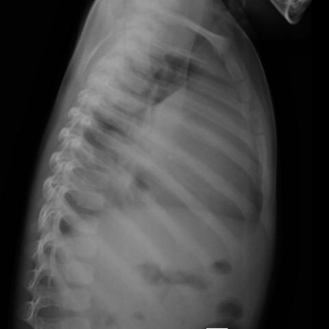

# M1：17132_8143559675802

D0 **B**；E **B**；ES **B**；参考 **B**。

[D0原回复](../../direct_qwen60/responses/17132_8143559675802_1.json) · [基准来源/原图](../../v12/results/cases/17132_8143559675802.md)

```text
Based on the chest radiograph findings and the clinical presentation, which of the following is the most likely diagnosis, considering the obscuration of the left heart border, significant cardio-mediastinal shift to the right, and mediastinal widening observed in the chest X-ray (Figures 1 and 2)?

A) Left lower lobe pneumonia
B) T-cell acute lymphoblastic leukemia/lymphoma
C) Pulmonary tuberculosis
D) Primary lung carcinoma
E) Left-sided pleural effusion
F) Hodgkin’s lymphoma
```




## E

[请求/原回复/检索/反馈/反思/更新](../traces/eval/17132_8143559675802_E.json) · [作答前真实可见记忆](../memory/visible/17132_8143559675802_E.json)

实际注入历史记忆：

```text
Historical example 1 (modality CXR): Pattern: mediastinal mass with bilateral pleural effusions; Earlier choice: The mediastinal mass is predominantly located on the right side [truncated]; Corrected interpretation: The mediastinal mass is predominantly located on the left side, and the pleural effusion is more pronounced on the right side.; Earlier distinction: chosen A (right mass, left effusion) but reference is C [truncated]; Difference: saved reasoning cited right-sided mass (loss of right heart border, tracheal deviation left) and greater left effusion; reference [truncated]; Inspect: On PA CXR, assess which heart border is lost (left vs right) and direction of tracheal deviation relative to mediastinal shift; correlate with costophrenic angle [truncated]; Basis: image: Figure 2 shows left heart [truncated]; Limit: No lateral view provided; tracheal deviation assessment limited by image quality; no prior films for comparison..
Historical example 2 (modality CXR): Pattern: silhouette sign in right lower lung zone with diaphragm/heart border merging; Earlier choice: The mass is situated in the right lower lung zone, [truncated]; Corrected interpretation: The mass is situated in the right lower lung zone, merging with the right heart border, and silhouettes the right hemidiaphragm anteriorly.; Earlier distinction: correct selection of B based on right heart border loss [truncated]; Difference: the historical alternative uniquely specifies right lower zone + right heart border merging + anterior hemidiaphragm silhouetting; A [truncated]; Inspect: On PA CXR, identify which cardiac border is lost (right border loss → right lower lobe pathology) and whether the costophrenic angle is obscured anteriorly [truncated]; Basis: image: unverified visual observation: right lower [truncated]; Limit: Images lack scale markers or clinical history; lateral view resolution limits precise diaphragm contour assessment; no temporal data [truncated].
Historical example 3 (modality CXR): Pattern: explicit clinical situation; Earlier choice: The mass is located in the right cardiophrenic angle, is [truncated]; Corrected interpretation: The mass is located in the right cardiophrenic angle, is large, and suggests a Morgagni hernia.; Earlier distinction: correct selection of B (right cardiophrenic angle, large, Morgagni hernia); Difference: Morgagni hernias occur anteriorly through the sternocostal triangle, typically right-sided; Bochdalek is posterolateral and usually left-sided. The mass [truncated]; Inspect: On PA CXR, inspect whether the opacity silhouettes the right heart border *and* lies below the level of the aortic arch, with sharp lateral margin [truncated]; Basis: image: unverified visual observation: opacity in [truncated]; Limit: Original historical reasoning was not retained; only the saved choice is known. Image resolution limits assessment of air-fluid [truncated].
```

本题提交后的原回复：

```text
Answer: B) T-cell acute lymphoblastic leukemia/lymphoma  
Reason: The PA view (Figure 1) shows obscuration of the left heart border, marked mediastinal widening, and rightward cardio-mediastinal shift—classic for a large anterior mediastinal mass compressing and displacing structures; the lateral view (Figure 2) confirms a bulky anterior mediastinal opacity without lung consolidation or pleural fluid, favoring lymphoproliferative disease like T-ALL/lymphoma over pneumonia, TB, carcinoma, or effusion.
```

提交时间：2026-10-31T16:00:11.367378+00:00；本病例反馈时间：2026-10-31T16:00:15.235945+00:00，反馈释放位置23。当前/未来病例未进入本次记忆投影。

## ES

[请求/原回复/检索/反馈/反思/更新](../traces/eval/17132_8143559675802_ES.json) · [作答前真实可见记忆](../memory/visible/17132_8143559675802_ES.json)

实际注入历史记忆：

```text
Historical example 1 (modality CXR): Pattern: mediastinal mass with bilateral pleural effusions; Earlier choice: The mediastinal mass is predominantly located on the right side [truncated]; Corrected interpretation: The mediastinal mass is predominantly located on the left side, and the pleural effusion is more pronounced on the right side.; Earlier distinction: chosen A (right mass, left effusion) but reference is C [truncated]; Difference: saved reasoning cited right-sided mass (loss of right heart border, tracheal deviation left) and greater left effusion; reference [truncated]; Inspect: On PA CXR, assess which heart border is lost (left vs right) and direction of tracheal deviation relative to mediastinal shift; correlate with costophrenic angle [truncated]; Basis: image: Figure 2 shows left heart [truncated]; Limit: No lateral view provided; tracheal deviation assessment limited by image quality; no prior films for comparison..
Historical example 2 (modality CXR): Pattern: silhouette sign in right lower lung zone with diaphragm/heart border merging; Earlier choice: The mass is situated in the right lower lung zone, [truncated]; Corrected interpretation: The mass is situated in the right lower lung zone, merging with the right heart border, and silhouettes the right hemidiaphragm anteriorly.; Earlier distinction: correct selection of B based on right heart border loss [truncated]; Difference: the historical alternative uniquely specifies right lower zone + right heart border merging + anterior hemidiaphragm silhouetting; A [truncated]; Inspect: On PA CXR, identify which cardiac border is lost (right border loss → right lower lobe pathology) and whether the costophrenic angle is obscured anteriorly [truncated]; Basis: image: unverified visual observation: right lower [truncated]; Limit: Images lack scale markers or clinical history; lateral view resolution limits precise diaphragm contour assessment; no temporal data [truncated].
Historical example 3 (modality CXR): Pattern: explicit clinical situation; Earlier choice: The mass is located in the right cardiophrenic angle, is [truncated]; Corrected interpretation: The mass is located in the right cardiophrenic angle, is large, and suggests a Morgagni hernia.; Earlier distinction: correct selection of B (right cardiophrenic angle, large, Morgagni hernia); Difference: Morgagni hernias occur anteriorly through the sternocostal triangle, typically right-sided; Bochdalek is posterolateral and usually left-sided. The mass [truncated]; Inspect: On PA CXR, inspect whether the opacity silhouettes the right heart border *and* lies below the level of the aortic arch, with sharp lateral margin [truncated]; Basis: image: unverified visual observation: opacity in [truncated]; Limit: Original historical reasoning was not retained; only the saved choice is known. Image resolution limits assessment of air-fluid [truncated].
Conditional procedure 1: when When mediastinal opacity obscures one heart border and tracheal deviation is present on PA CXR, inspect Inspect which cardiac border is silhouetted (left border loss = left mediastinal pathology; right border loss = right-sided) and confirm tracheal deviation direction—deviation away from mass [truncated]; limitation: Unreliable if both borders obscured or in severe cardiomegaly; requires adequate inspiration and centering..
Conditional procedure 2: when When a right-sided lower lung opacity merges with the right heart border on PA CXR and the right costophrenic angle [truncated], inspect Inspect lateral CXR for anterior-inferior opacity overlapping the cardiac silhouette and diaphragm dome; if present, localize to right lower lobe abutting heart and diaphragm; limitation: Unreliable if lateral view is rotated or overpenetrated; does not distinguish tumor from consolidation [truncated].
```

本题提交后的原回复：

```text
Answer: B) T-cell acute lymphoblastic leukemia/lymphoma  
Reason: The PA view (Figure 1) shows obscuration of the left heart border, marked rightward cardio-mediastinal shift, and mediastinal widening—classic for a large anterior mediastinal mass compressing and displacing structures; the lateral view (Figure 2) confirms a bulky anterior mediastinal opacity silhouetting the cardiac silhouette and extending from the thoracic inlet downward, highly suggestive of thymic involvement in T-cell ALL/lymphoma, especially in a pediatric-appearing chest.
```

提交时间：2026-10-31T16:00:15.231369+00:00；本病例反馈时间：2026-10-31T16:00:15.235945+00:00，反馈释放位置23。当前/未来病例未进入本次记忆投影。

