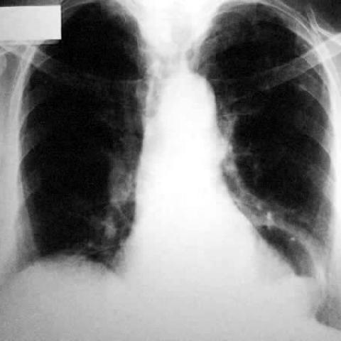

# M1：1975_8353802257622

D0 **B**；E **B**；ES **B**；参考 **B**。

[D0原回复](../../direct_qwen60/responses/1975_8353802257622_1.json) · [基准来源/原图](../../v12/results/cases/1975_8353802257622.md)

```text
Based on the chest X-ray in Figure 1, which of the following statements best describes the characteristics and relationships of the cystic lesion and irregular mass in the left paracardiac area that are consistent with a mixed-type hiatal hernia?
A) The cystic lesion is centrally located and directly compresses the heart, while the irregular mass is entirely below the diaphragm, suggesting a paraoesophageal hernia.
B) The cystic lesion has a smooth margin and is located superior to the irregular mass, which extends from the mediastinal area to the left paracardiac area, consistent with a mixed-type hiatal hernia.
C) The irregular mass is located above the cystic lesion and does not extend to the mediastinal area, indicating a sliding hernia.
D) Both the cystic lesion and the irregular mass are entirely within the right hemithorax, unrelated to a hiatal hernia.
E) The cystic lesion is irregular and located inferiorly, with the mass positioned superiorly in the left lung apex, suggesting a pulmonary cystic lesion.
F) The irregular mass is centrally located, and the cystic lesion is found bilaterally, consistent with a diaphragmatic hernia.
```



## E

[请求/原回复/检索/反馈/反思/更新](../traces/eval/1975_8353802257622_E.json) · [作答前真实可见记忆](../memory/visible/1975_8353802257622_E.json)

实际注入历史记忆：

```text
Historical example 1 (modality CXR): Pattern: mediastinal mass in midline near carina on PA and lateral views; Earlier choice: Bronchogenic cyst; Corrected interpretation: Cystic lymphangioma; Earlier distinction: chosen D (bronchogenic cyst) but reference the historical alternative (cystic [truncated]; Difference: Cystic lymphangioma often presents as a multilocular, lobulated mass with septations; bronchogenic cyst is typically unilocular and smooth. [truncated]; Inspect: On lateral CXR, inspect for lobulation/septation and posterior mediastinal extension: multilocularity and posterior location favor cystic lymphangioma over bronchogenic cyst.; Basis: image: Lateral view shows a lobulated, [truncated]; Limit: No CT confirmation; CXR lacks soft-tissue resolution to definitively assess septation; age of patient unknown (lymphangioma more common [truncated].
Historical example 2 (modality CXR): Pattern: recurrent localized consolidation after antibiotic response in smoker; Earlier choice: The recurrent pneumonia is caused by bronchogenic carcinoma.; Corrected interpretation: The recurrent pneumonia is due to an endobronchial fibrolipoma causing obstruction.; Earlier distinction: chosen F (carcinoma) but reference the historical alternative (fibrolipoma); Difference: Both carcinoma and fibrolipoma cause obstructive pneumonia; distinction requires visual evidence of lesion morphology (e.g., smooth, well-circumscribed endobronchial [truncated]; Inspect: On follow-up imaging, inspect the hilar opacity for smooth, rounded, mobile-appearing intraluminal mass on lateral view or CT—fibrolipomas often appear as pedunculated, fat-density lesions; carcinoma [truncated]; Basis: image: unverified visual observation: right hilar [truncated]; Limit: CXR lacks resolution to distinguish endobronchial tumor types; no CT or histology provided; reference answer unsupported by visible [truncated].
Historical example 3 (modality CXR): Pattern: progression of RUL lesion with cavitation over time; Earlier choice: The lesion is due to tuberculosis with cavitation.; Corrected interpretation: The lesion suggests a primary lung cancer with necrosis and cavitation.; Earlier distinction: selected the historical alternative (TB) but reference the historical alternative [truncated]; Difference: No visible satellite lesions or upper-lobe apical predominance typical of TB; cavity appears irregular, thick-walled, and associated with [truncated]; Inspect: In progressive cavitary RUL lesions, inspect cavity wall thickness (>15 mm suggests malignancy), margin regularity, and presence of a surrounding soft-tissue mass vs. diffuse consolidation.; Basis: image: Figure 1a: dense RUL infiltrate; [truncated]; Limit: No clinical history (e.g., smoking, weight loss), no timeline between images, no lateral view to assess retrosternal clear [truncated].
```

本题提交后的原回复：

```text
Answer: B) The cystic lesion has a smooth margin and is located superior to the irregular mass, which extends from the mediastinal area to the left paracardiac area, consistent with a mixed-type hiatal hernia.

Reason: The CXR shows a well-defined, smooth, radiolucent (cystic-appearing) structure in the left paracardiac region, superior to a more opaque, irregular soft-tissue density that straddles the mediastinum and extends leftward—matching the classic appearance of a mixed hiatal hernia (gastric fundus above diaphragm + paraesophageal component). Other options misassign laterality, location, or morphology inconsistent with the image.
```

提交时间：2026-10-31T16:03:59.032695+00:00；本病例反馈时间：2026-10-31T16:04:03.354864+00:00，反馈释放位置31。当前/未来病例未进入本次记忆投影。

## ES

[请求/原回复/检索/反馈/反思/更新](../traces/eval/1975_8353802257622_ES.json) · [作答前真实可见记忆](../memory/visible/1975_8353802257622_ES.json)

实际注入历史记忆：

```text
Historical example 1 (modality CXR): Pattern: mediastinal mass in midline near carina on PA and lateral views; Earlier choice: Bronchogenic cyst; Corrected interpretation: Cystic lymphangioma; Earlier distinction: chosen D (bronchogenic cyst) but reference the historical alternative (cystic [truncated]; Difference: Cystic lymphangioma often presents as a multilocular, lobulated mass with septations; bronchogenic cyst is typically unilocular and smooth. [truncated]; Inspect: On lateral CXR, inspect for lobulation/septation and posterior mediastinal extension: multilocularity and posterior location favor cystic lymphangioma over bronchogenic cyst.; Basis: image: Lateral view shows a lobulated, [truncated]; Limit: No CT confirmation; CXR lacks soft-tissue resolution to definitively assess septation; age of patient unknown (lymphangioma more common [truncated].
Historical example 2 (modality CXR): Pattern: progression of RUL lesion with cavitation over time; Earlier choice: The lesion is due to tuberculosis with cavitation.; Corrected interpretation: The lesion suggests a primary lung cancer with necrosis and cavitation.; Earlier distinction: selected the historical alternative (TB) but reference the historical alternative [truncated]; Difference: No visible satellite lesions or upper-lobe apical predominance typical of TB; cavity appears irregular, thick-walled, and associated with [truncated]; Inspect: In progressive cavitary RUL lesions, inspect cavity wall thickness (>15 mm suggests malignancy), margin regularity, and presence of a surrounding soft-tissue mass vs. diffuse consolidation.; Basis: image: Figure 1a: dense RUL infiltrate; [truncated]; Limit: No clinical history (e.g., smoking, weight loss), no timeline between images, no lateral view to assess retrosternal clear [truncated].
Historical example 3 (modality CXR): Pattern: serial CXR comparison for pulmonary lesion evolution; Earlier choice: The nodular lesions have decreased in size in all lobes, [truncated]; Corrected interpretation: The nodular lesions have transformed into fibrotic striae in the right upper lobe, indicating healing and resolution.; Earlier distinction: Saved response selected the historical alternative (size reduction), but reference [truncated]; Difference: C relies on perceived size/density decrease; E requires identification of linear, reticular, low-density opacities replacing nodules—indicating fibrosis rather [truncated]; Inspect: On follow-up CXR, inspect right upper lobe for transition from discrete nodular opacities to thin, irregular linear densities (fibrotic striae) with preserved lung volume and [truncated]; Basis: image: unverified visual observation (images lack [truncated]; Limit: Image resolution too low to distinguish fibrotic striae from residual nodules; no clinical history or prior imaging context; [truncated].
Conditional procedure 1: when When CXR shows a new or enlarging cavitary lesion in the upper lobe with irregular thick wall (>15 mm) and [truncated], inspect Inspect for mass effect (mediastinal shift, hilum displacement), wall thickness on magnified view, and absence of satellite nodules; consider malignancy over TB; limitation: Unreliable if image quality poor or no prior imaging for comparison.
Conditional procedure 2: when When mediastinal opacity obscures one heart border and tracheal deviation is present on PA CXR, inspect Inspect which cardiac border is silhouetted (left border loss = left mediastinal pathology; right border loss = right-sided) and confirm tracheal deviation direction—deviation away from mass [truncated]; limitation: Unreliable if both borders obscured or in severe cardiomegaly; requires adequate inspiration and centering..
```

本题提交后的原回复：

```text
Answer: B) The cystic lesion has a smooth margin and is located superior to the irregular mass, which extends from the mediastinal area to the left paracardiac area, consistent with a mixed-type hiatal hernia.

Reason: The CXR shows a well-defined, smooth, radiolucent (cystic-appearing) opacity in the left paracardiac region, superior to a more heterogeneous, irregular soft-tissue density that straddles the mediastinum and extends toward the left heart border—consistent with a mixed hiatal hernia containing both gastric fundus (cystic gas-filled component) and omental/fat/visceral tissue (irregular mass). No evidence supports right-sided, bilateral, or pulmonary origin.
```

提交时间：2026-10-31T16:04:03.350824+00:00；本病例反馈时间：2026-10-31T16:04:03.354864+00:00，反馈释放位置31。当前/未来病例未进入本次记忆投影。

