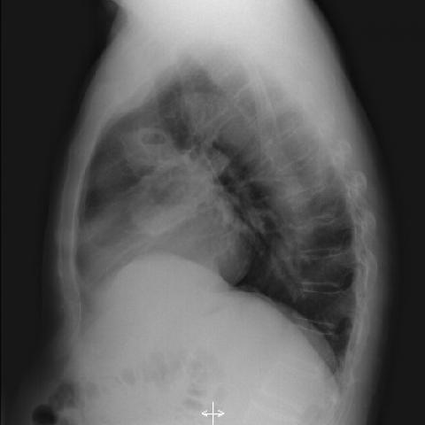

# M1：2243_8353801511231

D0 **C**；E **C**；ES **C**；参考 **C**。

[D0原回复](../../direct_qwen60/responses/2243_8353801511231_1.json) · [基准来源/原图](../../v12/results/cases/2243_8353801511231.md)

```text
Based on the chest X-ray findings in Figure 1a and Figure 1b, which of the following best explains the radiographic features that support the diagnosis of Wegener's granulomatosis in this patient?
A) The presence of bilateral pleural effusions, which are common in Wegener's granulomatosis.
B) Solitary nodular mass with smooth margins, typical of Wegener's granulomatosis.
C) Multiple nodular masses with irregular margins and cavitation in the right lung, consistent with necrotising granulomatous vasculitis.
D) Diffuse bilateral interstitial infiltrates, which are a hallmark of Wegener's granulomatosis.
E) Left lung involvement with dense consolidation and air bronchograms, indicating Wegener's granulomatosis.
F) Mediastinal lymphadenopathy, which is a common finding in Wegener's granulomatosis.
```




## E

[请求/原回复/检索/反馈/反思/更新](../traces/eval/2243_8353801511231_E.json) · [作答前真实可见记忆](../memory/visible/2243_8353801511231_E.json)

实际注入历史记忆：

```text
Historical example 1 (modality CXR): Pattern: serial imaging showing resolution of multiple peripheral pulmonary nodules; Earlier choice: The pulmonary nodules have decreased in size and number post-antibiotic [truncated]; Corrected interpretation: The pulmonary nodules have decreased in size and number post-antibiotic therapy, with resolution of cavitations, consistent with septic emboli.; Earlier distinction: Correct selection of B based on visible resolution of nodules [truncated]; Difference: Figure 1 shows multiple discrete opacities (red arrows) in mid-to-lower lung zones; Figure 7 shows clear lung fields [truncated]; Inspect: When comparing serial CXRs, inspect for presence/absence of peripheral nodules and cavitations; assess change in number, size, and density across timepoints; Basis: image: Red arrows in Figure 1 [truncated]; Limit: No clinical history, timing, or microbiology; cannot confirm septic emboli definitively without source identification.
Historical example 2 (modality CXR): Pattern: unilateral basal opacity in asymptomatic patient with acute neurological symptoms; Earlier choice: A homogeneously dense, sharply outlined mass consistent with a vascular [truncated]; Corrected interpretation: A smoothly contoured, calcified lesion suggesting a benign granuloma, incidental to the patient's acute neurological symptoms.; Earlier distinction: the historical alternative (vascular anomaly) was selected but reference the [truncated]; Difference: Reference diagnosis implies calcification and smooth contour—key discriminators absent in E’s description; E incorrectly links mass to congenital [truncated]; Inspect: On PA CXR, inspect the right basal lesion for internal calcification (high-density speckles/rim) and margin smoothness vs. irregularity; correlate with lateral view if available to [truncated]; Basis: image: Right basal opacity visible (arrow), [truncated]; Limit: Original historical reasoning was not retained; only the saved choice is known. Image resolution insufficient to confirm calcification [truncated].
Historical example 3 (modality CXR): Pattern: large right hemithorax opacity with mediastinal shift; Earlier choice: Pleural effusion; Corrected interpretation: Well-differentiated liposarcoma; Earlier distinction: chosen pleural effusion (D) vs reference well-differentiated liposarcoma (B); Difference: Saved reasoning cited blunting of costophrenic angle, meniscus, and absence of discrete mass margin—features supporting effusion; however, reference [truncated]; Inspect: On CXR, inspect for subtle radiolucency within the opacity suggesting fat content; if ambiguous, require CT to confirm fat density (>−50 HU) and exclude effusion.; Basis: image: unverified visual observation: large homogeneous [truncated]; Limit: No CT available; CXR cannot reliably distinguish large effusion from fatty tumor; reference explanation missing; mediastinal shift direction [truncated].
```

本题提交后的原回复：

```text
Answer: C) Multiple nodular masses with irregular margins and cavitation in the right lung, consistent with necrotising granulomatous vasculitis.  
Reason: Figure 1a shows multiple ill-defined, irregularly margined opacities in the right lung, with a central lucency suggesting cavitation; Figure 1b (lateral view) confirms these are parenchymal nodules rather than pleural or mediastinal, matching classic radiographic features of Wegener’s granulomatosis (now GPA).
```

提交时间：2026-10-31T16:04:20.561602+00:00；本病例反馈时间：2026-10-31T16:04:25.347588+00:00，反馈释放位置32。当前/未来病例未进入本次记忆投影。

## ES

[请求/原回复/检索/反馈/反思/更新](../traces/eval/2243_8353801511231_ES.json) · [作答前真实可见记忆](../memory/visible/2243_8353801511231_ES.json)

实际注入历史记忆：

```text
Historical example 1 (modality CXR): Pattern: serial imaging showing regression of pulmonary opacities; Earlier choice: The pulmonary nodules have decreased in size and number post-antibiotic [truncated]; Corrected interpretation: The pulmonary nodules have decreased in size and number post-antibiotic therapy, with resolution of cavitations, consistent with septic emboli.; Earlier distinction: Correct selection of B based on visible resolution of nodules/cavitations [truncated]; Difference: Figure 1 shows multiple discrete opacities (red arrows) in mid-lung zones and costophrenic angles; Figure 7 shows clear [truncated]; Inspect: Compare paired CXRs for presence/absence of discrete nodules and cavitations; specifically inspect costophrenic angles and mid-lung zones for residual scarring or volume loss to distinguish [truncated]; Basis: image: Unverified visual observation: Figure 1 [truncated]; Limit: No temporal labels, clinical history, or microbiologic data; cannot confirm antibiotic use or septic source from images alone.
Historical example 2 (modality CXR): Pattern: unilateral basal opacity in asymptomatic patient with acute neurological symptoms; Earlier choice: A homogeneously dense, sharply outlined mass consistent with a vascular [truncated]; Corrected interpretation: A smoothly contoured, calcified lesion suggesting a benign granuloma, incidental to the patient's acute neurological symptoms.; Earlier distinction: the historical alternative (vascular anomaly) was selected but reference the [truncated]; Difference: Reference diagnosis implies calcification and smooth contour—key discriminators absent in E’s description; E incorrectly links mass to congenital [truncated]; Inspect: On PA CXR, inspect the right basal lesion for internal calcification (high-density speckles/rim) and margin smoothness vs. irregularity; correlate with lateral view if available to [truncated]; Basis: image: Right basal opacity visible (arrow), [truncated]; Limit: Original historical reasoning was not retained; only the saved choice is known. Image resolution insufficient to confirm calcification [truncated].
Historical example 3 (modality CXR): Pattern: supported distribution; Earlier choice: The presence of bilateral nodular opacities predominantly in the lower [truncated]; Corrected interpretation: The presence of bilateral nodular opacities predominantly in the lower lobes and diffuse interstitial thickening on the chest X-ray, combined with the patient's history, strongly supports a diagnosis of silicone embolism syndrome.; Earlier distinction: the historical alternative selected over A, D, E based on [truncated]; Difference: Bilateral nodular opacities *predominantly in lower lobes* + interstitial thickening—distinct from lobar consolidation (A), wedge-shaped PTE (D), or [truncated]; Inspect: In bilateral nodular/interstitial CXR, assess lobar distribution: lower-lobe predominance favors silicone embolism; upper/mid-lobe favors granulomatous or infectious causes; Basis: image: unverified visual observation (nodularity and [truncated]; Limit: No clinical history provided in input; image resolution insufficient to confirm lobar predominance or exclude superimposition; reference explanation [truncated].
Conditional procedure 1: when When bilateral symmetric coarse nodular opacities improve dramatically after immunosuppression (e.g., steroids), and cavitary or fibrotic features are absent, inspect Inspect for preservation of lung volumes and absence of traction bronchiectasis or reticulation on follow-up to distinguish acute hemorrhage resolution from chronic granulomatous/fibrotic disease regression; limitation: Requires adequate inspiration and comparable projection; unreliable if follow-up is CT misinterpreted as CXR.
Conditional procedure 2: when When CXR shows bilateral nodular opacities and hilar fullness, and symmetry is ambiguous on PA view, inspect Inspect lateral CXR for symmetrical anterior mediastinal lymphadenopathy (prevascular nodes) and compare hilar silhouette width left vs. right on PA; exclude unilateral volume loss or pleural [truncated]; limitation: Requires lateral view; unreliable if patient rotation or poor inspiration distorts hilar appearance.
```

本题提交后的原回复：

```text
Answer: C) Multiple nodular masses with irregular margins and cavitation in the right lung, consistent with necrotising granulomatous vasculitis.  
Reason: Figure 1a (PA view) shows multiple ill-defined, heterogeneous opacities in the right mid-to-lower lung with a central lucency suggestive of cavitation; Figure 1b (lateral view) confirms a mass-like opacity in the right middle lobe with irregular borders and internal lucency—classic for cavitary nodules in granulomatosis with polyangiitis (Wegener’s). Other options are inconsistent: no pleural effusions (A), not solitary or smooth (B), no diffuse interstitial infiltrates (D), left lung is relatively spared (E), and no mediastinal lymphadenopathy (F).
```

提交时间：2026-10-31T16:04:25.343185+00:00；本病例反馈时间：2026-10-31T16:04:25.347588+00:00，反馈释放位置32。当前/未来病例未进入本次记忆投影。

