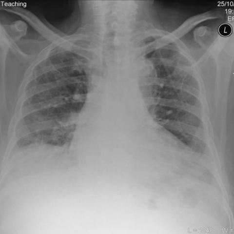

# M1：3397_8353801520783

D0 **C**；E **C**；ES **C**；参考 **C**。

[D0原回复](../../direct_qwen60/responses/3397_8353801520783_1.json) · [基准来源/原图](../../v12/results/cases/3397_8353801520783.md)

```text
Based on the chest X-ray findings in Figure 1, which of the following best describes the location and characteristics of the lung abnormalities observed, and how do they correlate with the patient's clinical presentation?
A) Bibasal reticulonodular shadowing with predominantly central distribution, suggesting pulmonary edema.
B) Upper lobe reticulonodular shadowing with cavitations, indicating possible pulmonary tuberculosis.
C) Bibasal interstitial reticulonodular shadowing with peripheral distribution, consistent with interstitial lung disease.
D) Diffuse alveolar opacities with ground glass appearance, typical of acute respiratory distress syndrome.
E) Unilateral upper lobe reticulonodular pattern, raising suspicion for a malignant process.
F) Central perihilar opacities with nodular characteristics, suggesting sarcoidosis.
```



## E

[请求/原回复/检索/反馈/反思/更新](../traces/eval/3397_8353801520783_E.json) · [作答前真实可见记忆](../memory/visible/3397_8353801520783_E.json)

实际注入历史记忆：

```text
Historical example 1 (modality CXR): Pattern: explicit clinical situation; Earlier choice: Multiple nodular masses with irregular margins and cavitation in the [truncated]; Corrected interpretation: Multiple nodular masses with irregular margins and cavitation in the right lung, consistent with necrotising granulomatous vasculitis.; Earlier distinction: correct selection of C over distractors A, B, D, E, [truncated]; Difference: Multiple ill-defined nodules with central lucency (cavitation) in right lung on PA (Fig 1a) and lateral (Fig 1b) [truncated]; Inspect: On CXR, inspect for multiple parenchymal nodules with irregular margins and central lucency; confirm they are not pleural/mediastinal using lateral view; Basis: image: unverified visual observation: right upper/mid [truncated]; Limit: No clinical history, labs, or temporal sequence; cavitation not definitively confirmed without CT; image resolution limits margin assessment.
Historical example 2 (modality CXR): Pattern: serial imaging in known primary pulmonary nodular amyloidosis; Earlier choice: Bilateral nodules with increase in number and size on the [truncated]; Corrected interpretation: Bilateral nodules with increase in number and size on the right side, accompanied by a transient left pleural effusion.; Earlier distinction: correct selection of B based on temporal evolution across CXRs [truncated]; Difference: the historical alternative uniquely matches observed increase in nodule number/size (especially right lung) and transient left pleural effusion [truncated]; Inspect: On serial CXRs, compare nodule count/size per lung field across timepoints and specifically check for presence/absence of pleural effusion at each date; correlate with CT [truncated]; Basis: image: Fig 5a shows left pleural [truncated]; Limit: Exact dates/timing of all images not fully visible; some figures are CT slices without orientation labels; no clinical [truncated].
Historical example 3 (modality CXR): Pattern: paraquat poisoning with serial imaging; Earlier choice: The initial chest X-ray reveals focal opacities that progress to [truncated]; Corrected interpretation: The initial chest X-ray reveals focal opacities that progress to diffuse reticular-nodular opacities with decreased lung volume.; Earlier distinction: Correct selection of C based on visible focal opacities in [truncated]; Difference: the historical alternative uniquely matches the observed transition from subtle focal (likely basilar) opacities to widespread reticular-nodular pattern [truncated]; Inspect: On initial CXR, inspect lower zones for faint hazy opacities with preserved diaphragmatic contour; on follow-up, assess for increased reticulation, nodularity, and reduced costophrenic angles/rib [truncated]; Basis: image: Figure 1: subtle basilar haze; [truncated]; Limit: No time interval between images; no lateral views to confirm posterior location or volume loss; image resolution limits [truncated].
```

本题提交后的原回复：

```text
Answer: C) Bibasal interstitial reticulonodular shadowing with peripheral distribution, consistent with interstitial lung disease.  
Reason: The CXR shows bilateral, predominantly basilar reticulonodular opacities that are more prominent peripherally and spare the central/hilar regions; there is no cavitation, pleural effusion, or alveolar consolidation to support TB, edema, ARDS, or malignancy.
```

提交时间：2026-10-31T16:05:33.824075+00:00；本病例反馈时间：2026-10-31T16:05:37.520007+00:00，反馈释放位置35。当前/未来病例未进入本次记忆投影。

## ES

[请求/原回复/检索/反馈/反思/更新](../traces/eval/3397_8353801520783_ES.json) · [作答前真实可见记忆](../memory/visible/3397_8353801520783_ES.json)

实际注入历史记忆：

```text
Historical example 1 (modality CXR): Pattern: explicit clinical situation; Earlier choice: Diffuse nodular opacities are predominantly located in the upper lung [truncated]; Corrected interpretation: Diffuse nodular opacities are predominantly located in the upper lung lobes with moderate bilateral hilar lymphadenopathy, which is consistent with stage 2 sarcoidosis.; Earlier distinction: correct selection of B over the competing alternatives based on [truncated]; Difference: the historical alternative claims lower-lobe predominance; images show reticulonodular opacities concentrated in upper/mid zones (PA and lateral views), [truncated]; Inspect: On PA CXR, assess relative density of nodules in upper vs. lower lung zones using the aortic arch and diaphragm as landmarks; on lateral CXR, [truncated]; Basis: image: upper/mid zone nodularity and bilateral [truncated]; Limit: No clinical history, spirometry, or ACE levels; image resolution limits precise nodule size assessment; lateral view slightly rotated [truncated].
Historical example 2 (modality CXR): Pattern: bilateral peripheral consolidations in mid/lower zones; Earlier choice: The consolidations are equally distributed in both mid and lower [truncated]; Corrected interpretation: The consolidations are equally distributed in both mid and lower zones of both lungs, correlating with severe COVID-19 pneumonia.; Earlier distinction: Correct selection of C over unilateral or upper-lobe–predominant options; Difference: Symmetric, patchy opacities involving both mid and lower zones bilaterally with relative upper lobe sparing—visible on PA (Fig [truncated]; Inspect: On PA CXR, assess zone-wise opacity density (upper/mid/lower) per lung; on lateral, verify if opacities lie anterior-inferior (lower lobe) or posterior (posterior segment), and whether [truncated]; Basis: image: Bilateral mid/lower zone opacities visible [truncated]; Limit: No clinical history or labs; reference explanation unavailable; cannot confirm COVID-19 etiology from imaging alone.
Historical example 3 (modality CXR): Pattern: serial imaging in known primary pulmonary nodular amyloidosis; Earlier choice: Bilateral nodules with increase in number and size on the [truncated]; Corrected interpretation: Bilateral nodules with increase in number and size on the right side, accompanied by a transient left pleural effusion.; Earlier distinction: correct selection of B based on temporal evolution across CXRs [truncated]; Difference: the historical alternative uniquely matches observed increase in nodule number/size (especially right lung) and transient left pleural effusion [truncated]; Inspect: On serial CXRs, compare nodule count/size per lung field across timepoints and specifically check for presence/absence of pleural effusion at each date; correlate with CT [truncated]; Basis: image: Fig 5a shows left pleural [truncated]; Limit: Exact dates/timing of all images not fully visible; some figures are CT slices without orientation labels; no clinical [truncated].
Conditional procedure 1: when When a right-sided lower lung opacity merges with the right heart border on PA CXR and the right costophrenic angle [truncated], inspect Inspect lateral CXR for anterior-inferior opacity overlapping the cardiac silhouette and diaphragm dome; if present, localize to right lower lobe abutting heart and diaphragm; limitation: Unreliable if lateral view is rotated or overpenetrated; does not distinguish tumor from consolidation [truncated].
Conditional procedure 2: when When CXR shows diffuse interstitial opacities and fissural thickening in a patient with systemic symptoms, and cardiac silhouette appears borderline [truncated], inspect Quantify cardiothoracic ratio (max transverse cardiac width / inner thoracic diameter); if ≥0.52, consider cardiomegaly and evaluate for pulmonary vascular redistribution or right heart enlargement signs; limitation: Inadequate inspiration inflates CT ratio; scoliosis distorts measurements.
```

本题提交后的原回复：

```text
Answer: C) Bibasal interstitial reticulonodular shadowing with peripheral distribution, consistent with interstitial lung disease.  
Reason: The CXR shows increased reticulonodular opacities concentrated in the lower lung zones (bibasal), sparing the upper lobes, and extending toward the periphery—visible as fine linear and nodular densities below the level of the diaphragm and away from the hila. This pattern matches option C and differs from upper-lobe–predominant (B, E), central/hilar (A, F), or diffuse alveolar (D) distributions.
```

提交时间：2026-10-31T16:05:37.515509+00:00；本病例反馈时间：2026-10-31T16:05:37.520007+00:00，反馈释放位置35。当前/未来病例未进入本次记忆投影。

