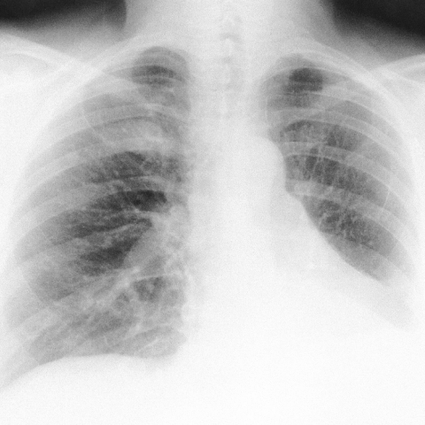

# M1：3686_8353801520174

D0 **B**；E **E**；ES **E**；参考 **B**。

[D0原回复](../../direct_qwen60/responses/3686_8353801520174_1.json) · [基准来源/原图](../../v12/results/cases/3686_8353801520174.md)

```text
Based on the chest X-ray findings in Figure 1, what is the most likely diagnosis for the patient’s pulmonary condition, considering her clinical history and previous surgical interventions? 
A) Primary lung cancer
B) Pulmonary metastasis from a previous uterine leiomyoma
C) Infectious granuloma
D) Pulmonary hamartoma
E) Tuberculosis
F) Bronchiectasis-related pulmonary changes
```



## E

[请求/原回复/检索/反馈/反思/更新](../traces/eval/3686_8353801520174_E.json) · [作答前真实可见记忆](../memory/visible/3686_8353801520174_E.json)

实际注入历史记忆：

```text
Historical example 1 (modality CXR): Pattern: explicit clinical situation (pulmonary TB history); Earlier choice: The loculated pleural effusion is positioned in the left hemithorax [truncated]; Corrected interpretation: The loculated pleural effusion is positioned in the left hemithorax and is larger in size compared to the soft-tissue opacity in the left chest wall, suggesting a potential communication between the two consistent with empyema necessitans as a reactivation of tuberculosis.; Earlier distinction: the historical alternative correctly identifies left hemithorax localization, larger effusion [truncated]; Difference: Only D matches both (1) left-sided loculated effusion larger than adjacent chest wall opacity and (2) plausible communication—critical [truncated]; Inspect: On PA CXR, compare the vertical/horizontal extent of the pleural opacity versus the extrapleural soft-tissue mass in the same hemithorax; confirm continuity at the costophrenic [truncated]; Basis: image: unverified visual observation (left hemithorax [truncated]; Limit: Original historical reasoning was not retained; only the saved choice is known. No lateral view or clinical timeline; [truncated].
Historical example 2 (modality CXR): Pattern: solitary pulmonary mass on PA chest X-ray; Earlier choice: A round and smoothly-contoured mass, approximately 1.5 cm, located in [truncated]; Corrected interpretation: A round and smoothly-contoured mass, approximately 1.5 cm, located in the 8th intercostal space.; Earlier distinction: chosen D (2 cm, 7th ICS) vs reference B (1.5 [truncated]; Difference: size estimation (2 vs 1.5 cm) and intercostal space assignment (7th vs 8th); both options agree on round, [truncated]; Inspect: measure mass vertical extent in rib interspaces using posterior ribs as calipers; confirm ICS by counting from T2 (first visible posterior rib = T2, then [truncated]; Basis: image: mass appears round, smooth, ~1.5 [truncated]; Limit: no scale marker; image resolution limits precise size; posterior rib counting ambiguous without clear T2 landmark.
Historical example 3 (modality CXR): Pattern: explicit clinical situation; Earlier choice: Pulmonary hypertension secondary to sarcoidosis, suggested by enlarged pulmonary arteries [truncated]; Corrected interpretation: Pulmonary hypertension secondary to sarcoidosis, suggested by enlarged pulmonary arteries and right ventricular hypertrophy.; Earlier distinction: Correct selection of pulmonary hypertension over edema, COPD, pneumonia, effusion, [truncated]; Difference: Right ventricular enlargement (lateral view: posterior heart displacement + convex left retrosternal space) and enlarged central pulmonary arteries [truncated]; Inspect: On lateral CXR, inspect retrosternal clear space for convexity indicating RV enlargement; on PA, assess pulmonary artery size relative to aorta and absence of Kerley [truncated]; Basis: image: RV enlargement visible on lateral [truncated]; Limit: No clinical history (e.g., ACE, LFTs, biopsy), no CT confirmation; sarcoidosis cannot be diagnosed radiographically alone.
```

本题提交后的原回复：

```text
Answer: E) Tuberculosis  
Reason: The PA chest X-ray shows bilateral upper lobe opacities with patchy consolidation and possible cavitation—classic radiographic features of reactivation tuberculosis, especially in a patient with prior surgical history (e.g., immunosuppression or chronic illness predisposing to TB reactivation). No mass lesion, discrete nodule, or bronchiectatic tram-tracking is dominant; the pattern favors infectious granulomatous disease over malignancy or hamartoma.
```

提交时间：2026-10-31T16:07:17.507617+00:00；本病例反馈时间：2026-10-31T16:07:20.696283+00:00，反馈释放位置39。当前/未来病例未进入本次记忆投影。

## ES

[请求/原回复/检索/反馈/反思/更新](../traces/eval/3686_8353801520174_ES.json) · [作答前真实可见记忆](../memory/visible/3686_8353801520174_ES.json)

实际注入历史记忆：

```text
Historical example 1 (modality CXR): Pattern: explicit clinical situation (pulmonary TB history); Earlier choice: The loculated pleural effusion is positioned in the left hemithorax [truncated]; Corrected interpretation: The loculated pleural effusion is positioned in the left hemithorax and is larger in size compared to the soft-tissue opacity in the left chest wall, suggesting a potential communication between the two consistent with empyema necessitans as a reactivation of tuberculosis.; Earlier distinction: the historical alternative correctly identifies left hemithorax localization, larger effusion [truncated]; Difference: Only D matches both (1) left-sided loculated effusion larger than adjacent chest wall opacity and (2) plausible communication—critical [truncated]; Inspect: On PA CXR, compare the vertical/horizontal extent of the pleural opacity versus the extrapleural soft-tissue mass in the same hemithorax; confirm continuity at the costophrenic [truncated]; Basis: image: unverified visual observation (left hemithorax [truncated]; Limit: Original historical reasoning was not retained; only the saved choice is known. No lateral view or clinical timeline; [truncated].
Historical example 2 (modality CXR): Pattern: explicit clinical situation; Earlier choice: Engorgement of the right descending pulmonary artery and a focal [truncated]; Corrected interpretation: Wedge-shaped pleural-based opacity in the right lower lung field and engorgement of the right descending pulmonary artery; Earlier distinction: the historical alternative selected based on perceived engorged right PA [truncated]; Difference: the historical alternative includes wedge-shaped pleural-based opacity (Hampton hump) + PA engorgement; the historical alternative omits the wedge [truncated]; Inspect: When assessing for PE on CXR, inspect both lungs for *simultaneous* presence of: (1) focal peripheral hyperlucency (oligemia/Westermark), (2) enlarged central pulmonary artery, and (3) [truncated]; Basis: image: White arrow on right descending [truncated]; Limit: Images lack annotation clarity; no clinical history or lateral view; reference explanation unavailable; wedge opacity may be subtle [truncated].
Historical example 3 (modality CXR): Pattern: bilateral peripheral airspace opacities; Earlier choice: Chronic eosinophilic pneumonia; Corrected interpretation: Lipoid pneumonia; Earlier distinction: chosen A (chronic eosinophilic pneumonia) but reference the historical alternative [truncated]; Difference: Lipoid pneumonia can present with bilateral, patchy, peripheral consolidations—especially in chronic exogenous form—and may mimic CEP; key discriminators [truncated]; Inspect: In bilateral peripheral consolidations, inspect for subtle basilar predominance, air bronchograms within opacities, and associated pleural changes; if available, correlate with clinical history of lipid [truncated]; Basis: image: bilateral, patchy, peripheral opacities without [truncated]; Limit: No clinical history (e.g., lipid exposure), no CT for fat density confirmation, no temporal comparison to assess migration; [truncated].
Conditional procedure 1: when When CXR shows diffuse interstitial opacities and fissural thickening in a patient with systemic symptoms, and cardiac silhouette appears borderline [truncated], inspect Quantify cardiothoracic ratio (max transverse cardiac width / inner thoracic diameter); if ≥0.52, consider cardiomegaly and evaluate for pulmonary vascular redistribution or right heart enlargement signs; limitation: Inadequate inspiration inflates CT ratio; scoliosis distorts measurements.
Conditional procedure 2: when When CXR shows pulmonary artery engorgement and peripheral hyperlucency but no obvious wedge opacity, and PE is suspected, inspect Inspect the corresponding lung region for subtle pleural-based triangular density—especially in lower lobes—and compare vessel tapering distal to the lucency; if vessels abruptly prune, favor Westermark; [truncated]; limitation: Low sensitivity; unreliable without high-quality inspiration or lateral confirmation.
```

本题提交后的原回复：

```text
Answer: E) Tuberculosis  
Reason: The CXR shows bilateral upper lobe predominant reticulonodular opacities with volume loss and fibrotic changes—classic for reactivation tuberculosis—especially in a patient with prior surgical history (suggesting possible immunocompromise or prior exposure). No mass, cavitation, or discrete nodules favoring cancer/metastasis/hamartoma, and bronchiectasis would show tram-tracking or cystic airspaces, not this pattern.
```

提交时间：2026-10-31T16:07:20.691478+00:00；本病例反馈时间：2026-10-31T16:07:20.696283+00:00，反馈释放位置39。当前/未来病例未进入本次记忆投影。

