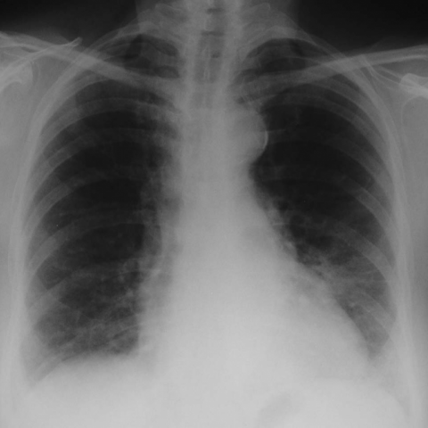

# M1：3834_8353801523222

D0 **C**；E **C**；ES **C**；参考 **C**。

[D0原回复](../../direct_qwen60/responses/3834_8353801523222_1.json) · [基准来源/原图](../../v12/results/cases/3834_8353801523222.md)

```text
Based on the chest X-ray provided in Figure 1, what is the most likely radiological finding consistent with the patient's accelerated phase usual interstitial pneumonia (UIP) as described in the case?
A) Bilateral reticular shadowing with focal honeycombing
B) Peripheral ground glass opacities with minimal reticular shadowing
C) Diffuse ground glass opacities superimposed on reticular shadowing
D) Central ground glass opacities with reticular shadowing
E) Isolated reticular pattern without ground glass opacities
F) Diffuse honeycombing with no ground glass opacities
```



## E

[请求/原回复/检索/反馈/反思/更新](../traces/eval/3834_8353801523222_E.json) · [作答前真实可见记忆](../memory/visible/3834_8353801523222_E.json)

实际注入历史记忆：

```text
Historical example 1 (modality CXR): Pattern: asymmetric reticular opacities and hyperlucency; Earlier choice: The lower lobe reticular markings are more prominent on the [truncated]; Corrected interpretation: The lower lobe reticular markings are more prominent on the right side, and the upper lobe hyperlucency is equally pronounced on both sides.; Earlier distinction: saved response selected the historical alternative (left lower reticular, right [truncated]; Difference: The PA view (Fig 1a) shows denser reticular markings in the right lower zone (especially near costophrenic angle) [truncated]; Inspect: In PA CXR, compare reticular opacity density in right vs left lower zones at the costophrenic angles, and assess upper zone vascular marking symmetry rather [truncated]; Basis: image: Fig 1a shows more confluent [truncated]; Limit: No clinical history, no scale bar, lateral views are low-resolution and overlapping; hyperlucency assessment is qualitative and prone [truncated].
Historical example 2 (modality CXR): Pattern: supported distribution; Earlier choice: Patchy multifocal opacities and nodules of various sizes, predominantly in [truncated]; Corrected interpretation: Patchy multifocal opacities and nodules of various sizes, predominantly in both lower lobes.; Earlier distinction: the historical alternative selected and confirmed correct; Difference: the historical alternative describes patchy multifocal opacities/nodules in both lower lobes; image shows bilateral, predominantly basilar, ill-defined opacities [truncated]; Inspect: On PA CXR, assess lobar distribution of nodular/patchy opacities: confirm bilateral basilar predominance and absence of upper-lobe cavitation or homogenous consolidation; Basis: image: bilateral basilar patchy opacities with [truncated]; Limit: Original historical reasoning was not retained; only the saved choice is known. No clinical history, lateral view, or [truncated].
Historical example 3 (modality CXR): Pattern: supported distribution; Earlier choice: The presence of bilateral nodular opacities predominantly in the lower [truncated]; Corrected interpretation: The presence of bilateral nodular opacities predominantly in the lower lobes and diffuse interstitial thickening on the chest X-ray, combined with the patient's history, strongly supports a diagnosis of silicone embolism syndrome.; Earlier distinction: the historical alternative selected over A, D, E based on [truncated]; Difference: Bilateral nodular opacities *predominantly in lower lobes* + interstitial thickening—distinct from lobar consolidation (A), wedge-shaped PTE (D), or [truncated]; Inspect: In bilateral nodular/interstitial CXR, assess lobar distribution: lower-lobe predominance favors silicone embolism; upper/mid-lobe favors granulomatous or infectious causes; Basis: image: unverified visual observation (nodularity and [truncated]; Limit: No clinical history provided in input; image resolution insufficient to confirm lobar predominance or exclude superimposition; reference explanation [truncated].
```

本题提交后的原回复：

```text
Answer: C) Diffuse ground glass opacities superimposed on reticular shadowing  
Reason: The CXR shows bilateral, diffuse hazy opacities (ground glass) with superimposed fine reticular markings, especially in the lower zones—consistent with accelerated UIP where ground glass reflects active inflammation/alveolar filling and reticulation reflects fibrosis; this combination distinguishes it from pure reticular (A, E), isolated honeycombing (F), or peripheral-only (B) or central-only (D) patterns.
```

提交时间：2026-10-31T16:08:11.809740+00:00；本病例反馈时间：2026-10-31T16:08:15.241804+00:00，反馈释放位置41。当前/未来病例未进入本次记忆投影。

## ES

[请求/原回复/检索/反馈/反思/更新](../traces/eval/3834_8353801523222_ES.json) · [作答前真实可见记忆](../memory/visible/3834_8353801523222_ES.json)

实际注入历史记忆：

```text
Historical example 1 (modality CXR): Pattern: bibasal interstitial reticulonodular opacities with peripheral predominance; Earlier choice: Bibasal interstitial reticulonodular shadowing with peripheral distribution, consistent with interstitial [truncated]; Corrected interpretation: Bibasal interstitial reticulonodular shadowing with peripheral distribution, consistent with interstitial lung disease.; Earlier distinction: correct selection of C over the competing alternatives (upper lobe) [truncated]; Difference: opacities are concentrated below the hila, extending to lung periphery near costophrenic angles—not upper lobes, not perihilar, not [truncated]; Inspect: On PA CXR, trace reticulonodular densities from diaphragm upward: if they peak in lower zones and spare upper lobes while avoiding hila, favor peripheral interstitial [truncated]; Basis: image: unverified visual observation: increased linear/nodular [truncated]; Limit: No clinical history, inspiration adequacy, or lateral view available; reference explanation absent; cannot confirm if opacities truly peripheral [truncated].
Historical example 2 (modality CXR): Pattern: supported distribution; Earlier choice: The bilateral pulmonary consolidations have partially resolved, indicating partial response [truncated]; Corrected interpretation: The bilateral pulmonary consolidations have completely resolved, indicating full recovery; however, the presence of persistent reticular markings suggests ongoing peripheral interstitial involvement.; Earlier distinction: the historical alternative selected (partial resolution + increased reticulation) vs [truncated]; Difference: Saved reasoning claims consolidations are 'less extensive' and reticular markings 'more visible' in 1b; reference implies consolidations are [truncated]; Inspect: Compare lower-zone opacity density quantitatively (e.g., silhouette sign against diaphragm, vascular obscuration) between serial CXRs before concluding complete vs partial resolution.; Basis: image: Unverified: apparent reduction in central [truncated]; Limit: No scale, inspiration level, or clinical context (e.g., oxygenation, symptoms); image resolution too low to reliably assess fine [truncated].
Historical example 3 (modality CXR): Pattern: bilateral peripheral airspace opacities; Earlier choice: Chronic eosinophilic pneumonia; Corrected interpretation: Lipoid pneumonia; Earlier distinction: chosen A (chronic eosinophilic pneumonia) but reference the historical alternative [truncated]; Difference: Lipoid pneumonia can present with bilateral, patchy, peripheral consolidations—especially in chronic exogenous form—and may mimic CEP; key discriminators [truncated]; Inspect: In bilateral peripheral consolidations, inspect for subtle basilar predominance, air bronchograms within opacities, and associated pleural changes; if available, correlate with clinical history of lipid [truncated]; Basis: image: bilateral, patchy, peripheral opacities without [truncated]; Limit: No clinical history (e.g., lipid exposure), no CT for fat density confirmation, no temporal comparison to assess migration; [truncated].
Conditional procedure 1: when When CXR shows diffuse interstitial opacities and fissural thickening in a patient with systemic symptoms, and cardiac silhouette appears borderline [truncated], inspect Quantify cardiothoracic ratio (max transverse cardiac width / inner thoracic diameter); if ≥0.52, consider cardiomegaly and evaluate for pulmonary vascular redistribution or right heart enlargement signs; limitation: Inadequate inspiration inflates CT ratio; scoliosis distorts measurements.
Conditional procedure 2: when When CXR shows diffuse bilateral micronodular opacities that obscure cardiac and diaphragmatic contours without pleural effusion or volume loss, inspect Inspect for preserved lung volume and absence of bronchovascular distortion; assess nodule density—if uniformly hyperdense and silhouetting borders, consider pulmonary alveolar microlithiasis; limitation: Cannot confirm calcification without CT; mimics miliary TB or silicosis if non-calcified.
```

本题提交后的原回复：

```text
Answer: C) Diffuse ground glass opacities superimposed on reticular shadowing  
Reason: The CXR shows bilateral, diffuse hazy opacities (ground-glass appearance) that obscure vascular markings, particularly in the lower zones, with superimposed fine reticular lines—consistent with accelerated UIP where active inflammation (ground glass) overlays fibrotic changes (reticulation). Peripheral and basal predominance is evident, and honeycombing is not clearly visible, ruling out A and F.
```

提交时间：2026-10-31T16:08:15.237945+00:00；本病例反馈时间：2026-10-31T16:08:15.241804+00:00，反馈释放位置41。当前/未来病例未进入本次记忆投影。

