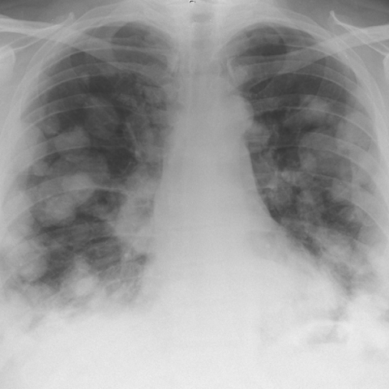

# M1：4510_8353801532552

D0 **A**；E **F**；ES **E**；参考 **A**。

[D0原回复](../../direct_qwen60/responses/4510_8353801532552_1.json) · [基准来源/原图](../../v12/results/cases/4510_8353801532552.md)

```text
Based on the chest X-ray findings presented in Figure 1, which of the following statements is most likely correct regarding the diagnosis and radiological features observed in this patient?

A) The chest X-ray shows bilateral rounded opacities and a mediastinal mass, consistent with pulmonary metastases and an anterior mediastinal mass, supporting a diagnosis of mediastinal non-seminomatous germ cell tumour.
B) The chest X-ray demonstrates a prominent left hilar mass without any bilateral lung opacities, indicating a potential primary lung carcinoma rather than a mediastinal germ cell tumour.
C) The chest X-ray reveals a normal mediastinum with no evidence of opacities, suggesting that the symptoms are unrelated to any intrathoracic pathology.
D) The chest X-ray shows unilateral pleural effusion and no mediastinal enlargement, indicating a likely infectious or inflammatory process rather than a germ cell tumour.
E) The chest X-ray demonstrates bilateral hilar lymphadenopathy with no mediastinal mass, which is more indicative of sarcoidosis than a germ cell tumour.
F) The chest X-ray displays extensive lung consolidation and no mediastinal abnormalities, suggesting pneumonia rather than a germ cell tumour.
```



## E

[请求/原回复/检索/反馈/反思/更新](../traces/eval/4510_8353801532552_E.json) · [作答前真实可见记忆](../memory/visible/4510_8353801532552_E.json)

实际注入历史记忆：

```text
Historical example 1 (modality CXR): Pattern: solitary pulmonary mass on PA chest X-ray; Earlier choice: A round and smoothly-contoured mass, approximately 1.5 cm, located in [truncated]; Corrected interpretation: A round and smoothly-contoured mass, approximately 1.5 cm, located in the 8th intercostal space.; Earlier distinction: chosen D (2 cm, 7th ICS) vs reference B (1.5 [truncated]; Difference: size estimation (2 vs 1.5 cm) and intercostal space assignment (7th vs 8th); both options agree on round, [truncated]; Inspect: measure mass vertical extent in rib interspaces using posterior ribs as calipers; confirm ICS by counting from T2 (first visible posterior rib = T2, then [truncated]; Basis: image: mass appears round, smooth, ~1.5 [truncated]; Limit: no scale marker; image resolution limits precise size; posterior rib counting ambiguous without clear T2 landmark.
Historical example 2 (modality CXR): Pattern: large right hemithorax opacity with mediastinal shift; Earlier choice: Pleural effusion; Corrected interpretation: Well-differentiated liposarcoma; Earlier distinction: chosen pleural effusion (D) vs reference well-differentiated liposarcoma (B); Difference: Saved reasoning cited blunting of costophrenic angle, meniscus, and absence of discrete mass margin—features supporting effusion; however, reference [truncated]; Inspect: On CXR, inspect for subtle radiolucency within the opacity suggesting fat content; if ambiguous, require CT to confirm fat density (>−50 HU) and exclude effusion.; Basis: image: unverified visual observation: large homogeneous [truncated]; Limit: No CT available; CXR cannot reliably distinguish large effusion from fatty tumor; reference explanation missing; mediastinal shift direction [truncated].
Historical example 3 (modality CXR): Pattern: unilateral basal opacity in asymptomatic patient with acute neurological symptoms; Earlier choice: A homogeneously dense, sharply outlined mass consistent with a vascular [truncated]; Corrected interpretation: A smoothly contoured, calcified lesion suggesting a benign granuloma, incidental to the patient's acute neurological symptoms.; Earlier distinction: the historical alternative (vascular anomaly) was selected but reference the [truncated]; Difference: Reference diagnosis implies calcification and smooth contour—key discriminators absent in E’s description; E incorrectly links mass to congenital [truncated]; Inspect: On PA CXR, inspect the right basal lesion for internal calcification (high-density speckles/rim) and margin smoothness vs. irregularity; correlate with lateral view if available to [truncated]; Basis: image: Right basal opacity visible (arrow), [truncated]; Limit: Original historical reasoning was not retained; only the saved choice is known. Image resolution insufficient to confirm calcification [truncated].
```

本题提交后的原回复：

```text
Answer: F) The chest X-ray displays extensive lung consolidation and no mediastinal abnormalities, suggesting pneumonia rather than a germ cell tumour.

Reason: The image shows diffuse, patchy, bilateral opacities with ill-defined margins, predominantly in the lower and middle lung zones—consistent with consolidation (e.g., pneumonia)—and no discrete mass, hilar enlargement, or mediastinal widening. There is no evidence of bilateral rounded nodules (A), isolated left hilar mass (B), normal lungs (C), pleural effusion (D), or symmetric bilateral hilar lymphadenopathy (E).
```

提交时间：2026-10-31T16:09:25.364015+00:00；本病例反馈时间：2026-10-31T16:09:28.921327+00:00，反馈释放位置44。当前/未来病例未进入本次记忆投影。

## ES

[请求/原回复/检索/反馈/反思/更新](../traces/eval/4510_8353801532552_ES.json) · [作答前真实可见记忆](../memory/visible/4510_8353801532552_ES.json)

实际注入历史记忆：

```text
Historical example 1 (modality CXR): Pattern: pleural-based mass on PA chest X-ray; Earlier choice: A round and smoothly-contoured mass, approximately 1.5 cm, located in [truncated]; Corrected interpretation: A round and smoothly-contoured mass, approximately 1.5 cm, located in the 8th intercostal space.; Earlier distinction: the historical alternative selected (2 cm, 7th interspace) vs reference [truncated]; Difference: Size estimation (2 cm vs 1.5 cm) and rib-level assignment (7th vs 8th intercostal space); both describe round, [truncated]; Inspect: Count intercostal spaces from the *anterior* first rib (visible at sternum) or use the diaphragmatic dome as landmark: the 8th interspace lies ~1 cm above [truncated]; Basis: image: Mass appears round, smooth, pleural-based, [truncated]; Limit: Image lacks scale marker; rib counting ambiguous without clear anterior rib identification; inspiration level unknown; no side-by-side comparison [truncated].
Historical example 2 (modality CXR): Pattern: unilateral basal opacity in asymptomatic patient with acute neurological symptoms; Earlier choice: A homogeneously dense, sharply outlined mass consistent with a vascular [truncated]; Corrected interpretation: A smoothly contoured, calcified lesion suggesting a benign granuloma, incidental to the patient's acute neurological symptoms.; Earlier distinction: the historical alternative (vascular anomaly) was selected but reference the [truncated]; Difference: Reference diagnosis implies calcification and smooth contour—key discriminators absent in E’s description; E incorrectly links mass to congenital [truncated]; Inspect: On PA CXR, inspect the right basal lesion for internal calcification (high-density speckles/rim) and margin smoothness vs. irregularity; correlate with lateral view if available to [truncated]; Basis: image: Right basal opacity visible (arrow), [truncated]; Limit: Original historical reasoning was not retained; only the saved choice is known. Image resolution insufficient to confirm calcification [truncated].
Historical example 3 (modality CXR): Pattern: explicit clinical situation; Earlier choice: An irregular, ill-defined mass in the left lower lobe extending [truncated]; Corrected interpretation: An irregular, ill-defined mass in the left lower lobe extending to the mediastinum, consistent with pulmonary epithelioid haemangioendothelioma (PEH).; Earlier distinction: selection of B over the competing alternatives based on margin [truncated]; Difference: the historical alternative describes a sharply marginated solitary mass (typical bronchogenic carcinoma), whereas image shows an ill-defined, heterogeneous [truncated]; Inspect: On PA CXR, assess left heart border silhouette sign; on lateral view, confirm posterior location and whether mass abuts or displaces the esophagus/hilum—ill-defined margins + [truncated]; Basis: image: unverified visual observation: left lower [truncated]; Limit: No clinical history, size scale, or follow-up imaging; PEH is rare and imaging overlap with other malignancies exists; [truncated].
Conditional procedure 1: when When a rounded opacity at the left costophrenic angle spares the left heart border on PA CXR, inspect Inspect lateral CXR for an anterior-inferior soft-tissue mass continuous with abdominal structures—suggesting diaphragmatic hernia rather than pleural or pulmonary lesion; limitation: Unreliable if lateral view is poorly positioned or obscured by overlying structures; does not [truncated].
Conditional procedure 2: when When CXR shows bilateral nodular opacities and hilar fullness, and symmetry is ambiguous on PA view, inspect Inspect lateral CXR for symmetrical anterior mediastinal lymphadenopathy (prevascular nodes) and compare hilar silhouette width left vs. right on PA; exclude unilateral volume loss or pleural [truncated]; limitation: Requires lateral view; unreliable if patient rotation or poor inspiration distorts hilar appearance.
```

本题提交后的原回复：

```text
Answer: E) The chest X-ray demonstrates bilateral hilar lymphadenopathy with no mediastinal mass, which is more indicative of sarcoidosis than a germ cell tumour.

Reason: The image shows symmetric, ill-defined hazy opacities centered at both hila without a discrete mediastinal mass; the lung parenchyma otherwise appears relatively spared, and there is no pleural effusion or consolidation. This pattern matches bilateral hilar lymphadenopathy—classically seen in sarcoidosis—rather than the unilateral mass, metastases, or mediastinal tumor described in other options.
```

提交时间：2026-10-31T16:09:28.916919+00:00；本病例反馈时间：2026-10-31T16:09:28.921327+00:00，反馈释放位置44。当前/未来病例未进入本次记忆投影。

