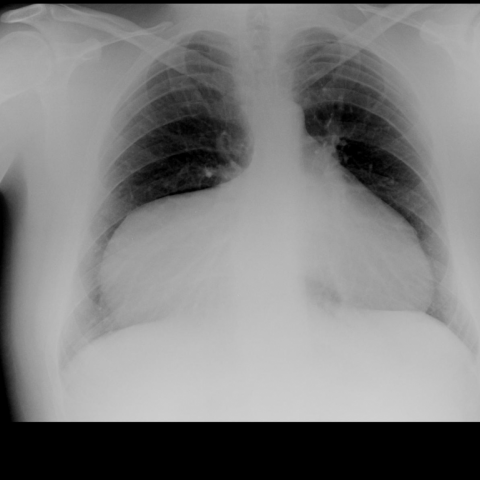

# M1：5369_8353801533158

D0 **A**；E **A**；ES **A**；参考 **A**。

[D0原回复](../../direct_qwen60/responses/5369_8353801533158_1.json) · [基准来源/原图](../../v12/results/cases/5369_8353801533158.md)

```text
Based on the chest X-ray provided in Figure 1, which of the following best describes the findings and possible diagnosis? Consider the anatomical location, size, and content of the observed mass.
A) A large right-sided paracardiac opacity indicative of a Morgagni's hernia with liver herniation.
B) A left-sided pleural effusion causing mediastinal shift and obscuration of the heart border.
C) A right-sided lung consolidation consistent with pneumonia.
D) A large pericardial effusion causing an apparent paracardiac mass effect.
E) A right-sided intrathoracic mass suggestive of a mediastinal tumor.
F) A diaphragmatic hernia with herniation of the stomach, presenting as a right-sided opacity.
```



## E

[请求/原回复/检索/反馈/反思/更新](../traces/eval/5369_8353801533158_E.json) · [作答前真实可见记忆](../memory/visible/5369_8353801533158_E.json)

实际注入历史记忆：

```text
Historical example 1 (modality CXR): Pattern: large right hemithorax opacity with mediastinal shift; Earlier choice: Pleural effusion; Corrected interpretation: Well-differentiated liposarcoma; Earlier distinction: chosen pleural effusion (D) vs reference well-differentiated liposarcoma (B); Difference: Saved reasoning cited blunting of costophrenic angle, meniscus, and absence of discrete mass margin—features supporting effusion; however, reference [truncated]; Inspect: On CXR, inspect for subtle radiolucency within the opacity suggesting fat content; if ambiguous, require CT to confirm fat density (>−50 HU) and exclude effusion.; Basis: image: unverified visual observation: large homogeneous [truncated]; Limit: No CT available; CXR cannot reliably distinguish large effusion from fatty tumor; reference explanation missing; mediastinal shift direction [truncated].
Historical example 2 (modality CXR): Pattern: explicit clinical situation; Earlier choice: The mass is located in the right cardiophrenic angle, is [truncated]; Corrected interpretation: The mass is located in the right cardiophrenic angle, is large, and suggests a Morgagni hernia.; Earlier distinction: correct selection of B (right cardiophrenic angle, large, Morgagni hernia); Difference: Morgagni hernias occur anteriorly through the sternocostal triangle, typically right-sided; Bochdalek is posterolateral and usually left-sided. The mass [truncated]; Inspect: On PA CXR, inspect whether the opacity silhouettes the right heart border *and* lies below the level of the aortic arch, with sharp lateral margin [truncated]; Basis: image: unverified visual observation: opacity in [truncated]; Limit: Original historical reasoning was not retained; only the saved choice is known. Image resolution limits assessment of air-fluid [truncated].
Historical example 3 (modality CXR): Pattern: anterior mediastinal mass with cardio-mediastinal shift and left heart border obscuration; Earlier choice: T-cell acute lymphoblastic leukemia/lymphoma; Corrected interpretation: T-cell acute lymphoblastic leukemia/lymphoma; Earlier distinction: correct selection of T-cell ALL/lymphoma over pleural effusion or pneumonia; Difference: lateral view (Figure 2) shows a homogeneous anterior mediastinal opacity without pleural fluid line or lung consolidation; rightward [truncated]; Inspect: In PA CXR with left heart border obscuration and mediastinal widening, inspect lateral view for anterior mediastinal opacity location vs. pleural fluid meniscus or parenchymal [truncated]; Basis: image: PA shows widened mediastinum, right [truncated]; Limit: No clinical history (e.g., age, symptoms, labs); image resolution limits fine detail; reference explanation unavailable.
```

本题提交后的原回复：

```text
Answer: A) A large right-sided paracardiac opacity indicative of a Morgagni's hernia with liver herniation.  
Reason: The CXR shows a well-defined, homogeneous opacity in the right cardiophrenic angle that silhouettes the right heart border and lies below the aortic arch, with a sharp lateral margin—classic for Morgagni hernia; no meniscus or air-fluid level is seen, arguing against effusion or gastric herniation, and lung markings are preserved medially, excluding consolidation.
```

提交时间：2026-10-31T16:10:43.198097+00:00；本病例反馈时间：2026-10-31T16:10:46.709470+00:00，反馈释放位置47。当前/未来病例未进入本次记忆投影。

## ES

[请求/原回复/检索/反馈/反思/更新](../traces/eval/5369_8353801533158_ES.json) · [作答前真实可见记忆](../memory/visible/5369_8353801533158_ES.json)

实际注入历史记忆：

```text
Historical example 1 (modality CXR): Pattern: explicit clinical situation; Earlier choice: The mass is located in the right cardiophrenic angle, is [truncated]; Corrected interpretation: The mass is located in the right cardiophrenic angle, is large, and suggests a Morgagni hernia.; Earlier distinction: correct selection of B (right cardiophrenic angle, large, Morgagni hernia); Difference: Morgagni hernias occur anteriorly through the sternocostal triangle, typically right-sided; Bochdalek is posterolateral and usually left-sided. The mass [truncated]; Inspect: On PA CXR, inspect whether the opacity silhouettes the right heart border *and* lies below the level of the aortic arch, with sharp lateral margin [truncated]; Basis: image: unverified visual observation: opacity in [truncated]; Limit: Original historical reasoning was not retained; only the saved choice is known. Image resolution limits assessment of air-fluid [truncated].
Historical example 2 (modality CXR): Pattern: mediastinal mass with bilateral pleural effusions; Earlier choice: The mediastinal mass is predominantly located on the right side [truncated]; Corrected interpretation: The mediastinal mass is predominantly located on the left side, and the pleural effusion is more pronounced on the right side.; Earlier distinction: chosen A (right mass, left effusion) but reference is C [truncated]; Difference: saved reasoning cited right-sided mass (loss of right heart border, tracheal deviation left) and greater left effusion; reference [truncated]; Inspect: On PA CXR, assess which heart border is lost (left vs right) and direction of tracheal deviation relative to mediastinal shift; correlate with costophrenic angle [truncated]; Basis: image: Figure 2 shows left heart [truncated]; Limit: No lateral view provided; tracheal deviation assessment limited by image quality; no prior films for comparison..
Historical example 3 (modality CXR): Pattern: pleural-based mass on PA chest X-ray; Earlier choice: A round and smoothly-contoured mass, approximately 1.5 cm, located in [truncated]; Corrected interpretation: A round and smoothly-contoured mass, approximately 1.5 cm, located in the 8th intercostal space.; Earlier distinction: the historical alternative selected (2 cm, 7th interspace) vs reference [truncated]; Difference: Size estimation (2 cm vs 1.5 cm) and rib-level assignment (7th vs 8th intercostal space); both describe round, [truncated]; Inspect: Count intercostal spaces from the *anterior* first rib (visible at sternum) or use the diaphragmatic dome as landmark: the 8th interspace lies ~1 cm above [truncated]; Basis: image: Mass appears round, smooth, pleural-based, [truncated]; Limit: Image lacks scale marker; rib counting ambiguous without clear anterior rib identification; inspiration level unknown; no side-by-side comparison [truncated].
Conditional procedure 1: when When mediastinal opacity obscures one heart border and tracheal deviation is present on PA CXR, inspect Inspect which cardiac border is silhouetted (left border loss = left mediastinal pathology; right border loss = right-sided) and confirm tracheal deviation direction—deviation away from mass [truncated]; limitation: Unreliable if both borders obscured or in severe cardiomegaly; requires adequate inspiration and centering..
Conditional procedure 2: when When a rounded opacity at the left costophrenic angle spares the left heart border on PA CXR, inspect Inspect lateral CXR for an anterior-inferior soft-tissue mass continuous with abdominal structures—suggesting diaphragmatic hernia rather than pleural or pulmonary lesion; limitation: Unreliable if lateral view is poorly positioned or obscured by overlying structures; does not [truncated].
```

本题提交后的原回复：

```text
Answer: A) A large right-sided paracardiac opacity indicative of a Morgagni's hernia with liver herniation.

Reason: The PA chest X-ray shows a well-defined, homogeneous opacity in the right cardiophrenic angle that silhouettes the right heart border and lies below the aortic arch, with a sharp lateral margin—classic for a Morgagni hernia. The opacity is large and does not show air-fluid levels or lung markings, favoring herniated abdominal content (e.g., liver) over effusion, consolidation, or tumor.
```

提交时间：2026-10-31T16:10:46.705622+00:00；本病例反馈时间：2026-10-31T16:10:46.709470+00:00，反馈释放位置47。当前/未来病例未进入本次记忆投影。

