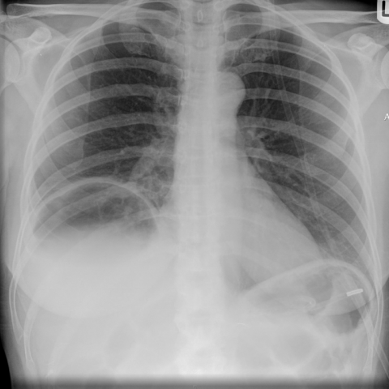

# M1：5533_8353801540251

D0 **B**；E **B**；ES **B**；参考 **B**。

[D0原回复](../../direct_qwen60/responses/5533_8353801540251_1.json) · [基准来源/原图](../../v12/results/cases/5533_8353801540251.md)

```text
Based on the chest X-ray in Figure 1b, which of the following is the most accurate interpretation of the findings under the right hemidiaphragm?
A. Presence of air suggestive of a perforated viscus with pneumoperitoneum, indicated by the absence of haustral folds and uniform diaphragm thickness.
B. Chilaiditi's sign indicated by the presence of haustral folds and increased thickness of the right hemidiaphragm compared to the left, suggesting interposition of the bowel.
C. Pneumothorax on the right side indicated by air under the diaphragm and absence of lung markings.
D. Normal anatomical variant, as indicated by the symmetric thickness of both hemidiaphragms and presence of lung markings.
E. Perforated gastric ulcer indicated by free air under the diaphragm with varying diaphragm thickness.
F. Interstitial lung disease indicated by diffuse reticular markings and air under the diaphragm.
```



## E

[请求/原回复/检索/反馈/反思/更新](../traces/eval/5533_8353801540251_E.json) · [作答前真实可见记忆](../memory/visible/5533_8353801540251_E.json)

实际注入历史记忆：

```text
Historical example 1 (modality CXR): Pattern: mediastinal shift with unilateral opacity/hypolucency; Earlier choice: The mediastinal shift is caused by volume loss in the [truncated]; Corrected interpretation: The mediastinal shift is caused by volume loss in the right hemithorax with compensatory left lung expansion.; Earlier distinction: correct selection of B over E and C based on [truncated]; Difference: Right hemithorax shows reduced rib spacing, elevated right hemidiaphragm, and small right hilum—consistent with volume loss—not hyperinflation (which [truncated]; Inspect: On CXR with mediastinal shift, inspect ipsilateral intercostal spacing, hemidiaphragm height, and hilar size: reduced spacing + elevated diaphragm + small hilum = volume loss; [truncated]; Basis: image: right hemithorax appears smaller with [truncated]; Limit: Original historical reasoning was not retained; only the saved choice is known. Image quality low; exact rib count [truncated].
Historical example 2 (modality CXR): Pattern: unilateral lung hyperlucency with reduced size and vascular markings; Earlier choice: Swyer-James-McLeod syndrome characterized by a smaller, hyperlucent lung with reduced [truncated]; Corrected interpretation: Swyer-James-McLeod syndrome characterized by a smaller, hyperlucent lung with reduced vascular markings; Earlier distinction: Correct selection of Swyer-James-McLeod syndrome (E) over pneumothorax (C) or [truncated]; Difference: Hyperlucency with *reduced* lung volume (narrow intercostal spaces, elevated hemidiaphragm, small hilum) vs. volume increase in emphysema or [truncated]; Inspect: On PA CXR, compare intercostal spacing and hemidiaphragm height between sides: reduced spacing + elevated diaphragm on hyperlucent side confirms volume loss; assess hilar size [truncated]; Basis: image: Left lung smaller, hyperlucent, with [truncated]; Limit: Original historical reasoning was not retained; only the saved choice is known. No clinical history (e.g., childhood infection), [truncated].
Historical example 3 (modality CXR): Pattern: unilateral hemithorax opacity with mediastinal shift and absent breath sounds; Earlier choice: Total atelectasis of the right lung; Corrected interpretation: Unilateral pulmonary agenesis; Earlier distinction: Chose atelectasis (A) over agenesis (C); Difference: Agenesis implies congenital absence of lung, bronchus, and pulmonary artery; atelectasis is acquired collapse. Key discriminators: absence of [truncated]; Inspect: On CXR, inspect right hemithorax for diaphragmatic position (elevated? flattened?), rib spacing (crowded?), and vascular/bronchial markings (completely absent vs reduced); compare to contralateral side.; Basis: image: right hemithorax opaque, trachea shifted [truncated]; Limit: Original historical reasoning was not retained; only the saved choice is known. No clinical history (e.g., lifelong symptoms), [truncated].
```

本题提交后的原回复：

```text
Answer: B. Chilaiditi's sign indicated by the presence of haustral folds and increased thickness of the right hemidiaphragm compared to the left, suggesting interposition of the bowel.

Reason: The image shows a well-defined, curvilinear lucency beneath the right hemidiaphragm with visible haustral folds (segmented gas pattern), consistent with colonic interposition—classic for Chilaiditi’s sign. The right hemidiaphragm appears thicker and slightly elevated relative to the left, and there is no evidence of free intraperitoneal air (e.g., no sharp, linear “double-wall” sign or absence of bowel gas elsewhere). Options A, C, and E incorrectly infer pneumoperitoneum or pneumothorax, which would show *free* air without haustra; D and F are inconsistent with the visible bowel gas pattern and lack of diffuse lung changes.
```

提交时间：2026-10-31T16:11:34.691766+00:00；本病例反馈时间：2026-10-31T16:11:39.254263+00:00，反馈释放位置49。当前/未来病例未进入本次记忆投影。

## ES

[请求/原回复/检索/反馈/反思/更新](../traces/eval/5533_8353801540251_ES.json) · [作答前真实可见记忆](../memory/visible/5533_8353801540251_ES.json)

实际注入历史记忆：

```text
Historical example 1 (modality CXR): Pattern: unilateral lung hyperlucency with reduced size and vascular markings; Earlier choice: Swyer-James-McLeod syndrome characterized by a smaller, hyperlucent lung with reduced [truncated]; Corrected interpretation: Swyer-James-McLeod syndrome characterized by a smaller, hyperlucent lung with reduced vascular markings; Earlier distinction: Correct selection of Swyer-James-McLeod syndrome (E) over pneumothorax (C) or [truncated]; Difference: Hyperlucency with *reduced* lung volume (narrow intercostal spaces, elevated hemidiaphragm, small hilum) vs. volume increase in emphysema or [truncated]; Inspect: On PA CXR, compare intercostal spacing and hemidiaphragm height between sides: reduced spacing + elevated diaphragm on hyperlucent side confirms volume loss; assess hilar size [truncated]; Basis: image: Left lung smaller, hyperlucent, with [truncated]; Limit: Original historical reasoning was not retained; only the saved choice is known. No clinical history (e.g., childhood infection), [truncated].
Historical example 2 (modality CXR): Pattern: mediastinal shift with unilateral opacity/hypolucency; Earlier choice: The mediastinal shift is caused by volume loss in the [truncated]; Corrected interpretation: The mediastinal shift is caused by volume loss in the right hemithorax with compensatory left lung expansion.; Earlier distinction: correct selection of B over E and C based on [truncated]; Difference: Right hemithorax shows reduced rib spacing, elevated right hemidiaphragm, and small right hilum—consistent with volume loss—not hyperinflation (which [truncated]; Inspect: On CXR with mediastinal shift, inspect ipsilateral intercostal spacing, hemidiaphragm height, and hilar size: reduced spacing + elevated diaphragm + small hilum = volume loss; [truncated]; Basis: image: right hemithorax appears smaller with [truncated]; Limit: Original historical reasoning was not retained; only the saved choice is known. Image quality low; exact rib count [truncated].
Historical example 3 (modality CXR): Pattern: unilateral hemithorax opacity with mediastinal shift and absent breath sounds; Earlier choice: Total atelectasis of the right lung; Corrected interpretation: Unilateral pulmonary agenesis; Earlier distinction: Chose atelectasis (A) over agenesis (C); Difference: Agenesis implies congenital absence of lung, bronchus, and pulmonary artery; atelectasis is acquired collapse. Key discriminators: absence of [truncated]; Inspect: On CXR, inspect right hemithorax for diaphragmatic position (elevated? flattened?), rib spacing (crowded?), and vascular/bronchial markings (completely absent vs reduced); compare to contralateral side.; Basis: image: right hemithorax opaque, trachea shifted [truncated]; Limit: Original historical reasoning was not retained; only the saved choice is known. No clinical history (e.g., lifelong symptoms), [truncated].
Conditional procedure 1: when When unilateral hyperlucency is present without obvious pleural line or mediastinal shift, and lung size appears reduced, inspect Inspect ipsilateral intercostal space width and hemidiaphragm position relative to contralateral side; reduced spacing + elevated diaphragm supports volume loss (e.g., Swyer-James), not hyperinflation or pneumothorax; limitation: Unreliable if inspiration inadequate or diaphragm obscured by gastric air; requires comparison to contralateral [truncated].
Conditional procedure 2: when When a serpentine tubular opacity is seen in the medial right lung on PA CXR with ipsilateral volume loss elsewhere, inspect Inspect its trajectory on lateral view: if it descends posteriorly along the right heart border toward the diaphragm without air lucency and tapers, suspect anomalous pulmonary [truncated]; limitation: Cannot differentiate small aneurysms or vascular malformations without contrast; unreliable if poor inspiration or [truncated].
```

本题提交后的原回复：

```text
Answer: B. Chilaiditi's sign indicated by the presence of haustral folds and increased thickness of the right hemidiaphragm compared to the left, suggesting interposition of the bowel.

Reason: The image shows a curvilinear opacity beneath the right hemidiaphragm with visible haustral folds (segmented, sacculated appearance), consistent with colon interposed between liver and diaphragm—classic for Chilaiditi’s sign. The right hemidiaphragm appears slightly thicker and elevated relative to the left, and there is no free air (no sharp lucency without overlying bowel gas), ruling out pneumoperitoneum or perforation.
```

提交时间：2026-10-31T16:11:39.250125+00:00；本病例反馈时间：2026-10-31T16:11:39.254263+00:00，反馈释放位置49。当前/未来病例未进入本次记忆投影。

