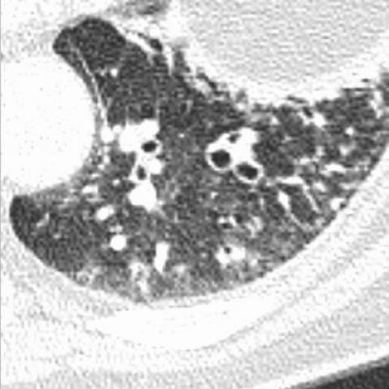
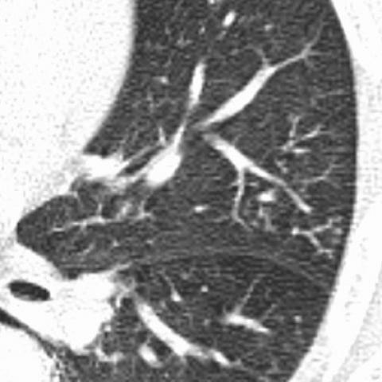

# M1：722_8353802117601

D0 **D**；E **D**；ES **D**；参考 **D**。

[D0原回复](../../direct_qwen60/responses/722_8353802117601_1.json) · [基准来源/原图](../../v12/results/cases/722_8353802117601.md)

```text
Based on the chest X-ray findings, which of the following statements best describes the relationship between the bronchiectatic changes and the consolidation observed in this patient? 

A) The bronchiectatic changes are primarily located in the right upper lobe and are larger than the consolidation in the left lower lobe.
B) The bronchiectatic changes are primarily located in the left lower lobe and are smaller than the consolidation in the right middle lobe.
C) The bronchiectatic changes are primarily located in the right lower lobe and are of similar size to the consolidation in the left lower lobe.
D) The bronchiectatic changes are primarily located in the left lower lobe and are larger than the consolidation in the right middle lobe.
E) The bronchiectatic changes are primarily located in the left upper lobe and are smaller than the consolidation in the right middle lobe.
F) The bronchiectatic changes are primarily located in the left lower lobe and are of similar size to the consolidation in the right middle lobe.
```







## E

[请求/原回复/检索/反馈/反思/更新](../traces/eval/722_8353802117601_E.json) · [作答前真实可见记忆](../memory/visible/722_8353802117601_E.json)

实际注入历史记忆：

```text
Historical example 1 (modality CXR): Pattern: single hilar opacity with ambiguous lobe assignment; Earlier choice: The opacity at the left hilum is an anterior lesion [truncated]; Corrected interpretation: The opacity at the left hilum is a posterior lesion in the left lower lobe, appearing irregular with spiculated margins, indicating a malignant process consistent with metastasis.; Earlier distinction: the historical alternative selected (anterior left upper lobe, irregular margins, [truncated]; Difference: Anterior vs posterior lobe assignment: left hilum opacity silhouettes the left heart border (indicating middle/lower lobe), not the [truncated]; Inspect: When a left hilar opacity abuts the left heart border on PA CXR, inspect the lateral view for posterior positioning and check if the opacity [truncated]; Basis: image: Opacity at left hilum obscures [truncated]; Limit: Original historical reasoning was not retained; only the saved choice is known. Lateral view missing; PA-only assessment cannot [truncated].
Historical example 2 (modality CXR): Pattern: bilateral basilar-predominant alveolar opacities with right middle lobe involvement; Earlier choice: The bilateral alveolar infiltrates are predominantly in the lower lobes [truncated]; Corrected interpretation: The bilateral alveolar infiltrates are predominantly in the lower lobes and the middle lobe of the right lung, consistent with pulmonary alveolar proteinosis, despite the absence of restrictive impairment in pulmonary function tests.; Earlier distinction: Correct selection of B over A, C, E, F based [truncated]; Difference: the historical alternative is unilateral/middle-lobe-only; C suggests upper-lobe predominance (not seen); E implies diffuse homogeneous infiltrates (here, lower-zone–predominant [truncated]; Inspect: On PA CXR, assess lobar involvement by tracing opacity extent relative to heart border (right middle lobe), diaphragm (lower lobes), and apex (upper sparing); confirm [truncated]; Basis: image: Bilateral hazy opacities concentrated below [truncated]; Limit: No clinical history, labs, or CT to confirm PAP; CXR cannot distinguish PAP from other causes of basilar [truncated].
Historical example 3 (modality CXR): Pattern: unilateral left upper lobe opacity with pleural fluid; Earlier choice: The pleural effusion is smaller than the patchy consolidation, with [truncated]; Corrected interpretation: The pleural effusion is larger than the patchy consolidation, with both findings localized to the posterior zone of the left lung.; Earlier distinction: the historical alternative selected (effusion smaller, lateral; consolidation in left [truncated]; Difference: B assumes effusion is lateral on PA and posterior on lateral, consolidation anterior—yet reference D asserts both are [truncated]; Inspect: On lateral CXR, inspect whether the opaque region abuts the posterior chest wall and extends above the diaphragm without anterior lucency; if so, the effusion [truncated]; Basis: image: Fig 1a: left lower/mid lung [truncated]; Limit: No clinical history; images lack scale markers; lateral view partially obscured by overlying structures; reference explanation unavailable to [truncated].
```

本题提交后的原回复：

```text
Answer: D) The bronchiectatic changes are primarily located in the left lower lobe and are larger than the consolidation in the right middle lobe.

Reason: Figures 2b and 2c (high-resolution lung windows) show extensive cystic and tram-track bronchiectasis predominantly in the left lower lobe, with visible air-filled dilated bronchi and surrounding parenchymal destruction. Figure 2a (mediastinal window) shows a smaller, denser area of consolidation in the right middle lobe (adjacent to the heart border, consistent with RML location), which is clearly less extensive than the left lower lobe bronchiectatic changes. The size disparity and lobar localization match option D.
```

提交时间：2026-10-31T16:12:29.378836+00:00；本病例反馈时间：2026-10-31T16:12:33.393022+00:00，反馈释放位置51。当前/未来病例未进入本次记忆投影。

## ES

[请求/原回复/检索/反馈/反思/更新](../traces/eval/722_8353802117601_ES.json) · [作答前真实可见记忆](../memory/visible/722_8353802117601_ES.json)

实际注入历史记忆：

```text
Historical example 1 (modality CXR): Pattern: unilateral left upper lobe opacity with pleural fluid; Earlier choice: The pleural effusion is smaller than the patchy consolidation, with [truncated]; Corrected interpretation: The pleural effusion is larger than the patchy consolidation, with both findings localized to the posterior zone of the left lung.; Earlier distinction: the historical alternative selected (effusion smaller, lateral; consolidation in left [truncated]; Difference: B assumes effusion is lateral on PA and posterior on lateral, consolidation anterior—yet reference D asserts both are [truncated]; Inspect: On lateral CXR, inspect whether the opaque region abuts the posterior chest wall and extends above the diaphragm without anterior lucency; if so, the effusion [truncated]; Basis: image: Fig 1a: left lower/mid lung [truncated]; Limit: No clinical history; images lack scale markers; lateral view partially obscured by overlying structures; reference explanation unavailable to [truncated].
Historical example 2 (modality CXR): Pattern: single hilar opacity with ambiguous lobe assignment; Earlier choice: The opacity at the left hilum is an anterior lesion [truncated]; Corrected interpretation: The opacity at the left hilum is a posterior lesion in the left lower lobe, appearing irregular with spiculated margins, indicating a malignant process consistent with metastasis.; Earlier distinction: the historical alternative selected (anterior left upper lobe, irregular margins, [truncated]; Difference: Anterior vs posterior lobe assignment: left hilum opacity silhouettes the left heart border (indicating middle/lower lobe), not the [truncated]; Inspect: When a left hilar opacity abuts the left heart border on PA CXR, inspect the lateral view for posterior positioning and check if the opacity [truncated]; Basis: image: Opacity at left hilum obscures [truncated]; Limit: Original historical reasoning was not retained; only the saved choice is known. Lateral view missing; PA-only assessment cannot [truncated].
Historical example 3 (modality CXR): Pattern: immunocompromised patient with bilateral patchy opacities; Earlier choice: Multifocal patchy opacities with central distribution and right middle lobe [truncated]; Corrected interpretation: Multifocal patchy opacities with central distribution and right middle lobe consolidation, consistent with pneumocystis jirovecii pneumonia in an immunocompromised patient.; Earlier distinction: Correct selection of C over B and D based on [truncated]; Difference: the historical alternative describes peripheral ground-glass (HP), but images show opacities silhouetting right heart border (PA) and anterior-inferior [truncated]; Inspect: On PA CXR, check if opacity abuts right heart border; on lateral, verify anterior-inferior opacity overlapping cardiac silhouette and diaphragm dome to confirm right middle [truncated]; Basis: image: Right heart border silhouetting on [truncated]; Limit: No clinical history provided; image resolution limits fine pattern discrimination (e.g., true ground-glass vs. subtle consolidation).
Conditional procedure 1: when When a right-sided lower lung opacity merges with the right heart border on PA CXR and the right costophrenic angle [truncated], inspect Inspect lateral CXR for anterior-inferior opacity overlapping the cardiac silhouette and diaphragm dome; if present, localize to right lower lobe abutting heart and diaphragm; limitation: Unreliable if lateral view is rotated or overpenetrated; does not distinguish tumor from consolidation [truncated].
Conditional procedure 2: when When a left hilar opacity silhouettes the left heart border on PA CXR and lobe localization is ambiguous, inspect Inspect lateral view for posterior location and vertical position relative to carina; if lateral unavailable, assume lower lobe until proven otherwise; limitation: Inconclusive if lateral view overpenetrated or obscured; does not assess margin morphology.
```

本题提交后的原回复：

```text
Answer: D) The bronchiectatic changes are primarily located in the left lower lobe and are larger than the consolidation in the right middle lobe.

Reason: Figures 2b and 2c (high-resolution lung windows) show extensive cystic and tram-track bronchiectasis predominantly in the left lower lobe, with visible air-filled dilated bronchi and surrounding fibrosis. In contrast, the right middle lobe shows a smaller, denser area of consolidation without air bronchograms, confined to the anterior-inferior segment near the heart border. The volume and extent of bronchiectatic change clearly exceed that of the consolidation.
```

提交时间：2026-10-31T16:12:33.388768+00:00；本病例反馈时间：2026-10-31T16:12:33.393022+00:00，反馈释放位置51。当前/未来病例未进入本次记忆投影。

