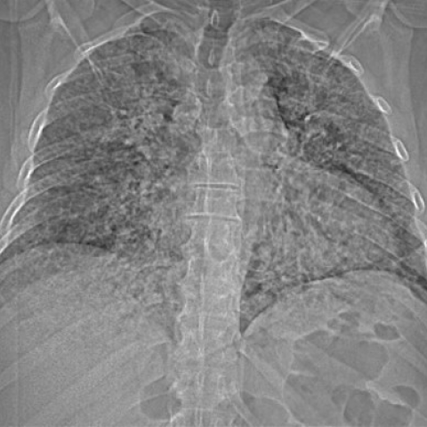

# M1：7659_8353800871660

D0 **C**；E **C**；ES **C**；参考 **C**。

[D0原回复](../../direct_qwen60/responses/7659_8353800871660_1.json) · [基准来源/原图](../../v12/results/cases/7659_8353800871660.md)

```text
A 61-year-old patient presented with cough, generalized musculoskeletal pain, and fever. The initial chest radiograph showed fine reticulonodular opacities throughout both lungs. Based on Figure 1, which statement is most accurate regarding the findings on the chest X-ray?

A) The reticulonodular opacities are predominantly located in the upper lobes and are symmetrical.

B) The reticulonodular opacities are predominantly located in the lower lobes and are asymmetrical.

C) The reticulonodular opacities are diffusely distributed throughout both lungs without a specific lobar predominance.

D) The reticulonodular opacities are associated with noticeable pleural effusion in the right lung.

E) The reticulonodular opacities are associated with noticeable pleural effusion in the left lung.

F) The reticulonodular opacities are accompanied by a significant shift of the mediastinum.
```



## E

[请求/原回复/检索/反馈/反思/更新](../traces/eval/7659_8353800871660_E.json) · [作答前真实可见记忆](../memory/visible/7659_8353800871660_E.json)

实际注入历史记忆：

```text
Historical example 1 (modality CXR): Pattern: supported distribution; Earlier choice: Bibasal interstitial reticulonodular shadowing with peripheral distribution, consistent with interstitial [truncated]; Corrected interpretation: Bibasal interstitial reticulonodular shadowing with peripheral distribution, consistent with interstitial lung disease.; Earlier distinction: correct selection of C over B and A based on [truncated]; Difference: Bibasal (not upper lobe) reticulonodular opacities with peripheral predominance and no cavitation or perihilar sparing—rules out TB (B), [truncated]; Inspect: Inspect lower lung zones for reticulonodular pattern; confirm peripheral accentuation and absence of cavities or hilar lymphadenopathy; Basis: image: bilateral basilar reticulonodular opacities, more [truncated]; Limit: No clinical history or temporal data; image resolution limits fine nodular/cavitary assessment; reference explanation unavailable.
Historical example 2 (modality CXR): Pattern: supported distribution; Earlier choice: Patchy multifocal opacities and nodules of various sizes, predominantly in [truncated]; Corrected interpretation: Patchy multifocal opacities and nodules of various sizes, predominantly in both lower lobes.; Earlier distinction: the historical alternative selected and confirmed correct; Difference: the historical alternative describes patchy multifocal opacities/nodules in both lower lobes; image shows bilateral, predominantly basilar, ill-defined opacities [truncated]; Inspect: On PA CXR, assess lobar distribution of nodular/patchy opacities: confirm bilateral basilar predominance and absence of upper-lobe cavitation or homogenous consolidation; Basis: image: bilateral basilar patchy opacities with [truncated]; Limit: Original historical reasoning was not retained; only the saved choice is known. No clinical history, lateral view, or [truncated].
Historical example 3 (modality CXR): Pattern: accelerated phase usual interstitial pneumonia (UIP); Earlier choice: Diffuse ground glass opacities superimposed on reticular shadowing; Corrected interpretation: Diffuse ground glass opacities superimposed on reticular shadowing; Earlier distinction: correct selection of C over A, B, D, E, F; Difference: Diffuse (not peripheral or central only) ground glass opacities coexisting with reticular shadowing—visible as hazy increased attenuation throughout [truncated]; Inspect: Assess distribution (diffuse vs. peripheral/central) and layering: look for hazy opacity that does not obscure vascular margins (GGO) overlaid on fine reticulation; confirm absence of [truncated]; Basis: image: unverified visual observation: bilateral hazy [truncated]; Limit: No clinical history, temporal comparison, or CT confirmation; CXR cannot reliably distinguish GGO from consolidation or edema without [truncated].
```

本题提交后的原回复：

```text
Answer: C) The reticulonodular opacities are diffusely distributed throughout both lungs without a specific lobar predominance.

Reason: The CXR shows fine reticulonodular opacities involving both lungs symmetrically, with no clear predominance in upper or lower zones—opacities extend from apices to bases and are relatively uniform in density and distribution. There is no visible pleural effusion or mediastinal shift.
```

提交时间：2026-10-31T16:12:53.663071+00:00；本病例反馈时间：2026-10-31T16:12:56.945534+00:00，反馈释放位置52。当前/未来病例未进入本次记忆投影。

## ES

[请求/原回复/检索/反馈/反思/更新](../traces/eval/7659_8353800871660_ES.json) · [作答前真实可见记忆](../memory/visible/7659_8353800871660_ES.json)

实际注入历史记忆：

```text
Historical example 1 (modality CXR): Pattern: bibasal interstitial reticulonodular opacities with peripheral predominance; Earlier choice: Bibasal interstitial reticulonodular shadowing with peripheral distribution, consistent with interstitial [truncated]; Corrected interpretation: Bibasal interstitial reticulonodular shadowing with peripheral distribution, consistent with interstitial lung disease.; Earlier distinction: correct selection of C over the competing alternatives (upper lobe) [truncated]; Difference: opacities are concentrated below the hila, extending to lung periphery near costophrenic angles—not upper lobes, not perihilar, not [truncated]; Inspect: On PA CXR, trace reticulonodular densities from diaphragm upward: if they peak in lower zones and spare upper lobes while avoiding hila, favor peripheral interstitial [truncated]; Basis: image: unverified visual observation: increased linear/nodular [truncated]; Limit: No clinical history, inspiration adequacy, or lateral view available; reference explanation absent; cannot confirm if opacities truly peripheral [truncated].
Historical example 2 (modality CXR): Pattern: bilateral upper lobe reticulonodular opacities with volume loss in a patient with [truncated]; Earlier choice: Tuberculosis; Corrected interpretation: Pulmonary metastasis from a previous uterine leiomyoma; Earlier distinction: Chose tuberculosis (E) over correct pulmonary metastasis from uterine leiomyoma [truncated]; Difference: Metastatic leiomyoma can present as bilateral, symmetric, nodular/reticulonodular opacities mimicking TB; absence of cavitation or discrete mass does [truncated]; Inspect: In bilateral upper lobe nodular/reticulonodular disease without cavitation, specifically inspect for *symmetric, well-defined small nodules* and *preserved lung volumes* (vs volume loss in TB); correlate [truncated]; Basis: image: bilateral upper lobe predominant reticulonodular [truncated]; Limit: No clinical history provided in prompt; image resolution insufficient to assess nodule margins or calcification; reference explanation unavailable.
Historical example 3 (modality CXR): Pattern: explicit clinical situation; Earlier choice: Diffuse nodular opacities are predominantly located in the upper lung [truncated]; Corrected interpretation: Diffuse nodular opacities are predominantly located in the upper lung lobes with moderate bilateral hilar lymphadenopathy, which is consistent with stage 2 sarcoidosis.; Earlier distinction: correct selection of B over the competing alternatives based on [truncated]; Difference: the historical alternative claims lower-lobe predominance; images show reticulonodular opacities concentrated in upper/mid zones (PA and lateral views), [truncated]; Inspect: On PA CXR, assess relative density of nodules in upper vs. lower lung zones using the aortic arch and diaphragm as landmarks; on lateral CXR, [truncated]; Basis: image: upper/mid zone nodularity and bilateral [truncated]; Limit: No clinical history, spirometry, or ACE levels; image resolution limits precise nodule size assessment; lateral view slightly rotated [truncated].
Conditional procedure 1: when When CXR shows bilateral upper lobe reticulonodular opacities without cavitation in a female with prior uterine surgery (especially leiomyoma), and [truncated], inspect Inspect for symmetric, discrete 2–5 mm nodules with sharp margins and absence of fibrotic traction; if present, prioritize metastatic benign leiomyoma over TB; limitation: Requires confirmed uterine leiomyoma history; indistinguishable from sarcoidosis or fungal infection without histology.
Conditional procedure 2: when When CXR shows bilateral nodular opacities and hilar fullness, and symmetry is ambiguous on PA view, inspect Inspect lateral CXR for symmetrical anterior mediastinal lymphadenopathy (prevascular nodes) and compare hilar silhouette width left vs. right on PA; exclude unilateral volume loss or pleural [truncated]; limitation: Requires lateral view; unreliable if patient rotation or poor inspiration distorts hilar appearance.
```

本题提交后的原回复：

```text
Answer: C) The reticulonodular opacities are diffusely distributed throughout both lungs without a specific lobar predominance.  
Reason: The CXR shows fine reticulonodular opacities extending from the apices to the bases bilaterally, with no clear concentration in upper or lower zones; the pattern appears relatively uniform and symmetric across lung fields, and there is no visible pleural effusion or mediastinal shift.
```

提交时间：2026-10-31T16:12:56.941428+00:00；本病例反馈时间：2026-10-31T16:12:56.945534+00:00，反馈释放位置52。当前/未来病例未进入本次记忆投影。

