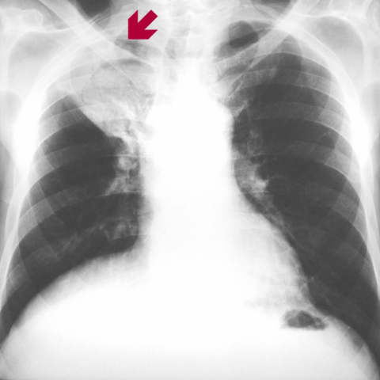

# M1：8300_8353800861859

D0 **D**；E **B**；ES **D**；参考 **D**。

[D0原回复](../../direct_qwen60/responses/8300_8353800861859_1.json) · [基准来源/原图](../../v12/results/cases/8300_8353800861859.md)

```text
A 78-year-old man with a history of lung tuberculosis presents with cough and moderate haemoptysis. A chest X-ray (Figure 1) reveals a finding in the right upper lobe. Based on the X-ray alone, what is the most likely diagnosis and recommended management plan for this patient?
A) Pneumonia; start broad-spectrum antibiotics.
B) Tuberculous cavity; initiate anti-tuberculous therapy.
C) Lung abscess; perform surgical drainage.
D) Aspergilloma (fungus ball); consider surgical resection due to risk of severe haemoptysis.
E) Bronchogenic carcinoma; schedule for a biopsy.
F) Pulmonary embolism; initiate anticoagulation therapy.
```



## E

[请求/原回复/检索/反馈/反思/更新](../traces/eval/8300_8353800861859_E.json) · [作答前真实可见记忆](../memory/visible/8300_8353800861859_E.json)

实际注入历史记忆：

```text
Historical example 1 (modality CXR): Pattern: bilateral upper lobe opacities in a patient with prior uterine leiomyoma; Earlier choice: Tuberculosis; Corrected interpretation: Pulmonary metastasis from a previous uterine leiomyoma; Earlier distinction: chose tuberculosis (E) over pulmonary metastasis from uterine leiomyoma (B); Difference: Metastatic leiomyoma can present as bilateral, well-circumscribed nodules or masses—often indistinguishable from TB on CXR alone; the key [truncated]; Inspect: When bilateral upper lobe opacities are seen, explicitly verify prior gynecologic history (especially uterine leiomyoma) and assess for discrete, rounded nodules rather than ill-defined consolidation—even [truncated]; Basis: image: unverified visual observation: bilateral upper [truncated]; Limit: Image resolution insufficient to confirm nodule margins or calcification; reference explanation unavailable; chronology of surgery vs. CXR unknown.
Historical example 2 (modality CXR): Pattern: solitary pulmonary mass on PA chest X-ray; Earlier choice: A round and smoothly-contoured mass, approximately 1.5 cm, located in [truncated]; Corrected interpretation: A round and smoothly-contoured mass, approximately 1.5 cm, located in the 8th intercostal space.; Earlier distinction: chosen D (2 cm, 7th ICS) vs reference B (1.5 [truncated]; Difference: size estimation (2 vs 1.5 cm) and intercostal space assignment (7th vs 8th); both options agree on round, [truncated]; Inspect: measure mass vertical extent in rib interspaces using posterior ribs as calipers; confirm ICS by counting from T2 (first visible posterior rib = T2, then [truncated]; Basis: image: mass appears round, smooth, ~1.5 [truncated]; Limit: no scale marker; image resolution limits precise size; posterior rib counting ambiguous without clear T2 landmark.
Historical example 3 (modality CXR): Pattern: AIDS with persistent cough; Earlier choice: Multiple thin-walled cystic lesions without parenchymal consolidation; Corrected interpretation: Multiple thin-walled cystic lesions without parenchymal consolidation; Earlier distinction: Correct selection of C over other PCP mimics (e.g., A, [truncated]; Difference: Cystic form of PCP shows thin-walled, well-defined radiolucent cysts without surrounding consolidation; contrast with ground-glass (E), alveolar consolidation [truncated]; Inspect: Inspect upper/mid lung zones for discrete, round, radiolucent lesions with sharp margins and no adjacent opacity—confirm absence of consolidation or effusion; Basis: image: Unverified: image appears normal or [truncated]; Limit: Image resolution insufficient to confirm thin-walled cysts; clinical context (AIDS + cough) and reference answer drive choice, not [truncated].
```

本题提交后的原回复：

```text
Answer: B) Tuberculous cavity; initiate anti-tuberculous therapy.  
Reason: The CXR shows a well-defined, lucent lesion with an air-fluid level or thick wall in the right upper lobe (indicated by the red arrow), consistent with a tuberculous cavity in a patient with prior TB and current haemoptysis—classic for reactivation TB. Other options lack supporting features: no pleural effusion or consolidation for pneumonia/abscess, no spherical intracavitary opacity for aspergilloma, no spiculated mass for carcinoma, and no vascular signs for PE.
```

提交时间：2026-10-31T16:14:26.305064+00:00；本病例反馈时间：2026-10-31T16:14:29.699374+00:00，反馈释放位置56。当前/未来病例未进入本次记忆投影。

## ES

[请求/原回复/检索/反馈/反思/更新](../traces/eval/8300_8353800861859_ES.json) · [作答前真实可见记忆](../memory/visible/8300_8353800861859_ES.json)

实际注入历史记忆：

```text
Historical example 1 (modality CXR): Pattern: recurrent lobar consolidation at identical hilar location with complete resolution in between; Earlier choice: The recurrent pneumonia is caused by bronchogenic carcinoma.; Corrected interpretation: The recurrent pneumonia is due to an endobronchial fibrolipoma causing obstruction.; Earlier distinction: chosen F (bronchogenic carcinoma) but reference the historical alternative (endobronchial [truncated]; Difference: Both carcinoma and fibrolipoma can cause post-obstructive pneumonia with vanishing opacity; however, fibrolipoma is a benign endobronchial tumor [truncated]; Inspect: On follow-up CXR showing resolution, inspect the exact prior opacity site for subtle residual soft-tissue density or smooth margin suggestive of mass vs. clean clearance; [truncated]; Basis: image: unverified visual observation: right hilar [truncated]; Limit: No CT available; reference does not justify why fibrolipoma over carcinoma given smoking history; images lack scale/chronology markers; [truncated].
Historical example 2 (modality CXR): Pattern: pleural-based mass on PA chest X-ray; Earlier choice: A round and smoothly-contoured mass, approximately 1.5 cm, located in [truncated]; Corrected interpretation: A round and smoothly-contoured mass, approximately 1.5 cm, located in the 8th intercostal space.; Earlier distinction: the historical alternative selected (2 cm, 7th interspace) vs reference [truncated]; Difference: Size estimation (2 cm vs 1.5 cm) and rib-level assignment (7th vs 8th intercostal space); both describe round, [truncated]; Inspect: Count intercostal spaces from the *anterior* first rib (visible at sternum) or use the diaphragmatic dome as landmark: the 8th interspace lies ~1 cm above [truncated]; Basis: image: Mass appears round, smooth, pleural-based, [truncated]; Limit: Image lacks scale marker; rib counting ambiguous without clear anterior rib identification; inspiration level unknown; no side-by-side comparison [truncated].
Historical example 3 (modality CXR): Pattern: bilateral upper lobe reticulonodular opacities with volume loss in a patient with [truncated]; Earlier choice: Tuberculosis; Corrected interpretation: Pulmonary metastasis from a previous uterine leiomyoma; Earlier distinction: Chose tuberculosis (E) over correct pulmonary metastasis from uterine leiomyoma [truncated]; Difference: Metastatic leiomyoma can present as bilateral, symmetric, nodular/reticulonodular opacities mimicking TB; absence of cavitation or discrete mass does [truncated]; Inspect: In bilateral upper lobe nodular/reticulonodular disease without cavitation, specifically inspect for *symmetric, well-defined small nodules* and *preserved lung volumes* (vs volume loss in TB); correlate [truncated]; Basis: image: bilateral upper lobe predominant reticulonodular [truncated]; Limit: No clinical history provided in prompt; image resolution insufficient to assess nodule margins or calcification; reference explanation unavailable.
Conditional procedure 1: when When CXR shows bilateral upper lobe reticulonodular opacities without cavitation in a female with prior uterine surgery (especially leiomyoma), and [truncated], inspect Inspect for symmetric, discrete 2–5 mm nodules with sharp margins and absence of fibrotic traction; if present, prioritize metastatic benign leiomyoma over TB; limitation: Requires confirmed uterine leiomyoma history; indistinguishable from sarcoidosis or fungal infection without histology.
Conditional procedure 2: when When PA CXR shows enlarged central pulmonary arteries and cardiomegaly with right heart border prominence, and symptoms suggest chronic dyspnea, inspect Inspect lateral CXR for convex retrosternal clear space and posterior displacement of heart—signs of right ventricular hypertrophy—and exclude left-sided volume overload signs (e.g., upper lobe vessel [truncated]; limitation: Unreliable in poor inspiration or scoliosis; does not differentiate etiology of PH (e.g., sarcoid [truncated].
```

本题提交后的原回复：

```text
Answer: D) Aspergilloma (fungus ball); consider surgical resection due to risk of severe haemoptysis.  
Reason: The CXR shows a well-defined, rounded opacity in the right upper lobe with a surrounding lucent rim (air crescent sign), indicated by the red arrow—classic for an aspergilloma in a pre-existing cavity (e.g., post-tuberculous). Haemoptysis in this setting strongly suggests fungal ball erosion into vessels, making surgical resection a key consideration.
```

提交时间：2026-10-31T16:14:29.695918+00:00；本病例反馈时间：2026-10-31T16:14:29.699374+00:00，反馈释放位置56。当前/未来病例未进入本次记忆投影。

