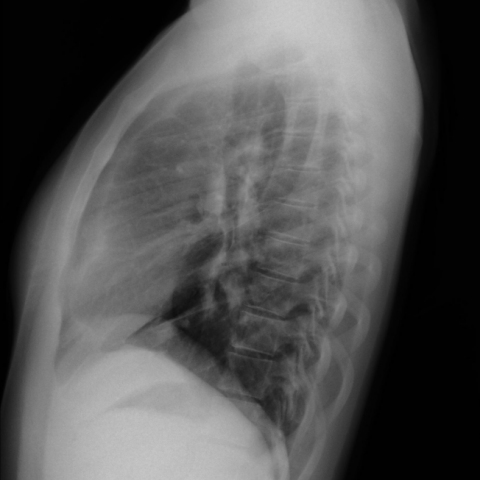

# M1：9815_8353800828253

D0 **C**；E **C**；ES **C**；参考 **C**。

[D0原回复](../../direct_qwen60/responses/9815_8353800828253_1.json) · [基准来源/原图](../../v12/results/cases/9815_8353800828253.md)

```text
Based solely on the chest X-ray findings (Fig. 1), which of the following options most accurately describes the observed condition and its potential implication for the patient's respiratory symptoms?

A) Normal chest X-ray with no significant findings.
B) Presence of a right-sided tracheal bronchus without any significant vascular anomaly.
C) Enlargement of the right cardiac cavities with a possible vascular anomaly, suggestive of a partial anomalous pulmonary venous return.
D) Bilateral enlargement of cardiac cavities with no additional vascular structures.
E) Presence of a pulmonary varix in the left middle pulmonary field.
F) Right-sided pulmonary sequestration with no cardiac enlargement.
```




## E

[请求/原回复/检索/反馈/反思/更新](../traces/eval/9815_8353800828253_E.json) · [作答前真实可见记忆](../memory/visible/9815_8353800828253_E.json)

实际注入历史记忆：

```text
Historical example 1 (modality CXR): Pattern: solitary pulmonary mass on PA chest X-ray; Earlier choice: A round and smoothly-contoured mass, approximately 1.5 cm, located in [truncated]; Corrected interpretation: A round and smoothly-contoured mass, approximately 1.5 cm, located in the 8th intercostal space.; Earlier distinction: chosen D (2 cm, 7th ICS) vs reference B (1.5 [truncated]; Difference: size estimation (2 vs 1.5 cm) and intercostal space assignment (7th vs 8th); both options agree on round, [truncated]; Inspect: measure mass vertical extent in rib interspaces using posterior ribs as calipers; confirm ICS by counting from T2 (first visible posterior rib = T2, then [truncated]; Basis: image: mass appears round, smooth, ~1.5 [truncated]; Limit: no scale marker; image resolution limits precise size; posterior rib counting ambiguous without clear T2 landmark.
Historical example 2 (modality CXR): Pattern: well-defined rounded opacity in right lower lobe with systemic symptoms; Earlier choice: Pulmonary abscess; Corrected interpretation: Pulmonary hydatid cyst; Earlier distinction: chosen D (pulmonary abscess) but reference the historical alternative (hydatid [truncated]; Difference: Abscess typically shows air-fluid level and surrounding consolidation; hydatid cyst appears as smooth, sharply demarcated, non-inflamed spherical opacity—often [truncated]; Inspect: On lateral CXR, inspect for absence of air-fluid level, smooth wall, and lack of perilesional consolidation—key features favoring hydatid cyst over abscess.; Basis: image: rounded, well-defined opacity in RLL [truncated]; Limit: No clinical history of endemic exposure, travel, or eosinophilia; image resolution insufficient to confirm calcification or daughter cysts; [truncated].
Historical example 3 (modality CXR): Pattern: serial imaging in known primary pulmonary nodular amyloidosis; Earlier choice: Bilateral nodules with increase in number and size on the [truncated]; Corrected interpretation: Bilateral nodules with increase in number and size on the right side, accompanied by a transient left pleural effusion.; Earlier distinction: correct selection of B based on temporal evolution across CXRs [truncated]; Difference: the historical alternative uniquely matches observed increase in nodule number/size (especially right lung) and transient left pleural effusion [truncated]; Inspect: On serial CXRs, compare nodule count/size per lung field across timepoints and specifically check for presence/absence of pleural effusion at each date; correlate with CT [truncated]; Basis: image: Fig 5a shows left pleural [truncated]; Limit: Exact dates/timing of all images not fully visible; some figures are CT slices without orientation labels; no clinical [truncated].
```

本题提交后的原回复：

```text
Answer: C) Enlargement of the right cardiac cavities with a possible vascular anomaly, suggestive of a partial anomalous pulmonary venous return.

Reason: The PA view (Fig. 1a) shows right-sided cardiac enlargement—specifically increased right atrial and right ventricular contours—with a prominent, vertically oriented vessel descending along the right heart border, consistent with an anomalous pulmonary vein. The lateral view (Fig. 1b) confirms anterior displacement of the right heart and a tubular opacity paralleling the right cardiac silhouette, supporting partial anomalous pulmonary venous return rather than isolated tracheal bronchus, varix, or sequestration.
```

提交时间：2026-10-31T16:16:23.227869+00:00；本病例反馈时间：2026-10-31T16:16:28.243937+00:00，反馈释放位置60。当前/未来病例未进入本次记忆投影。

## ES

[请求/原回复/检索/反馈/反思/更新](../traces/eval/9815_8353800828253_ES.json) · [作答前真实可见记忆](../memory/visible/9815_8353800828253_ES.json)

实际注入历史记忆：

```text
Historical example 1 (modality CXR): Pattern: well-defined rounded opacity in right lower lobe with systemic symptoms; Earlier choice: Pulmonary abscess; Corrected interpretation: Pulmonary hydatid cyst; Earlier distinction: chosen D (pulmonary abscess) but reference the historical alternative (hydatid [truncated]; Difference: Abscess typically shows air-fluid level and surrounding consolidation; hydatid cyst appears as smooth, sharply demarcated, non-inflamed spherical opacity—often [truncated]; Inspect: On lateral CXR, inspect for absence of air-fluid level, smooth wall, and lack of perilesional consolidation—key features favoring hydatid cyst over abscess.; Basis: image: rounded, well-defined opacity in RLL [truncated]; Limit: No clinical history of endemic exposure, travel, or eosinophilia; image resolution insufficient to confirm calcification or daughter cysts; [truncated].
Historical example 2 (modality CXR): Pattern: explicit clinical situation; Earlier choice: Bilateral hilar enlargement is present, with the left hilum significantly [truncated]; Corrected interpretation: Bilateral hilar enlargement is present, with the left hilum significantly larger than the right, supporting the suspicion of pulmonary artery aneurysms consistent with Behçet’s disease.; Earlier distinction: the historical alternative selected, matching reference answer; Difference: Left hilum appears larger than right on PA view; this asymmetry (left > right) is cited as supporting [truncated]; Inspect: On PA CXR, compare hilar silhouette size and density relative to adjacent mediastinal structures (e.g., aortic knob, left heart border); confirm asymmetry by measuring hilar [truncated]; Basis: image: unverified visual observation: left hilar [truncated]; Limit: Original historical reasoning was not retained; only the saved choice is known. Image resolution insufficient to confirm aneurysm [truncated].
Historical example 3 (modality CXR): Pattern: serial imaging in known primary pulmonary nodular amyloidosis; Earlier choice: Bilateral nodules with increase in number and size on the [truncated]; Corrected interpretation: Bilateral nodules with increase in number and size on the right side, accompanied by a transient left pleural effusion.; Earlier distinction: correct selection of B based on temporal evolution across CXRs [truncated]; Difference: the historical alternative uniquely matches observed increase in nodule number/size (especially right lung) and transient left pleural effusion [truncated]; Inspect: On serial CXRs, compare nodule count/size per lung field across timepoints and specifically check for presence/absence of pleural effusion at each date; correlate with CT [truncated]; Basis: image: Fig 5a shows left pleural [truncated]; Limit: Exact dates/timing of all images not fully visible; some figures are CT slices without orientation labels; no clinical [truncated].
Conditional procedure 1: when When CXR shows diffuse interstitial opacities and fissural thickening in a patient with systemic symptoms, and cardiac silhouette appears borderline [truncated], inspect Quantify cardiothoracic ratio (max transverse cardiac width / inner thoracic diameter); if ≥0.52, consider cardiomegaly and evaluate for pulmonary vascular redistribution or right heart enlargement signs; limitation: Inadequate inspiration inflates CT ratio; scoliosis distorts measurements.
Conditional procedure 2: when When mediastinal opacity obscures one heart border and tracheal deviation is present on PA CXR, inspect Inspect which cardiac border is silhouetted (left border loss = left mediastinal pathology; right border loss = right-sided) and confirm tracheal deviation direction—deviation away from mass [truncated]; limitation: Unreliable if both borders obscured or in severe cardiomegaly; requires adequate inspiration and centering..
```

本题提交后的原回复：

```text
Answer: C) Enlargement of the right cardiac cavities with a possible vascular anomaly, suggestive of a partial anomalous pulmonary venous return.

Reason: The PA view (Fig. 1a) shows right-sided cardiac enlargement—specifically, increased right heart border opacity extending laterally beyond the normal contour, with a prominent right atrial silhouette and mild mediastinal shift. The lateral view (Fig.1b) confirms anterior–posterior enlargement of the right heart chambers and a subtle abnormal vessel coursing from the right lung toward the right atrium, consistent with anomalous pulmonary venous drainage. No air-fluid levels, nodules, or tracheal bronchus are visible; the findings do not support normalcy (A), isolated tracheal bronchus (B), bilateral cardiomegaly (D), left pulmonary varix (E), or sequestration (F).
```

提交时间：2026-10-31T16:16:28.239400+00:00；本病例反馈时间：2026-10-31T16:16:28.243937+00:00，反馈释放位置60。当前/未来病例未进入本次记忆投影。

