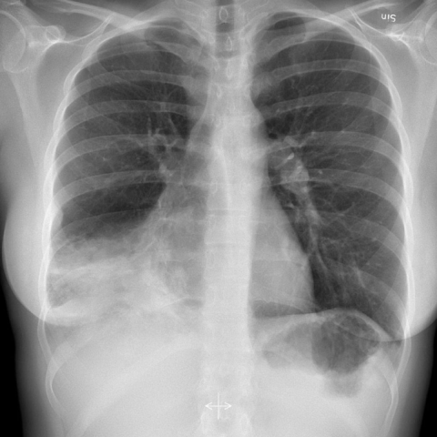
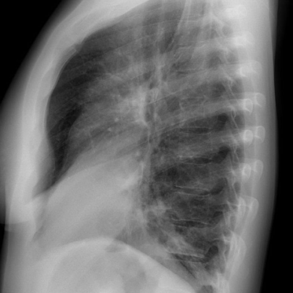
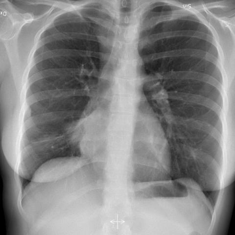
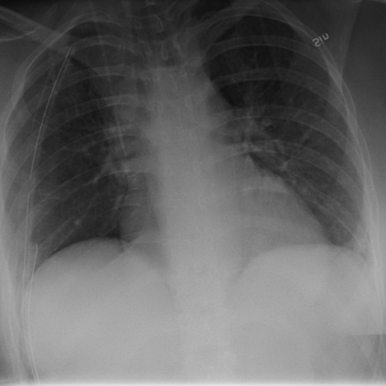
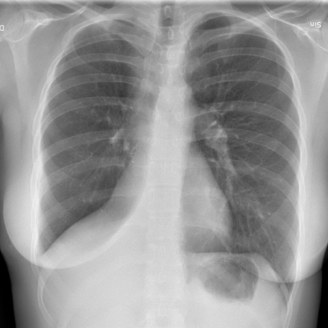
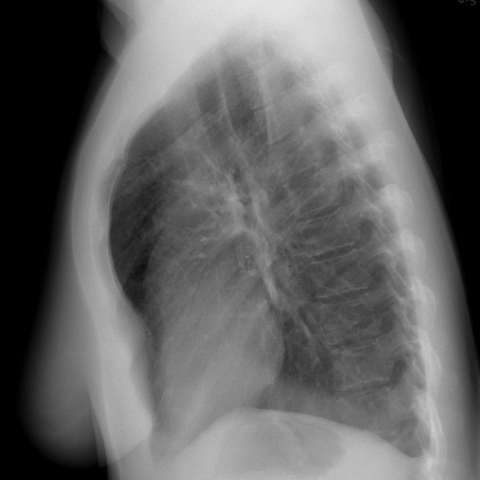

# M1独立训练种子：10026_8353800813737

[原始预测/反思/规则候选](../../traces/seed/10026_8353800813737.json)

来源：[ChestAgentBench固定版本](https://huggingface.co/datasets/wanglab/chest-agent-bench/tree/921e60440927f9893228d843c0206b755744252a) · [Eurorad病例](https://www.eurorad.org/case/10026)。数字前缀只用于来源链接，病例排除仍使用显式case_id派生hash。

本例属于独立memory_train，未与评测病例共享case_hash。原参考标签只用于授权的训练预热；模型影像观察仍未独立验证。

```text
Based on the chest X-ray findings in the provided figures, which of the following best describes the sequence of radiological changes observed in the patient's right lung, consistent with the clinical history of recurrent pneumonia and surgical intervention?

A) Initial right lower lobe consolidation followed by complete resolution post-antibiotic therapy and no further findings post-surgery.
B) Persistent right lower lobe consolidation with progression to atelectasis, followed by resolution of consolidation and minimal pneumothorax post-surgery.
C) Initial right middle lobe consolidation with subsequent volume reduction and atelectasis, and persistence of atelectasis post-surgery.
D) Initial right upper lobe consolidation with resolution post-antibiotic therapy and development of right lower lobe atelectasis post-surgery.
E) Persistent right lower lobe consolidation with eventual progression to pneumothorax, and complete resolution post-surgery.
F) Initial right lower lobe consolidation, with eventual progression to nodule formation, and complete resolution without atelectasis post-surgery.
```













参考选项全文：Persistent right lower lobe consolidation with progression to atelectasis, followed by resolution of consolidation and minimal pneumothorax post-surgery.

