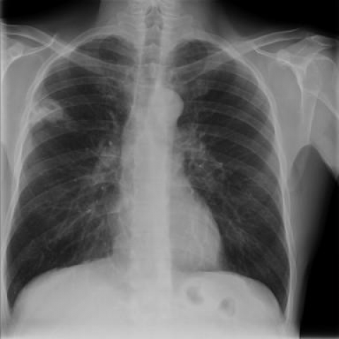
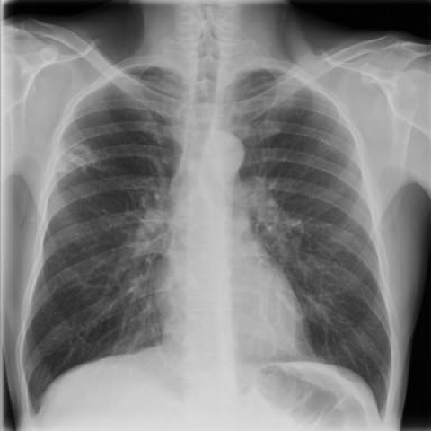
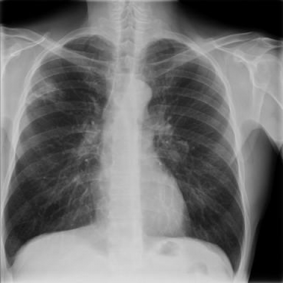
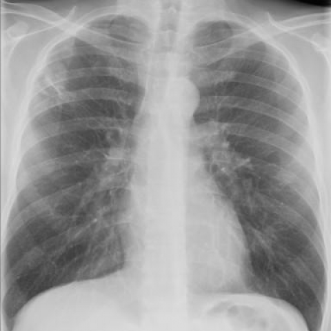

# M1独立训练种子：10027_8353800801428

[原始预测/反思/规则候选](../../traces/seed/10027_8353800801428.json)

来源：[ChestAgentBench固定版本](https://huggingface.co/datasets/wanglab/chest-agent-bench/tree/921e60440927f9893228d843c0206b755744252a) · [Eurorad病例](https://www.eurorad.org/case/10027)。数字前缀只用于来源链接，病例排除仍使用显式case_id派生hash。

本例属于独立memory_train，未与评测病例共享case_hash。原参考标签只用于授权的训练预热；模型影像观察仍未独立验证。

```text
A 45-year-old male patient with advanced HIV infection was hospitalized and underwent several chest X-rays as part of his evaluation. Initial radiographs (Fig. 1) showed a cavitary lesion in the right infraclavicular region. Three weeks after empiric treatment initiation, follow-up radiographs (Fig. 3) showed initial regression with persistent cavitation. However, two months into treatment (Fig. 4), the lesion enlarged but without central cavitation. After three months and appropriate treatment for Nocardia, the final radiographs (Fig. 6) showed resolution of the lesion. Based on the chest X-ray findings over time, which of the following best describes the evolution of the patient's lung lesion?

A) Initial cavitary lesion that completely resolved without enlargement.
B) Initial cavitary lesion that enlarged, lost central cavitation, and resolved post-treatment.
C) Non-cavitary lesion that enlarged, developed cavitation, and resolved post-treatment.
D) Initial cavitary lesion that neither enlarged nor changed in cavitation over time.
E) Non-cavitary lesion that remained unchanged and did not resolve post-treatment.
F) Initial cavitary lesion that resolved but was replaced by new cavitary lesions.
```









参考选项全文：Initial cavitary lesion that enlarged, lost central cavitation, and resolved post-treatment.

