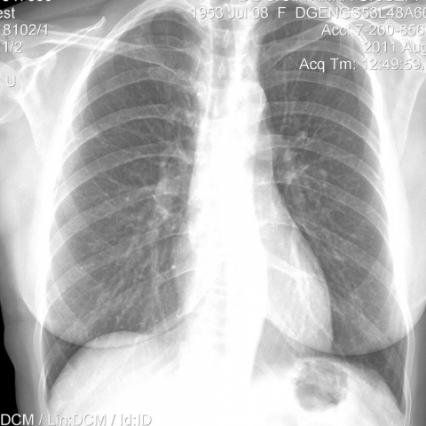
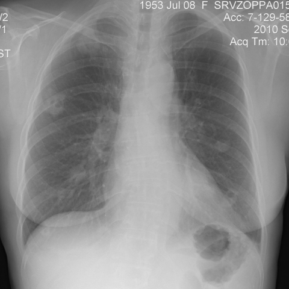

# M1独立训练种子：10071_8353800827977

[原始预测/反思/规则候选](../../traces/seed/10071_8353800827977.json)

来源：[ChestAgentBench固定版本](https://huggingface.co/datasets/wanglab/chest-agent-bench/tree/921e60440927f9893228d843c0206b755744252a) · [Eurorad病例](https://www.eurorad.org/case/10071)。数字前缀只用于来源链接，病例排除仍使用显式case_id派生hash。

本例属于独立memory_train，未与评测病例共享case_hash。原参考标签只用于授权的训练预热；模型影像观察仍未独立验证。

```text
Based on the chest X-ray findings in Figures 2a and 1a, which of the following statements accurately describes the changes observed in the pulmonary lesions, and what could be the clinical implication of this observation?

A) The nodular lesions in the right upper lobe have increased in size, indicating potential progression of the disease.
B) The nodular lesions in the left lower lobe have disappeared, suggesting a positive response to treatment.
C) The nodular lesions have decreased in size in all lobes, particularly in the right upper lobe, which indicates effective therapeutic response.
D) The nodular lesions have remained unchanged in size, suggesting resistance to treatment.
E) The nodular lesions have transformed into fibrotic striae in the right upper lobe, indicating healing and resolution.
F) The nodular lesions have increased in size and number, indicating dissemination of the infection.
```





参考选项全文：The nodular lesions have transformed into fibrotic striae in the right upper lobe, indicating healing and resolution.

