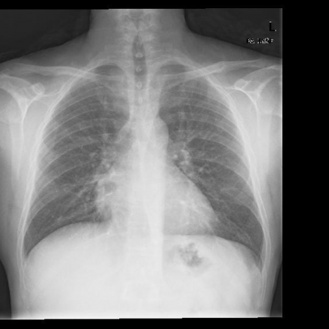
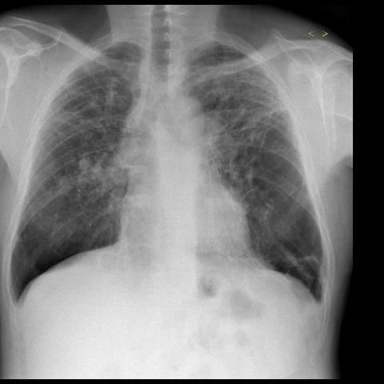

# M1独立训练种子：10098_8353800802244

[原始预测/反思/规则候选](../../traces/seed/10098_8353800802244.json)

来源：[ChestAgentBench固定版本](https://huggingface.co/datasets/wanglab/chest-agent-bench/tree/921e60440927f9893228d843c0206b755744252a) · [Eurorad病例](https://www.eurorad.org/case/10098)。数字前缀只用于来源链接，病例排除仍使用显式case_id派生hash。

本例属于独立memory_train，未与评测病例共享case_hash。原参考标签只用于授权的训练预热；模型影像观察仍未独立验证。

```text
Based on the chest X-ray findings from Figure 1 and Figure 2, and considering the clinical history of paraquat poisoning, which of the following statements best describes the progression of lung changes observed in this patient?

A) The initial chest X-ray shows diffuse reticular-nodular opacities, which evolve into honeycombing predominantly in the peripheral lung zones.
B) The initial chest X-ray is clear, followed by a rapid development of diffuse cystic changes in the central lung regions.
C) The initial chest X-ray reveals focal opacities that progress to diffuse reticular-nodular opacities with decreased lung volume.
D) The initial chest X-ray shows diffuse consolidation that later becomes fine reticular patterns with peripheral honeycombing.
E) The initial chest X-ray is normal, followed by gradual development of peripheral ground-glass opacities and cystic spaces.
F) The initial chest X-ray shows bilateral ground-glass opacities that progress to central reticular patterns and decreased lung volume.
```





参考选项全文：The initial chest X-ray reveals focal opacities that progress to diffuse reticular-nodular opacities with decreased lung volume.

