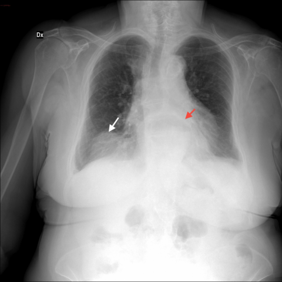
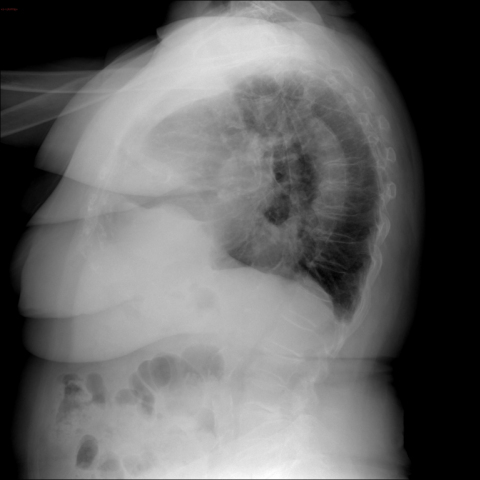

# M1独立训练种子：10123_8353800813902

[原始预测/反思/规则候选](../../traces/seed/10123_8353800813902.json)

来源：[ChestAgentBench固定版本](https://huggingface.co/datasets/wanglab/chest-agent-bench/tree/921e60440927f9893228d843c0206b755744252a) · [Eurorad病例](https://www.eurorad.org/case/10123)。数字前缀只用于来源链接，病例排除仍使用显式case_id派生hash。

本例属于独立memory_train，未与评测病例共享case_hash。原参考标签只用于授权的训练预热；模型影像观察仍未独立验证。

```text
Based solely on the chest X-ray figures provided, which diagnosis is most supported by the radiographic findings, considering the location and characteristics of the opacities observed?
A) Bochdalek's hernia due to the presence of a rounded opacity above the right diaphragm and a large retrocardiac opacity with a central air-fluid level.
B) Lung neoplasm characterized by a solitary rounded lesion above the right diaphragm.
C) Sliding hiatal hernia indicated by a large opacity with an air-fluid level in the retrocardiac region.
D) Diaphragmatic lipoma due to a large opacity above the right diaphragm.
E) Pleural effusion inferred from the presence of a rounded opacity and a large retrocardiac opacity.
F) Pneumonia suggested by the presence of a rounded consolidation above the right diaphragm.
```





参考选项全文：Sliding hiatal hernia indicated by a large opacity with an air-fluid level in the retrocardiac region.

