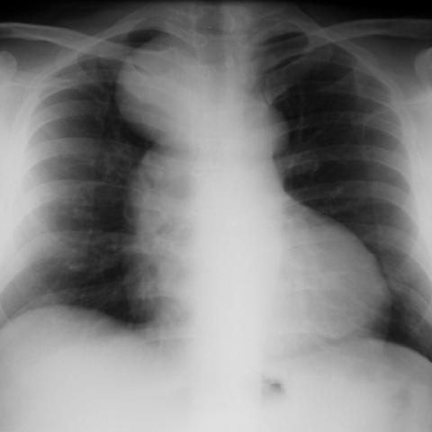

# M1独立训练种子：1025_8353802159498

[原始预测/反思/规则候选](../../traces/seed/1025_8353802159498.json)

来源：[ChestAgentBench固定版本](https://huggingface.co/datasets/wanglab/chest-agent-bench/tree/921e60440927f9893228d843c0206b755744252a) · [Eurorad病例](https://www.eurorad.org/case/1025)。数字前缀只用于来源链接，病例排除仍使用显式case_id派生hash。

本例属于独立memory_train，未与评测病例共享case_hash。原参考标签只用于授权的训练预热；模型影像观察仍未独立验证。

```text
Based on the chest X-ray findings, what is the most likely diagnosis for the homogeneous opacity seen lateral to the trachea, and what clinical feature supports this diagnosis?
A) Bronchogenic cyst; supported by the cervicothoracic sign indicating posterior localization
B) Thymoma; supported by the well-defined interface with the lung
C) Lymphoma; supported by the non-calcified nature of the opacity
D) Teratoma; supported by the homogeneous appearance of the mass
E) Thyroid mass; supported by displacement of the mediastinal line
F) Esophageal duplication cyst; supported by the opacity's lateral location to the trachea
```



参考选项全文：Bronchogenic cyst; supported by the cervicothoracic sign indicating posterior localization

原历史只保留合法选项，未保留完整理由；不得从反思推断当时真实思路。
