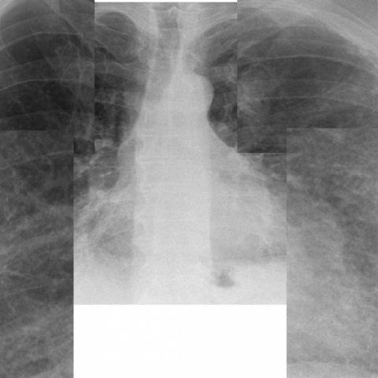
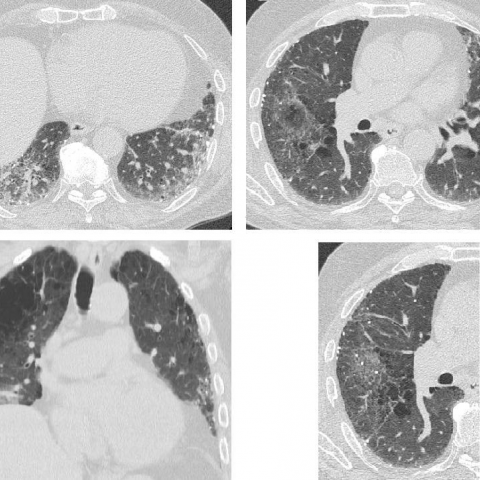
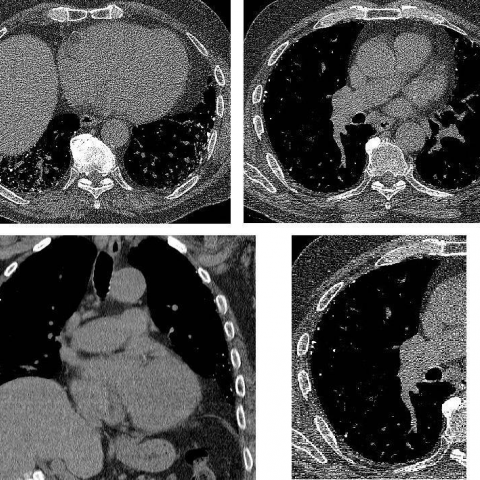

# M1独立训练种子：10260_8353800813701

[原始预测/反思/规则候选](../../traces/seed/10260_8353800813701.json)

来源：[ChestAgentBench固定版本](https://huggingface.co/datasets/wanglab/chest-agent-bench/tree/921e60440927f9893228d843c0206b755744252a) · [Eurorad病例](https://www.eurorad.org/case/10260)。数字前缀只用于来源链接，病例排除仍使用显式case_id派生hash。

本例属于独立memory_train，未与评测病例共享case_hash。原参考标签只用于授权的训练预热；模型影像观察仍未独立验证。

```text
Based on the chest X-ray findings, which of the following best explains the radiographic pattern observed in the patient's lungs, considering the clinical history and the provided images?
A) Healed tuberculosis with upper lobe nodular calcifications.
B) Alveolar microlithiasis with diffuse calcifications and ground-glass opacities.
C) Diffuse pulmonary ossification, nodular type, with lower lobe predominant calcified nodules.
D) Metastatic pulmonary calcification with upper lobe predominance.
E) Silicosis with predominantly upper lobe nodular patterns.
F) Amyloidosis with diffuse nodular deposits.
```







参考选项全文：Diffuse pulmonary ossification, nodular type, with lower lobe predominant calcified nodules.

