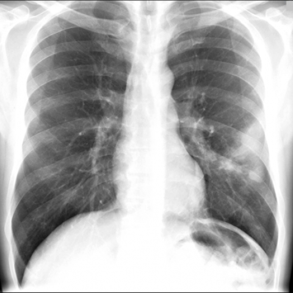

# M1独立训练种子：10304_8353800814334

[原始预测/反思/规则候选](../../traces/seed/10304_8353800814334.json)

来源：[ChestAgentBench固定版本](https://huggingface.co/datasets/wanglab/chest-agent-bench/tree/921e60440927f9893228d843c0206b755744252a) · [Eurorad病例](https://www.eurorad.org/case/10304)。数字前缀只用于来源链接，病例排除仍使用显式case_id派生hash。

本例属于独立memory_train，未与评测病例共享case_hash。原参考标签只用于授权的训练预热；模型影像观察仍未独立验证。

```text
Based on the chest X-ray findings in Figure 1, which of the following descriptions best characterizes the air-space consolidation in the left middle lung zone, and what is the most likely explanation for this finding given the clinical context?
A. A well-defined round consolidation with smooth margins, suggesting a benign tumor.
B. An ill-defined patchy consolidation with irregular margins, likely indicating an inflammatory process such as endobronchial tuberculosis.
C. A homogenous lobar consolidation with sharp margins, consistent with bacterial pneumonia.
D. A segmental consolidation with branching opacities, suggesting aspiration pneumonia.
E. A diffuse consolidation with calcified nodules, indicating healed granulomatous disease.
F. A nodular consolidation with peripheral cavitation, suggesting necrotizing pneumonia.
```



参考选项全文：An ill-defined patchy consolidation with irregular margins, likely indicating an inflammatory process such as endobronchial tuberculosis.

原历史只保留合法选项，未保留完整理由；不得从反思推断当时真实思路。
