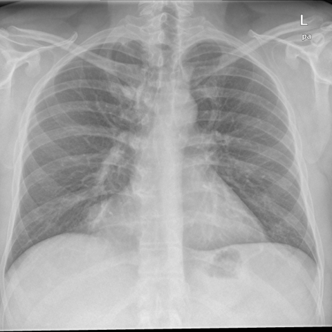
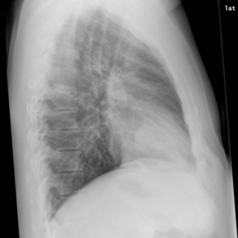

# M1独立训练种子：10439_8353800813902

[原始预测/反思/规则候选](../../traces/seed/10439_8353800813902.json)

来源：[ChestAgentBench固定版本](https://huggingface.co/datasets/wanglab/chest-agent-bench/tree/921e60440927f9893228d843c0206b755744252a) · [Eurorad病例](https://www.eurorad.org/case/10439)。数字前缀只用于来源链接，病例排除仍使用显式case_id派生hash。

本例属于独立memory_train，未与评测病例共享case_hash。原参考标签只用于授权的训练预热；模型影像观察仍未独立验证。

```text
Based solely on the chest X-ray findings, which of the following observations is correct regarding the round-oval mass obscuring the right cardiophrenic angle in the PA and lateral views (Figures 1a and 1b)?

A) The mass is located in the right cardiophrenic angle and appears larger on the lateral view compared to the PA view, suggesting it might be projecting anteriorly.
B) The mass is located in the left cardiophrenic angle and appears larger on the PA view compared to the lateral view, suggesting it is projecting posteriorly.
C) The mass is located in the right cardiophrenic angle and appears the same size on both the PA and lateral views, indicating it is centrally located in the mediastinum.
D) The mass is located in the left cardiophrenic angle and appears smaller on the lateral view compared to the PA view, suggesting it is centrally located.
E) The mass is located in the right cardiophrenic angle and appears smaller on the lateral view compared to the PA view, suggesting it is projecting anteriorly.
F) The mass is located in the right cardiophrenic angle and appears larger on the PA view compared to the lateral view, suggesting it is projecting posteriorly.
```





参考选项全文：The mass is located in the right cardiophrenic angle and appears smaller on the lateral view compared to the PA view, suggesting it is projecting anteriorly.

