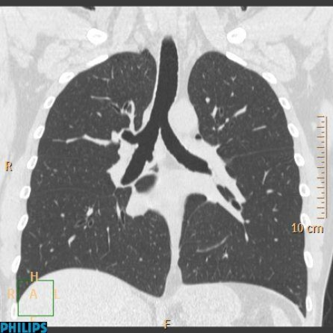
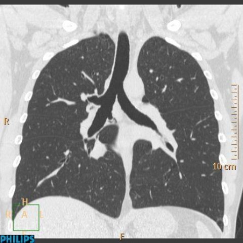
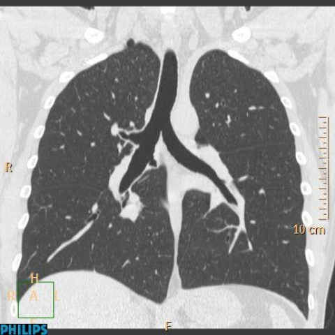
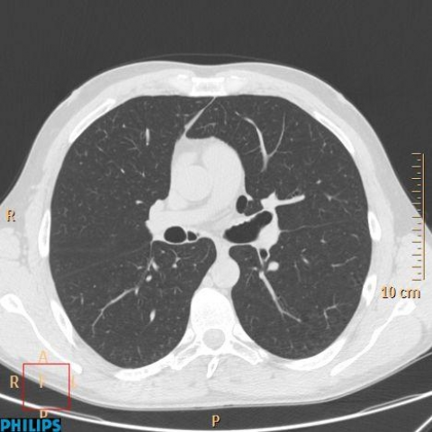
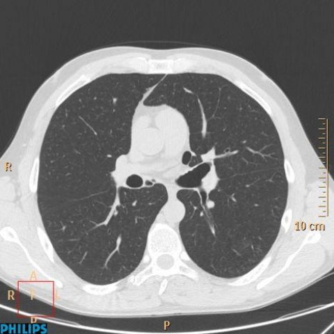
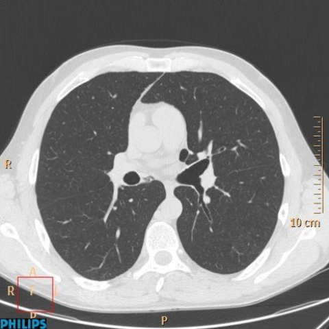
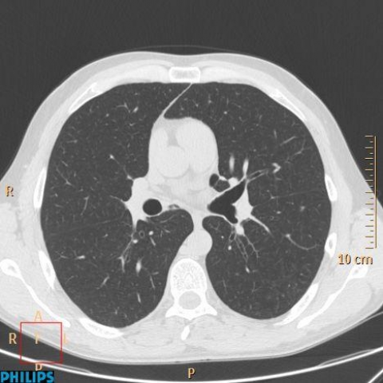

# M1独立训练种子：10474_8353800724703

[原始预测/反思/规则候选](../../traces/seed/10474_8353800724703.json)

来源：[ChestAgentBench固定版本](https://huggingface.co/datasets/wanglab/chest-agent-bench/tree/921e60440927f9893228d843c0206b755744252a) · [Eurorad病例](https://www.eurorad.org/case/10474)。数字前缀只用于来源链接，病例排除仍使用显式case_id派生hash。

本例属于独立memory_train，未与评测病例共享case_hash。原参考标签只用于授权的训练预热；模型影像观察仍未独立验证。

```text
Based on the provided chest X-ray figures, which of the following statements is most accurate regarding the presence and characteristics of the accessory cardiac bronchus (ACB) in this patient?

A) The chest X-ray shows a prominent mass near the right main bronchus that suggests an accessory cardiac bronchus.
B) The chest X-ray reveals a subtle radiolucent structure extending from the medial wall of the right intermediate bronchus, indicative of an accessory cardiac bronchus.
C) The chest X-ray indicates the presence of mediastinal lymphadenopathy, which is typically associated with an accessory cardiac bronchus.
D) The chest X-ray demonstrates air-space consolidation near the heart, consistent with an accessory cardiac bronchus.
E) The chest X-ray does not reveal any abnormal findings indicative of an accessory cardiac bronchus.
F) The chest X-ray shows evidence of bronchiectasis that could be mistaken for an accessory cardiac bronchus.
```
















参考选项全文：The chest X-ray does not reveal any abnormal findings indicative of an accessory cardiac bronchus.

