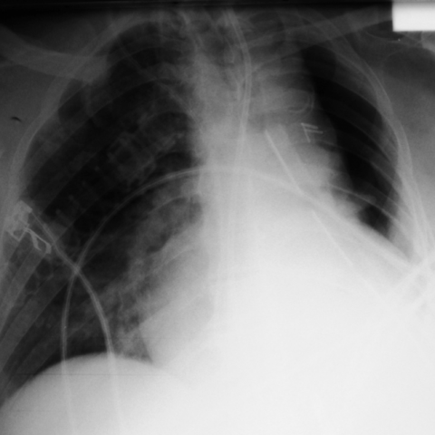
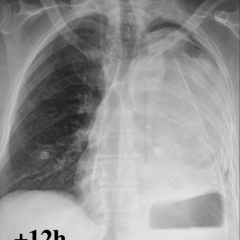

# M1独立训练种子：10494_8353800724538

[原始预测/反思/规则候选](../../traces/seed/10494_8353800724538.json)

来源：[ChestAgentBench固定版本](https://huggingface.co/datasets/wanglab/chest-agent-bench/tree/921e60440927f9893228d843c0206b755744252a) · [Eurorad病例](https://www.eurorad.org/case/10494)。数字前缀只用于来源链接，病例排除仍使用显式case_id派生hash。

本例属于独立memory_train，未与评测病例共享case_hash。原参考标签只用于授权的训练预热；模型影像观察仍未独立验证。

```text
Based on the changes observed in the chest X-rays over time, which of the following best describes the findings and supports the diagnosis of left upper lobe torsion after left lower lobectomy in this patient? Consider the position and changes in the opacification and lung structures.

A) The left hemithorax shows uniform opacification with no significant volume change, suggesting pneumonia.
B) The left hemithorax shows near complete opacification with a decrease in lung volume, indicating pulmonary edema.
C) There is complete opacification of the left hemithorax with the left upper lobe appearing enlarged and shifted, consistent with left upper lobe torsion.
D) The left hemithorax shows partial opacification with increased aeration, suggesting compensatory emphysema.
E) The left upper lobe appears in its normal position with no opacification, ruling out torsion.
F) The left hemithorax shows opacification with enhanced vascular markings, indicating ARDS.
```





参考选项全文：There is complete opacification of the left hemithorax with the left upper lobe appearing enlarged and shifted, consistent with left upper lobe torsion.

